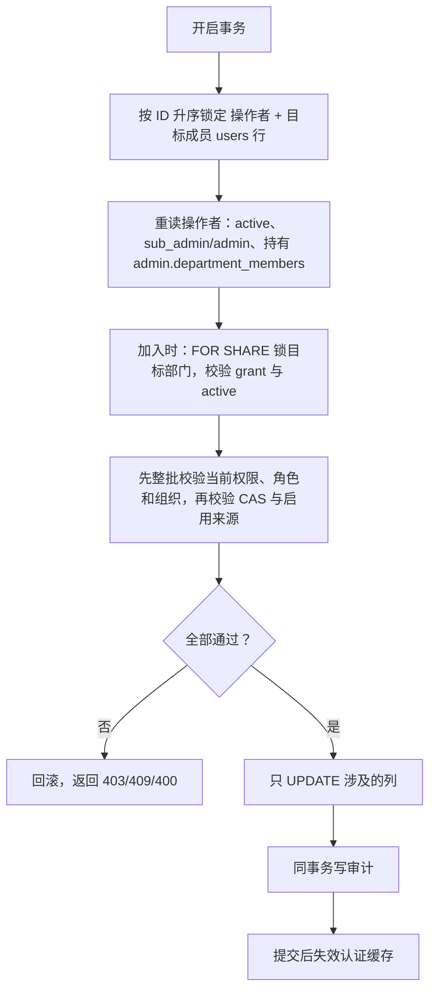

# 部门负责人管理本部门成员设计

更新：2026-10-29。状态：**已按锁定基线 `a058b81c6` 实现，采用独立负责人备注；等待 Claude 对照代码、测试及实际命令输出复核。** 分支 `feature/hy/10226_department_member_management`（从 main `eb34cc973` 创建），未推送、未部署。首轮设计审核结论与源码依据见第 12 节；执行约束见 [实施任务卡](department-member-management-implementation-plan-cn.md)。

前置功能：[组织、部门与多平台用量报表设计](organization-department-usage-design-cn.md)。该文档把"负责人自行管理成员"列为未纳入首版的扩展；本文是这个扩展的唯一设计文档，审核后原地修订。

## 1. 需求与已确认决策

客户需求：部门被授权的人可以管理本部门的成员。

| 决策点 | 已确认（2026-10-29） |
| --- | --- |
| 谁能管理 | 已有部门授权（`department_access_grants`）的 `sub_admin`，并且被单独勾选新权限 `admin.department_members` |
| 能做什么 | ① 维护成员名单：加入、移出本部门；② 账号状态与资料：启用/停用、修改用户名和负责人备注 |
| 加人来源 | 仅限**本组织、未分配部门**的普通用户；已在其他部门的人仍由完整管理员转岗 |
| 候选搜索 | 三个组织统一按邮箱/用户名关键字模糊搜索，每次最多 20 条 |
| 启用边界 | 只能启用"由负责人停用"的成员；管理员停用、内容审计自动封禁的成员只能看到状态，不能解封 |
| 密码 | 不允许负责人重置成员密码 |
| 入口 | 新建负责人专用页面「我的部门」；完整管理员的 `/admin/departments` 不变 |
| 备注 | 新增独立的负责人备注 `users.department_note`；负责人只读写它，管理员 `notes` 对负责人完全隐藏 |
| 备注归属 | 成员 `department_id` 变化（加入、移出、转岗、跨组织邮箱变更清归属）时清空，审计保留旧值 |
| 备注可见 | 完整管理员在用户管理页只读查看；管理员编辑用户不提供该字段；成员本人不可见 |

确认边界：本轮以本表和用户提供的 Claude 摘要作为需求依据，未独立取得更早的确认对话。备注三项于首轮审核后（2026-10-29）由用户确认，替代原稿共用 `notes` 的候选方案。

仍不开放给负责人：转岗（其他部门 ↔ 本部门）、新建/删除账号、修改邮箱/密码/角色/权限、余额、并发、RPM、分组、平台额度、订阅分配/延期/撤销，以及管理其他子管理员或管理员。

## 2. 权限模型

新增权限码 `admin.department_members`（菜单键 `department_members`，前端路由 `/admin/my-department`）。它与现有两项部门权限独立，共用同一份部门授权范围：

| 权限 | 能力 | 范围来源 |
| --- | --- | --- |
| `admin.organization_usage` | 查看/导出部门报表 | `department_access_grants` |
| `admin.department_subscriptions` | 查询订阅、重置额度 | 同上 |
| `admin.department_members`（新） | 成员名单、启停用、用户名/负责人备注 | 同上 |

- 有权限码但没有任何部门授权：页面显示"尚未配置可管理部门"，所有数据和写接口返回 `DEPARTMENT_SCOPE_DENIED`。
- 授予入口：部门管理页的负责人授权弹窗新增"成员管理"勾选；`PUT /admin/users/:id/department-scope` 增加 `manage_members` 字段，按现有 `report`、`reset_quota` 的方式原子写入权限码与授权，沿用 `admin_access_version` CAS。
- `manage_members` 默认不勾选，不因已有报表/额度权限自动开启；编辑既有授权时三项勾选均从真实权限集合恢复。只持有新权限的负责人重开弹窗再保存，不得自动增加报表或额度重置权限。旧请求省略 `manage_members` 时保留该项，显式 `false` 才撤销，避免旧页面意外清除新权限。
- 角色降级、软删除时清理 grants 的既有逻辑同样覆盖新权限；`NormalizeAdminPermissions` 对非 `sub_admin` 返回空权限。
- 完整管理员和 Admin API Key 调用新接口时视为不受部门限制，其他业务规则相同；侧栏不给管理员显示该页面，管理员继续使用部门管理页和用户管理页。

### 2.1 可管理成员的判定

每次写操作都在事务内重新判定，不信任客户端提交的部门或范围：

```text
可管理成员 = 未删除
          且 role = 'user'
          且 department_id ∈ 操作者当前 grants
          且 部门所属组织 = 成员邮箱推导的组织
```

- 不以 `status` 过滤：停用成员仍在名单中，才能被重新启用或移出。这与报表/订阅范围只统计 active 成员不同。
- `role` 不是 `user` 的成员（其他负责人、子管理员、管理员，包括操作者本人）在名单中只读展示（`manageable=false`），不提供任何操作。
- 部门停用（inactive）后禁止加入新成员；移出、启停用、改资料仍允许，与前置设计"停用部门保留已有成员及授权"一致。

## 3. 停用来源

内容审计自动封禁（`ContentModerationService` 的自动封禁分支）、管理员停用（`adminServiceImpl.UpdateUser`、`UserService.UpdateStatus`）都只写 `users.status='disabled'`，目前无法区分来源。新增来源字段：

| 字段 | 定义 |
| --- | --- |
| `users.disabled_source` | `VARCHAR(32) NULL`，CHECK 取值 `department_manager` / `other`；`status <> 'disabled'` 时必须为 NULL |

数据库触发器负责状态/来源一致性与禁止降级；**封禁意图由写入路径显式表达**。不能只根据 OLD/NEW 状态值推断操作者：已是 `disabled/department_manager` 时，管理员执行 `SET status='disabled'` 不会把未赋值的来源字段自动变成 `other`。

| 状态变化 | 触发器行为 |
| --- | --- |
| 任意 → 非 disabled | 清空为 NULL |
| 非 disabled → disabled（含 INSERT） | 语句显式写 `department_manager` 则保留；否则一律记为 `other` |
| disabled → disabled，显式再次封禁 | 管理员/系统写入 `other`，允许 `department_manager` 升级为 `other`；`other` 不能降回 `department_manager` |
| disabled 用户仅改用户名、备注、余额等 | 保留来源，不能把普通资料/计费更新当成再次封禁 |

- 部门成员仓储仅在已鉴权的负责人将 active 成员停用时，原子写 `status='disabled', disabled_source='department_manager'`。完整管理员/Admin API Key 即使调用本组接口，停用来源仍写 `other`。
- 通用 `UserRepository.Update` 在 `fields.Status=true` 且目标为 disabled 时必须同时写 `disabled_source='other'`，包括原状态已经 disabled；这同时覆盖 `adminServiceImpl.UpdateUser`、`UserService.UpdateStatus` 和内容审计封禁。不能把从旧 User 快照读到的来源原样写回。现有/新增的原生 SQL、导入等其他显式封禁路径同样遵守此合同；仅靠状态迁移触发器不构成“覆盖所有路径”的证明。
- CHECK 必须要求 disabled 时来源非 NULL 且在枚举内，非 disabled 时为 NULL；来源不作为通用用户更新请求可写字段。触发器、仓储映射和返回 DTO 以实际持久化值为准。
- 迁移时把已有 `status='disabled'` 的用户回填为 `other`。
- 内容审计封禁目前在用户已停用时跳过（`if user.Status != StatusDisabled`）。达到封禁条件后必须在数据库当前行上原子写入 `status='disabled', disabled_source='other'`，包含来源升级，避免负责人之后解封一个本应被审计封禁的账号；不能只改来源而保留并发启用后的 active 状态。是否发送首次封禁邮件与是否落实封禁分开判定，不能为避免重复邮件跳过必要写入。
- 负责人 A 停用的成员，同部门其他负责人也可以启用；成员被管理员转到其他部门后，由新部门负责人管理。
- 管理员在用户管理页启用后来源自动清空；用户管理页状态列增加"负责人停用"提示，方便管理员识别。

### 3.1 负责人备注

| 项 | 定义 |
| --- | --- |
| 字段 | `users.department_note TEXT NOT NULL DEFAULT ''`，CHECK `char_length(department_note) <= 1000` |
| 写入 | 仅部门成员仓储的负责人 PUT 写入；不加入通用 `UserUpdateFields`、管理员 `UpdateUserRequest` 或创建/导入路径，旧快照不能回写 |
| 清空 | 新增触发器 `users_department_note_guard`：`BEFORE UPDATE OF email, department_id`，当最终 `NEW.department_id IS DISTINCT FROM OLD.department_id` 时置空。触发器名按字母序排在 239 的 `users_department_guard` 之后，能看到后者因跨组织邮箱变更清空后的 `department_id`；不改写 239 的已应用函数 |
| 清空审计 | 旧值非空时由该触发器同事务写一条 `department.note_cleared` 审计（成员 ID、前后部门、旧备注），覆盖管理员转岗、负责人移出和邮箱变更三类路径；沿用 240 审计触发器的列与失败即回滚约束 |
| 可见 | 负责人名单只对 `manageable=true` 的行返回；管理员 `AdminUser` DTO 只读返回；普通用户 DTO 不返回 |

角色从 `user` 变为 `sub_admin` 时不清空，但该行在负责人页变为只读且不返回备注；管理员仍可见。

## 4. 接口合同

均以 `/api/v1` 为前缀，加入 `admin.department_members` 路由白名单；部门管理的写路由不加入。

| 方法与路径 | 内容 |
| --- | --- |
| `GET /admin/department-members/scope` | 当前可管理部门（id、组织、名称、状态）与默认部门；只有一个授权部门时自动选中 |
| `GET /admin/department-members` | 参数 `department_id`（`all` 或授权部门 ID）、`status`（`active`/`disabled`）、`q`、分页。返回 `id, email, username, department_note, status, disabled_source, can_enable, manageable, department_id, department_name, department_version`（`department_note` 仅可管理行返回，永不返回管理员 `notes`）；SQL 内过滤分页 |
| `GET /admin/department-members/candidates` | 参数 `department_id`（必须是授权且 active 的部门）、`q`（去空格后至少 2 个字符）。返回同组织、未分配、`role='user'`、未删除的用户，最多 20 条：`id, email, username, status, department_version` |
| `POST /admin/department-members/assign` | 请求体同现有 `assign-members`：`department_id`（授权部门 ID 表示加入，`null` 表示移出）+ `members[{user_id, expected_department_id, expected_department_version}]`，单次最多 200 人 |
| `PUT /admin/department-members/:id` | 必填 `expected_department_id`、`expected_department_version` + 可选 `username`、`department_note`、`status`；只写提交的字段 |

成员资料/状态 PUT 还必须携带列表返回的 `expected_department_version`；缺失或非法返回 400。它校验成员归属是否变化，不是用户名/备注的内容版本；归属变化会清空备注，因此版本校验同时防止旧页面把备注写进新的归属周期。请求中出现 `notes` 按未知字段返回 400。名单和候选查询在同一只读一致性事务内校验操作者、grants 并读取数据；不能把事务外获取的部门 ID 列表当成长期授权凭据，也不能直接复用现有强制 active 的报表/订阅查询。

### 4.1 加入与移出

| 操作 | 每个成员必须满足（任一不满足整批拒绝） |
| --- | --- |
| 首次加入 | 目标部门在 grants 内且 active；成员当前未分配、`role='user'`、邮箱组织与部门一致；重复加入见下文 |
| 移出 | 成员当前是可管理成员（第 2.1 节）；移出后 `department_id=NULL`，不删账号、不动订阅 |

判定顺序：先完成整批目标的当前授权、角色、组织判定，不满足返回 403 `DEPARTMENT_SCOPE_DENIED`，不透露对方当前在哪个部门；再做 `expected_department_id/version` CAS，不一致返回 409 `DEPARTMENT_CONFLICT`。负责人路径不能直接照搬完整管理员 `Assign` 的“目标状态相同就成功”规则：

- 加入：当前仍未分配时执行 CAS；已经属于请求的同一授权目标部门、且仍为同组织普通用户时，作为重复加入返回无变化成功。已经属于其他部门时拒绝，即使操作者也获授权那个部门，仍不能通过本接口转岗。
- 移出：只有当前仍在授权范围内才允许 CAS 和移出。第一次成功后成员已无部门，再次请求返回 403，不为未分配用户绕过鉴权；前端提示“当前不可管理，请刷新”，不推断是自己上次成功还是别人移出。此接口不承诺移出请求的成功重放。
- 批量中任一成员失败则整批回滚；无实际变化的成功不产生变更审计，实际变化写一条包含全部变化的审计。

### 4.2 启停用与资料

| 字段 | 规则 |
| --- | --- |
| `status=disabled` | 负责人对当前 active 成员写 `status='disabled', disabled_source='department_manager'`；已停用则无变化，不改来源。完整管理员/Admin API Key 显式停用始终按第 3 节写 other，含已 disabled 的情况 |
| `status=active` | 当前 active 时无变化成功；当前 disabled 时仅 `disabled_source='department_manager'` 可启用，否则 403 `DEPARTMENT_MEMBER_ENABLE_DENIED` |
| `username`、`department_note` | 去首尾空格；用户名保持现有 Ent `MaxLen(100)` 规则，即不超过 100 个 UTF-8 字节（例如 100 个 ASCII 字符或 33 个汉字；用户已确认不改为按字符计数），负责人路径走原生 SQL，必须在服务端按同一字节规则显式校验；负责人备注不超过 1000 个 Unicode 字符，服务端校验并由 DB CHECK 兜底。同部门多个负责人后写覆盖，不给资料内容另加版本 |
| 其他字段 | 请求体严格 JSON，出现未知字段（如 notes、email、password、role、balance）返回 400 |

成员当前部门或 `department_version` 与预期不一致时：当前成员仍可管理返回 409，已不在授权内返回 403。包括“原部门 → 其他部门/未分配 → 原部门”的往返，不能因部门 ID 相同接受旧页面的编辑或停用请求。资料表单仅提交实际修改字段，不能在改备注时回写列表中的旧 status。

状态变化提交后调用 `InvalidateAuthCacheByUserID`，并保留 migration 184 的认证缓存 outbox 触发器：JWT 的后续请求直接检查最新用户状态，API Key 沿用主动失效和多实例 outbox 收敛。这里的停用是拒绝后续鉴权，不是永久撤销 JWT/API Key，也不承诺中断已开始的请求/流；重新启用后未过期凭据可继续使用。缓存/通知故障下的收敛需单独验收，不能仅凭一次失效函数调用承诺多实例零延迟。订阅保留；停用成员按既有口径不再计入部门报表人数与订阅范围。

### 4.3 新增错误码

| 错误码 | HTTP | 前端处理 |
| --- | ---: | --- |
| `DEPARTMENT_MEMBER_ENABLE_DENIED` | 403 | 提示"该成员由管理员或系统停用，请联系管理员" |
| `DEPARTMENT_SCOPE_DENIED`（既有） | 403 | 刷新授权范围与名单，清除已选成员 |
| `DEPARTMENT_CONFLICT`（既有） | 409 | 提示成员已变化，刷新后重试 |
| `DEPARTMENT_INACTIVE`（既有） | 400 | 部门已停用，不能加人 |

## 5. 事务与并发

所有写操作复用现有部门写入锁协议：



| 并发场景 | 结果 |
| --- | --- |
| 管理员撤销该负责人授权或降级 | `SetAccess`/角色更新同样锁负责人用户行，二者串行；撤权提交后，负责人的写操作在锁内重读到无授权，返回 403 |
| 管理员同时转岗该成员 | 都锁成员行；当前仍可管理但 ID/版本变化返回 409，已经越出授权范围返回 403；移出后又调回仍需版本校验 |
| 内容审计同时封禁该成员 | 封禁写用户行；先封禁则负责人"启用"读到 `other` 被拒；先启用则随后的封禁照常生效 |
| 成员计费扣余额 | 只锁 `users` 行，不新增与订阅表的交叉锁序 |

锁顺序 `users → departments` 与现有 `Assign`、`SetAccess` 一致，`users → user_subscriptions` 的额度重置路径不受影响。

## 6. 审计

使用现有 `departmentAudit`，同事务写 `audit_logs`，异常则整体回滚：

| action | extra |
| --- | --- |
| `department.manager_assign_members` | 部门 ID、每个成员的 before/after 部门 |
| `department.manager_update_member` | 成员 ID、变更字段及前后值（status、disabled_source、username、department_note） |
| `department.note_cleared` | 由第 3.1 节触发器写入：成员 ID、前后部门、被清空的旧备注 |

不记录凭据。是否额外向管理员发送邮件通知不在本次范围（见第 10 节）。

## 7. 前端

| 范围 | 改动 |
| --- | --- |
| 新页面 `frontend/src/views/admin/MyDepartmentView.vue` | 顶部：部门选择（单部门自动选中）、状态筛选、关键字搜索、"添加成员"（部门停用时禁用）；表格：邮箱、用户名、负责人备注、状态（停用时标注"负责人停用/管理员停用"）、操作 |
| 行操作 | 编辑资料（用户名、负责人备注）；停用/启用（启用只在 `can_enable` 时显示）；移出（确认文案说明移出后自己将无法再管理该成员，账号与订阅不受影响）；`manageable=false` 的行无操作 |
| 添加成员弹窗 | 输入至少 2 个字符后搜索，展示最多 20 条候选，多选后提交 |
| 负责人授权弹窗 `DepartmentAccessDialog.vue` | 新增默认关闭的"成员管理"勾选；同步 `hasDepartmentPermission`、加载/重置/保存逻辑。只持有新权限时，既有报表/额度勾选保持 false，不能走“首次授权默认 true”分支 |
| 用户管理 `UsersView.vue` | 状态列对 `disabled_source='department_manager'` 显示"负责人停用"提示；只读展示负责人备注（可选列或部门列提示），`UserEditModal.vue` 不增加该字段 |
| 移出/转岗确认 | 负责人移出、管理员转岗的确认文案提示"负责人备注将被清空" |
| 导航 | `AppSidebar.vue` 子管理员菜单、`router/index.ts`（`adminPermission: 'admin.department_members'`）、`adminPermissions.ts`、类型及中英文文案 |
| 登录落地 | 只持有部门类权限的账号，落地顺序为组织报表 → 订阅 → 我的部门；`getAdminLandingPath` 的 `onlyDepartmentManagement` 判断加入新权限码 |

范围/权限类 403 清空名单并刷新范围，同时取消旧请求或用请求代次丢弃迟到结果；切换部门、关闭弹窗、卸载也作废旧请求和已选候选，避免旧部门响应覆盖新页面。`DEPARTMENT_MEMBER_ENABLE_DENIED` 只提示并刷新当前状态，不误判为全部授权丢失；409 时提示刷新。负责人不调用 `/admin/users`、`/admin/departments` 等完整管理员接口。

## 8. 后端改动落点

| 范围 | 路径 |
| --- | --- |
| 迁移 | `backend/migrations/` 新增一个迁移（编号在实现时取当前最大值 +1，不改已应用文件）：`disabled_source` 列、CHECK、触发器、回填；`department_note` 列、CHECK、清空与审计触发器 |
| Ent | `backend/ent/schema/user.go` 增加两个字段并重新生成；用户仓储映射到 `service.User`，管理员 DTO 只读返回；两者都不进入通用更新字段掩码 |
| 权限 | `backend/internal/service/admin_permission.go`：权限码、目录项、路由白名单 |
| 部门链路 | `department_service.go`、`department_handler.go`、`department_repo.go`：范围、名单、候选、加入/移出、成员更新；`SetAccess` 处理 `manage_members` |
| 路由 | `backend/internal/server/routes/department.go` |
| 认证缓存 | `DepartmentService` 注入认证缓存失效接口，更新 Wire |
| 通用用户写入 | `backend/internal/repository/user_repo.go` 的显式停用写入同步 `other`；核查创建、导入、原生 SQL，禁止从旧快照覆盖来源 |
| 内容审计 | `backend/internal/service/content_moderation.go` 自动封禁原子落实 disabled/other，含已负责人停用的用户；邮件判定独立 |

## 9. 验收与验证

| 类别 | 必须覆盖 |
| --- | --- |
| 权限 | 无新权限码 403；有权限无 grant 403；多部门授权；篡改 `department_id`、`:id`、跨组织成员均 403；仅有新权限的账号访问报表/订阅/用户管理接口 403 |
| 加入 | 同组织未分配成功；其他部门成员、其他组织、子管理员/管理员、已删除用户 403；停用部门 400；超过 200 人 400；CAS 冲突 409；整批全成全败 |
| 移出 | 可管理成员成功且订阅不变；非授权部门成员 403；移出后负责人不可再见该成员 |
| 启停用 | 停用后 JWT 后续请求拒绝；API Key 主动失效与 outbox 收敛；负责人停用可被同部门负责人启用；管理员停用、内容审计封禁、迁移回填的停用用户启用 403；管理员启用后来源清空；已 active 的启用重试无变化成功 |
| 停用来源 | 负责人停用 → 管理员再次提交 disabled → 来源 other → 负责人启用 403；UserService 同场景；负责人停用 → 异步审计封禁 → other；仅改备注/余额不污染来源；other 不能降回 department_manager；启用清空；INSERT 停用用户；回退再升级回填 |
| 资料 | 只写 username/department_note；提交 notes 等未知字段 400；不影响余额、并发等字段的并发计费写入 |
| 并发（真实 PG） | 撤权 vs 写入、转岗 vs 移出、封禁 vs 启用、计费扣费 vs 停用；原部门 → 移出/转岗 → 原部门后旧版本 PUT 409；封禁升级同时启用最终不能残留 active |
| 重试与审计 | 重复加入同一授权部门为无变化成功；移出成功后重试 403；混合批次先整批鉴权再 CAS；每个有实际变化的写请求一条审计，无变化不伪造变更，审计失败整体回滚 |
| 候选搜索 | 少于 2 个字符 400；只返回未分配同组织普通用户；最多 20 条 |
| 前端 | 菜单/路由/落地；单部门自动选中；`can_enable` 控制按钮；403/409 分码处理；仅成员权限重开授权弹窗并保存不新增报表/额度权限；旧请求的 manage_members 省略保留、false 撤销；切换部门与 403 后迟到响应不能恢复旧名单；i18n 完整性 |
| 备注 | 负责人接口任何响应都不含管理员 notes；只读行不返回 department_note；超过 1000 字 400 且 DB CHECK 兜底；负责人移出、管理员转岗、跨组织邮箱变更均清空并各写一条 note_cleared 审计，空备注不写；归属往返后旧页面 PUT 409；管理员列表只读可见、`PUT /admin/users/:id` 不能改；普通用户资料接口不返回 |
| 回归 | 现有部门管理、报表、订阅重置、用户管理启停用、内容审计封禁/解封 |

按 `llm-wiki/wiki/ops.md` 运行受影响 Go 单测、真实 PostgreSQL integration（无 Docker 时使用本机嵌入式 PG）、迁移与生成代码检查；前端 `pnpm lint:check`、`pnpm typecheck`、相关 Vitest。

## 10. 风险与未纳入范围

| 项 | 说明 |
| --- | --- |
| 备注（已决定） | 采用独立负责人备注，管理员 notes 不向负责人披露（第 3.1 节）。归属变化即清空，管理员转岗也会清掉负责人写的内容，旧值只在审计中可查 |
| 候选人暴露 | `other` 组织的未分配用户基本是所有外部注册用户，模糊搜索允许负责人按关键字查到他们的邮箱/用户名（每次最多 20 条）。这是已确认的取舍 |
| 停用的影响 | 后续登录和请求按第 4.2 节鉴权与缓存失效机制拒绝，已开始的流/请求不保证中断，订阅照常计时；负责人误操作需同部门负责人或管理员恢复 |
| 未纳入 | 转岗、新建/删除账号、密码、订阅分配、余额/额度、多级部门、操作邮件通知、管理员编辑负责人备注 |

上线顺序：先完成第 9 节验收 → 执行迁移（回填既有停用用户）→ 发布前后端 → 确认所有处理状态写入的实例已更新 → 给试点负责人勾选"成员管理" → 验证范围与启停用边界 → 逐步开放。旧版本不认识显式来源写入协议，混合版本期间不开启负责人权限。回退时先撤销所有 `admin.department_members` 权限码并等待在途写入结束，再回退应用；保留 `disabled_source` 列及兼容触发器。若旧版本曾恢复运行，再次升级开放前须把存量 disabled 来源保守重置为 other，不能假定已应用的迁移会再次回填。

## 11. 工作量

| 工作包 | 人日 |
| --- | ---: |
| 迁移、触发器（停用来源、负责人备注清空与审计）、Ent、通用停用写入与内容审计来源 | 1–1.5 |
| 后端权限、接口、事务与审计、缓存失效、Wire | 1.5–2 |
| 前端页面与弹窗、授权勾选、用户管理提示与备注只读、导航/落地/i18n | 1.5–2 |
| Go 单测、真实 PG 并发与触发器、Vitest、回归 | 1.5–2 |
| 文档与 wiki | 0.5 |
| **合计** | **6–8** |

前置设计第 12 节"负责人自行管理成员 +2–3 人日"只估了名单维护；本次增加启停用来源、独立负责人备注、资料编辑和独立页面，因此上调。首轮审核后的修订（显式来源写入、版本 CAS、授权弹窗、独立备注）已计入，较原稿 5–7 人日上调约 1 人日。

## 12. 首轮审核结论（2026-10-29）

结论：已确认的需求方向基本一致；原稿存在 1 项 P1 和 3 项 P2 设计缺口，另有备注可见性未经确认。本轮已将技术修订要求写入正文，未修改业务代码；以下“修订”不代表实现或测试已经通过。R1–R4 已由设计作者对照源码复核成立（R1 的现实触发路径是管理员在过期列表上点“停用”，`UsersView.vue` 的切换按钮按列表旧状态发送 disabled）；B1 已由用户决定。设计定稿待复核本轮备注修订；实现通过还需代码落实并完成验收，两者分别判断。

| 编号 | 级别 | 原稿问题、触发场景与依据 | 本轮修订及验收落点 |
| --- | --- | --- | --- |
| R1 | P1 | 负责人先停用，管理员再次提交 disabled，旧来源仍是 department_manager，负责人便可能解除管理员封禁。原稿的状态转换表无法识别这次再次封禁；通用仓储目前仅 SetStatus（`backend/internal/repository/user_repo.go:336`），管理员与 UserService 都走此路径。审计还有“已停用就跳过”（`backend/internal/service/content_moderation.go:2381`） | 第 3/8/9/10 节：封禁来源显式写入，状态/来源原子更新；普通资料更新保留来源；补重复封禁、异步封禁竞态和混合版本/再次升级场景 |
| R2 | P2 | PUT 只带 expected_department_id，成员离开又回到原部门时，旧页面仍能修改资料或停用；与“复用版本冲突检查”不符。现有迁移明确在归属变更时递增版本（`backend/migrations/239_departments.sql:59`） | 第 4/5/9 节：PUT 必带 expected_department_version，锁内先鉴权再校验；归属往返仍返回 409，不给资料内容另增版本 |
| R3 | P2 | 授权弹窗只增加勾选还不够：现有 hasDepartmentPermission 只认识报表/额度两项，只有成员管理的新账号会进入报表/额度默认 true 分支，重开保存意外增权（`frontend/src/components/admin/department/DepartmentAccessDialog.vue:91`） | 第 2/7/9 节：同步权限识别及加载/重置/保存；新权限默认关闭，单权限编辑不增加其他权限，省略字段与显式撤销分别处理 |
| R4 | P2 | “先鉴权”和“已在目标状态即成功”对移出重试互相矛盾：首次成功后已无部门，负责人无法再证明当前管理权。现有 Assign 的 no-op 是完整管理员路径（`backend/internal/repository/department_repo.go:323`），不能原样复用 | 第 4.1/9 节：明确加入可在仍授权时无变化成功，移出后重试 403；整批先鉴权再 CAS，前端刷新而不猜测成功原因 |
| B1 | 已决定 | “可以写备注”不等于“可以读取和覆盖管理员历史备注”；用户本轮已明确尚未确认共用 | 用户确认独立负责人备注、归属变化清空、管理员只读：第 1、3.1、4、6、7、8、9、10、11 节已同步 |

补充澄清：第 4.2 节明确原稿“立即失效”的适用边界，不等同于永久撤销凭据或终止在途请求；第 4/7 节补同快照读取与迟到响应隔离；启用 active 的重试、真实变化审计口径已统一。保留原先确认的同组织未分配候选、三个组织统一模糊搜索、20 条上限、普通用户写权限、无 grants 拒绝及不允许重置密码等边界。

本轮验证范围：核对上述源码、既有 wiki 和设计内部一致性；仅修改本设计及 wiki 入口，执行文档差异/链接/换行检查。未实现 migration/触发器/接口/页面，未运行 Go、PostgreSQL 或前端测试/构建，也未进行生产或浏览器验收。
