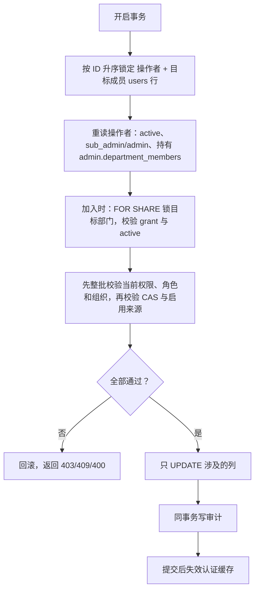

# 部门负责人管理本部门成员设计

更新：2026-11-04。状态：**已实现并通过实现复核（`8060a1e91`…`5e6c1ee55`，分支 `feature/hy/10226_department_member_management`），当前 main 已包含该实现；部署未核验，真实浏览器端到端未做。**

本文是"部门负责人管理本部门成员"功能的唯一文档，包含需求、权限、停用来源、负责人备注、接口合同、并发、代码地图、易错点和验证方式。原实施任务卡（固定接口、锁定测试、分阶段门禁）已并入 §4.4、§9.1、§9.2；审核原文不保留在仓库中，凡对后续修改有约束的结论都已写入正文，审核条目 R1–R4 的编号保留在 §12。实施任务卡原文最后存在于提交 `26f6363af`（可用 `git show 26f6363af:docs/features/department-member-management-implementation-plan-cn.md` 查看）。

前置功能：[组织、部门与多平台用量报表设计](organization-department-usage-design-cn.md)（该文档把"负责人自行管理成员"列为首版未纳入的扩展）。后续扩展：[组织负责人权限设计](organization-leader-design-cn.md) 复用本文接口，把范围扩展到整个组织（含未分配成员），并新增 `organization_manager` 停用等级；本文只描述部门负责人，组织负责人差异以该文档为准。

阅读顺序建议：
- 修改权限或授权弹窗：先读 §2 和 §12（R3）；
- 修改停用/启用或任何写 `users.status` 的代码：读 §3 和 §12（R1）；
- 修改接口或成员写入：读 §4、§5 和 §12（R2、R4）；
- 定位代码：读 §8；
- 跑测试或验收：读 §9。

## 1. 需求与已确认决策

客户需求：部门被授权的人可以管理本部门的成员。

| 决策点 | 已确认（2026-10-29） |
| --- | --- |
| 谁能管理 | 已有部门授权（`department_access_grants`）的 `sub_admin`，并且被单独勾选新权限 `admin.department_members` |
| 能做什么 | ① 维护成员名单：加入、移出本部门；② 账号状态与资料：启用/停用、修改用户名和负责人备注 |
| 加人来源 | 仅限**本组织、未分配部门**的普通用户；已在其他部门的人仍由完整管理员转岗 |
| 候选搜索 | 三个组织统一按邮箱/用户名关键字模糊搜索，每次最多 20 条 |
| 启用边界 | 只能启用"由负责人停用"的成员；管理员停用、内容审计自动封禁的成员只能看到状态，不能解封 |
| 密码 | 不允许负责人重置成员密码 |
| 入口 | 新建负责人专用页面「我的部门」；完整管理员的 `/admin/departments` 不变 |
| 备注 | 新增独立的负责人备注 `users.department_note`；负责人只读写它，管理员 `notes` 对负责人完全隐藏 |
| 备注归属 | 成员 `department_id` 变化（加入、移出、转岗、跨组织邮箱变更清归属）时清空，审计保留旧值 |
| 备注可见 | 完整管理员在用户管理页只读查看；管理员编辑用户不提供该字段；成员本人不可见 |
| 用户名长度 | 沿用 Ent `MaxLen(100)`，按 UTF-8 字节计（100 个 ASCII 或 33 个汉字）；用户已确认不改为按字符计 |

需求依据是本表和用户提供的需求摘要。备注三项（独立字段、归属变化清空、管理员只读）由用户在设计审核后确认，替代了原稿"负责人共用管理员 `notes`"的方案（见 §12 B1）。

仍不开放给负责人：转岗（其他部门 ↔ 本部门）、新建/删除账号、修改邮箱/密码/角色/权限、余额、并发、RPM、分组、平台额度、订阅分配/延期/撤销，以及管理其他子管理员或管理员。

## 2. 权限模型

新增权限码 `admin.department_members`（菜单键 `department_members`，前端路由 `/admin/my-department`）。它与现有两项部门权限独立，共用同一份部门授权范围：

| 权限 | 能力 | 范围来源 |
| --- | --- | --- |
| `admin.organization_usage` | 查看/导出部门报表 | `department_access_grants` |
| `admin.department_subscriptions` | 查询订阅、重置额度 | 同上 |
| `admin.department_members`（新） | 成员名单、启停用、用户名/负责人备注 | 同上 |

- 有权限码但没有任何部门授权：页面显示"尚未配置可管理部门"，所有数据和写接口返回 `DEPARTMENT_SCOPE_DENIED`（`DepartmentService.ManagedScope` 在范围为空时直接拒绝）。
- 授予入口：部门管理页的负责人授权弹窗 `DepartmentAccessDialog.vue` 新增"成员管理"勾选；`PUT /admin/users/:id/department-scope` 增加 `manage_members` 字段，按现有 `report`、`reset_quota` 的方式原子写入权限码与授权，沿用 `admin_access_version` CAS。
- `manage_members` 默认不勾选，不因已有报表/额度权限自动开启；编辑既有授权时三项勾选均从真实权限集合恢复。只持有新权限的负责人重开弹窗再保存，不得自动增加报表或额度重置权限（R3）。
- `DepartmentAccessInput.ManageMembers` 是 `*bool`：旧请求省略 `manage_members` 时保留现状，显式 `false` 才撤销，避免旧页面意外清除新权限。前端弹窗每次保存都显式发送布尔值。
- 角色降级、软删除时清理 grants 的既有逻辑同样覆盖新权限；`NormalizeAdminPermissions` 对非 `sub_admin` 返回空权限。
- 完整管理员和 Admin API Key 调用新接口时视为不受部门限制，其他业务规则相同；侧栏不给管理员显示该页面，管理员继续使用部门管理页和用户管理页。
- 新权限的路由白名单只有本组 5 条（§4），不含部门维护写路由。
- 组织负责人（`admin.organization_manage`）必然同时持有三项部门能力，通过组织授权而不是部门授权获得范围；范围计算按操作者类型二选一，不取并集。规则见 [组织负责人设计](organization-leader-design-cn.md) §3。

### 2.1 可管理成员的判定

每次写操作都在事务内重新判定，不信任客户端提交的部门或范围：

```text
可管理成员 = 未删除
          且 role = 'user'
          且 department_id ∈ 操作者当前 grants
          且 部门所属组织 = 成员邮箱推导的组织
```

- 不以 `status` 过滤：停用成员仍在名单中，才能被重新启用或移出。这与报表/订阅范围只统计 active 成员不同。
- `role` 不是 `user` 的成员（其他负责人、子管理员、管理员，包括操作者本人）在名单中只读展示（`manageable=false`），不提供任何操作。
- 部门停用（inactive）后禁止加入新成员；移出、启停用、改资料仍允许，与前置设计"停用部门保留已有成员及授权"一致。

## 3. 停用来源

内容审计自动封禁（`ContentModerationService` 的自动封禁分支）、管理员停用（`adminServiceImpl.UpdateUser`、`UserService.UpdateStatus`）原本都只写 `users.status='disabled'`，无法区分来源。为此新增来源字段：

| 字段 | 定义 |
| --- | --- |
| `users.disabled_source` | `VARCHAR(32) NULL`；migration 261 的 CHECK 取值 `department_manager` / `other`，migration 262 扩为 `department_manager` / `organization_manager` / `other`；`status <> 'disabled'` 时必须为 NULL |

数据库触发器 `users_disabled_source_guard`（函数 `maintain_user_disabled_source`，`BEFORE INSERT OR UPDATE OF status, disabled_source`）负责状态/来源一致性与禁止降级；**封禁意图由写入路径显式表达**。触发器无法区分"语句没写来源列"和"来源列沿用旧值"：已是 `disabled/department_manager` 时，管理员执行 `SET status='disabled'` 不会把未赋值的来源字段自动变成 `other`。

| 状态变化 | 触发器行为 |
| --- | --- |
| 任意 → 非 disabled | 清空为 NULL |
| 非 disabled → disabled（含 INSERT） | 语句显式写 `department_manager`（或 `organization_manager`）则保留；否则一律记为 `other` |
| disabled → disabled，显式再次封禁 | 只允许按等级 `department_manager < organization_manager < other` 升级；降级 `RAISE`（SQLSTATE 23514）。migration 262 把 261 的两级规则改为三级 |
| disabled 用户仅改用户名、备注、余额等 | 不触发来源列，保留来源；普通资料/计费更新不能当成再次封禁 |

- 部门成员仓储仅在已鉴权的负责人将 active 成员停用时，原子写 `status='disabled', disabled_source='department_manager'`（组织负责人写 `organization_manager`，见 `managerDisabledSource`）。完整管理员/Admin API Key 即使调用本组接口，停用来源仍写 `other`。
- 通用 `UserRepository.Update` 在 `fields.Status=true` 且目标为 disabled 时必须同时写 `disabled_source='other'`，包括原状态已经 disabled；这同时覆盖 `adminServiceImpl.UpdateUser`、`UserService.UpdateStatus` 和内容审计封禁。不能把从旧 User 快照读到的来源原样写回。现有/新增的原生 SQL、导入等其他显式封禁路径同样遵守此合同；仅靠状态迁移触发器不构成"覆盖所有路径"的证明（R1）。
- CHECK 要求 disabled 时来源非 NULL 且在枚举内，非 disabled 时为 NULL；来源不是通用用户更新请求的可写字段。触发器、仓储映射和返回 DTO 以实际持久化值为准。
- migration 261 把已有 `status='disabled'` 的用户回填为 `other`。
- 内容审计封禁原先在用户已停用时跳过（`if user.Status != StatusDisabled`）。现在达到封禁条件后必须在数据库当前行上原子写入 `status='disabled', disabled_source='other'`，包含来源升级，避免负责人之后解封一个本应被审计封禁的账号；不能只改来源而保留并发启用后的 active 状态。是否发送首次封禁邮件与是否落实封禁分开判定，不能为避免重复邮件跳过必要写入。
- 负责人 A 停用的成员，同部门其他负责人也可以启用；成员被管理员转到其他部门后，由新部门负责人管理。部门负责人能启用的来源只有 `department_manager`（`enableableDisabledSources`），不能启用组织负责人停用的成员。
- 管理员在用户管理页启用后来源自动清空；用户管理页状态列对 `department_manager` 显示"负责人停用"提示（组织负责人停用另有标签，见组织负责人设计 §4.4）。

### 3.1 负责人备注

| 项 | 定义 |
| --- | --- |
| 字段 | `users.department_note TEXT NOT NULL DEFAULT ''`，CHECK `users_department_note_length_check`：`char_length(department_note) <= 1000` |
| 写入 | 仅部门成员仓储的负责人 PUT 写入；不加入通用 `UserUpdateFields`、管理员 `UpdateUserRequest` 或创建/导入路径，旧快照不能回写 |
| 清空 | 触发器 `users_department_note_guard`（函数 `clear_user_department_note`）：`BEFORE UPDATE OF email, department_id`，当最终 `NEW.department_id IS DISTINCT FROM OLD.department_id` 时置空。PostgreSQL 同类触发器按名称字母序执行，该名排在 239 的 `users_department_guard` 之后，能看到后者因跨组织邮箱变更清空后的 `department_id`；不改写 239 的已应用函数 |
| 清空审计 | 旧值非空时由该触发器同事务写一条审计：`action='department.note_cleared'`、`auth_method='database_guard'`、`method='INTERNAL'`、`status_code=200`，`extra` 含 `user_id`、`before_department_id`、`after_department_id`、`department_note`（旧值）。覆盖管理员转岗、负责人移出和邮箱变更三类路径；沿用 240 审计触发器的列与失败即回滚约束 |
| 可见 | 负责人名单只对 `manageable=true` 的行返回；管理员 `AdminUser` DTO 只读返回；普通用户 DTO 不返回 |

角色从 `user` 变为 `sub_admin` 时不清空，但该行在负责人页变为只读且不返回备注；管理员仍可见。

## 4. 接口合同

均以 `/api/v1` 为前缀，加入 `admin.department_members` 路由白名单；部门管理的写路由不加入。

| 方法与路径 | 内容 |
| --- | --- |
| `GET /admin/department-members/scope` | 当前可管理部门（id、组织、名称、状态）与默认部门；只有一个授权部门时自动选中 |
| `GET /admin/department-members` | 参数 `department_id`（`all` 或授权部门 ID）、`status`（`active`/`disabled`）、`q`、分页。返回 `id, email, username, department_note, status, disabled_source, can_enable, manageable, department_id, department_name, department_version`（`department_note` 仅可管理行返回，永不返回管理员 `notes`）；SQL 内过滤分页 |
| `GET /admin/department-members/candidates` | 参数 `department_id`（必须是授权且 active 的部门）、`q`（去空格后至少 2 个字符）。返回同组织、未分配、`role='user'`、未删除的用户，最多 20 条：`id, email, username, status, department_version` |
| `POST /admin/department-members/assign` | 请求体同现有 `assign-members`：`department_id`（授权部门 ID 表示加入，`null` 表示移出）+ `members[{user_id, expected_department_id, expected_department_version}]`，单次最多 200 人 |
| `PUT /admin/department-members/:id` | 必填 `expected_department_id`、`expected_department_version` + 可选 `username`、`department_note`、`status`；只写提交的字段 |

成员资料/状态 PUT 必须携带列表返回的 `expected_department_version`；缺失或非法返回 400。它校验成员归属是否变化，不是用户名/备注的内容版本；归属变化会清空备注，因此版本校验同时防止旧页面把备注写进新的归属周期（R2）。请求中出现 `notes` 按未知字段返回 400。名单和候选查询在同一只读 repeatable-read 事务内校验操作者、grants 并读取数据；不能把事务外获取的部门 ID 列表当成长期授权凭据，也不能直接复用现有强制 active 的报表/订阅查询。

`department_id` 与 `department_name` 在 DTO 中可空，`expected_department_id` 显式 `null` 表示"确认成员未分配"、省略返回 400；这两点只对组织负责人管理未分配成员有意义，部门负责人看到的行总有部门（组织负责人设计 §4.7）。

### 4.1 加入与移出

| 操作 | 每个成员必须满足（任一不满足整批拒绝） |
| --- | --- |
| 首次加入 | 目标部门在 grants 内且 active；成员当前未分配、`role='user'`、邮箱组织与部门一致；重复加入见下文 |
| 移出 | 成员当前是可管理成员（§2.1）；移出后 `department_id=NULL`，不删账号、不动订阅 |

判定顺序：先完成整批目标的当前授权、角色、组织判定，不满足返回 403 `DEPARTMENT_SCOPE_DENIED`，不透露对方当前在哪个部门；再做 `expected_department_id/version` CAS，不一致返回 409 `DEPARTMENT_CONFLICT`。负责人路径不能照搬完整管理员 `Assign` 的"目标状态相同就成功"规则（R4）：

- 加入：当前仍未分配时执行 CAS；已经属于请求的同一授权目标部门、且仍为同组织普通用户时，作为重复加入返回无变化成功。已经属于其他部门时拒绝，即使操作者也获授权那个部门，仍不能通过本接口转岗。
- 移出：只有当前仍在授权范围内才允许 CAS 和移出。第一次成功后成员已无部门，再次请求返回 403，不为未分配用户绕过鉴权；前端提示"当前不可管理，请刷新"，不推断是自己上次成功还是别人移出。此接口不承诺移出请求的成功重放。
- 批量中任一成员失败则整批回滚；无实际变化的成功不产生变更审计，实际变化写一条包含全部变化的审计。

### 4.2 启停用与资料

| 字段 | 规则 |
| --- | --- |
| `status=disabled` | 负责人对当前 active 成员写 `status='disabled', disabled_source='department_manager'`；已停用则无变化，不改来源。完整管理员/Admin API Key 显式停用始终按 §3 写 `other`，含已 disabled 的情况 |
| `status=active` | 当前 active 时无变化成功；当前 disabled 时仅 `disabled_source='department_manager'` 可由部门负责人启用，否则 403 `DEPARTMENT_MEMBER_ENABLE_DENIED` |
| `username`、`department_note` | 去首尾空格；用户名不超过 100 个 UTF-8 字节（`len(username) > 100` 拒绝），负责人路径走原生 SQL，必须在服务端按同一字节规则显式校验；负责人备注不超过 1000 个 Unicode 字符（`utf8.RuneCountInString`），服务端校验并由 DB CHECK 兜底。同部门多个负责人后写覆盖，不给资料内容另加版本 |
| 其他字段 | 请求体严格 JSON，出现未知字段（如 notes、email、password、role、balance、disabled_source）返回 400 |

成员当前部门或 `department_version` 与预期不一致时：当前成员仍可管理返回 409，已不在授权内返回 403。包括"原部门 → 其他部门/未分配 → 原部门"的往返，不能因部门 ID 相同接受旧页面的编辑或停用请求。资料表单仅提交实际修改字段，不能在改备注时回写列表中的旧 status。完整管理员/Admin API Key 经本接口写负责人备注返回 `DEPARTMENT_SCOPE_DENIED`（管理员对该字段只读，前端已禁用输入）。

状态变化提交后调用 `InvalidateAuthCacheByUserID`，并保留 migration 184 的认证缓存 outbox 触发器：JWT 的后续请求直接检查最新用户状态，API Key 沿用主动失效和多实例 outbox 收敛。这里的停用是拒绝后续鉴权，不是永久撤销 JWT/API Key，也不承诺中断已开始的请求/流；重新启用后未过期凭据可继续使用。缓存/通知故障下的收敛需单独验收，不能仅凭一次失效函数调用承诺多实例零延迟。订阅保留；停用成员按既有口径不再计入部门报表人数与订阅范围。

### 4.3 错误码

| 错误码 | HTTP | 前端处理 |
| --- | ---: | --- |
| `DEPARTMENT_MEMBER_ENABLE_DENIED`（新） | 403 | 提示"该成员由管理员或系统停用，请联系管理员"，只刷新当前状态 |
| `DEPARTMENT_SCOPE_DENIED`（既有） | 403 | 刷新授权范围与名单，清除已选成员 |
| `DEPARTMENT_CONFLICT`（既有） | 409 | 提示成员已变化，刷新后重试 |
| `DEPARTMENT_INACTIVE`（既有） | 400 | 部门已停用，不能加人 |
| `DEPARTMENT_INVALID`（既有） | 400 | 参数非法：缺版本、用户名超长、备注超长、非法 status、`q` 少于 2 个字符、超过 200 人 |

### 4.4 固定 Go 接口（锁定测试直接依赖）

以下名称和语义被 §9.1 的锁定测试直接调用，改名或改语义必须同时说明理由并更新测试。均在 `backend/internal/service`。

```go
const AdminPermissionDepartmentMembers = "admin.department_members" // 目录项 MenuKey "department_members"，Route "/admin/my-department"

var ErrDepartmentMemberEnableDenied = infraerrors.Forbidden("DEPARTMENT_MEMBER_ENABLE_DENIED", "member was disabled by an administrator or the system")

// DepartmentAccessInput 字段：nil 表示保留现状，非 nil 按值授予或撤销。
ManageMembers *bool `json:"manage_members"`

func NewDepartmentService(repo DepartmentRepository, authCacheInvalidator APIKeyAuthCacheInvalidator) *DepartmentService
func (s *DepartmentService) ManagedScope(ctx context.Context) (*DepartmentScope, error)
func (s *DepartmentService) ManagedMembers(ctx context.Context, f DepartmentListFilter) (*ManagedDepartmentMemberList, error) // DepartmentID 为 "all" 或数字，不要求 Organization
func (s *DepartmentService) ManagedCandidates(ctx context.Context, departmentID int64, q string) ([]DepartmentMember, error)
func (s *DepartmentService) ManagedAssign(ctx context.Context, in DepartmentAssignInput) (int, error)
func (s *DepartmentService) UpdateManagedMember(ctx context.Context, userID int64, in ManagedMemberUpdateInput) (*ManagedDepartmentMember, error)
```

- `ManagedDepartmentMember`：字段同 §4 名单返回；`DepartmentNote` 仅 `Manageable=true` 时填充。`DepartmentID *int64`、`DepartmentName *string`（组织负责人引入的可空，原任务卡为非指针）。
- `ManagedMemberUpdateInput`：`ExpectedDepartmentID *int64`、`ExpectedDepartmentVersion *int64`、`Username`/`DepartmentNote`/`Status *string`；另有 `ExpectedUnassigned bool`（`json:"-"`，由 handler 识别显式 null，组织负责人用）。
- `authCacheInvalidator` 为 nil 时跳过失效调用（测试传 nil）；仓储 `UpdateManagedMember` 额外返回 `statusChanged`，只有状态实际变化且事务已提交才失效缓存。
- 错误映射：越权、目标不可管理、无权限或无授权 → `ErrDepartmentScopeDenied`；版本冲突 → `ErrDepartmentConflict`；参数非法 → `ErrDepartmentInvalid`；加入停用部门 → `ErrDepartmentInactive`；启用非本级可启用来源 → `ErrDepartmentMemberEnableDenied`。
- 审计 action `department.manager_assign_members`、`department.manager_update_member` 由 `departmentAudit` 写入，`actor_user_id` 为操作者；无实际变化时不写。
- 前端：`DepartmentAccessDialog.vue` 复选框 `data-testid="access-manage-members"`，保存时始终发送 `manage_members`；API 放在 `frontend/src/api/admin/departments.ts`，不新建 API 文件。

## 5. 事务与并发

所有写操作复用现有部门写入锁协议：



| 并发场景 | 结果 |
| --- | --- |
| 管理员撤销该负责人授权或降级 | `SetAccess`/角色更新同样锁负责人用户行，二者串行；撤权提交后，负责人的写操作在锁内重读到无授权，返回 403 |
| 管理员同时转岗该成员 | 都锁成员行；当前仍可管理但 ID/版本变化返回 409，已经越出授权范围返回 403；移出后又调回仍需版本校验 |
| 内容审计同时封禁该成员 | 封禁写用户行；先封禁则负责人"启用"读到 `other` 被拒；先启用则随后的封禁照常生效 |
| 成员计费扣余额 | 只锁 `users` 行，不新增与订阅表的交叉锁序 |

锁顺序 `users → departments` 与现有 `Assign`、`SetAccess` 一致，`users → user_subscriptions` 的额度重置路径不受影响。

## 6. 审计

使用现有 `departmentAudit`，同事务写 `audit_logs`，异常则整体回滚：

| action | extra |
| --- | --- |
| `department.manager_assign_members` | 部门 ID、每个成员的 before/after 部门 |
| `department.manager_update_member` | 成员 ID、变更字段及前后值（status、disabled_source、username、department_note） |
| `department.note_cleared` | 由 §3.1 触发器写入：成员 ID、前后部门、被清空的旧备注 |

不记录凭据。是否额外向管理员发送邮件通知不在本次范围（§10）。

## 7. 前端

| 范围 | 改动 |
| --- | --- |
| 新页面 `frontend/src/views/admin/MyDepartmentView.vue` | 顶部：部门选择（单部门自动选中）、状态筛选、关键字搜索、"添加成员"（部门停用时禁用）；表格：邮箱、用户名、负责人备注、状态（停用时标注"负责人停用/管理员停用"）、操作 |
| 行操作 | 编辑资料（用户名、负责人备注）；停用/启用（启用只在 `can_enable` 时显示）；移出（确认文案说明移出后自己将无法再管理该成员，账号与订阅不受影响）；`manageable=false` 的行无操作 |
| 添加成员弹窗 | 输入至少 2 个字符后搜索，展示最多 20 条候选，多选后提交 |
| 负责人授权弹窗 `DepartmentAccessDialog.vue` | 新增默认关闭的"成员管理"勾选；`hasDepartmentPermission`、加载/重置/保存逻辑同步识别三项权限。只持有新权限时，既有报表/额度勾选保持 false，不能走"首次授权默认 true"分支（R3） |
| 用户管理 `UsersView.vue` | 状态列对 `disabled_source='department_manager'` 显示"负责人停用"提示；只读展示负责人备注，`UserEditModal.vue` 不增加该字段 |
| 移出/转岗确认 | 负责人移出、管理员转岗（`DepartmentMembersDialog.vue`、`DepartmentAssignmentDialog.vue`）的确认文案提示"负责人备注将被清空" |
| 导航 | `AppSidebar.vue` 子管理员菜单、`router/index.ts`（`adminPermission: 'admin.department_members'`）、`adminPermissions.ts`、类型及中英文文案 |
| 登录落地 | 只持有部门类权限的账号，落地顺序为组织报表 → 订阅 → 我的部门；`getAdminLandingPath` 的 `onlyDepartmentManagement` 判断包含新权限码 |

范围/权限类 403 清空名单并刷新范围，同时取消旧请求或丢弃迟到结果；切换部门、关闭弹窗、卸载也作废旧请求和已选候选，避免旧部门响应覆盖新页面。`DEPARTMENT_MEMBER_ENABLE_DENIED` 只提示并刷新当前状态，不误判为全部授权丢失；409 时提示刷新。负责人不调用 `/admin/users`、`/admin/departments` 等完整管理员接口。

## 8. 代码地图

| 范围 | 位置 |
| --- | --- |
| 迁移 | `backend/migrations/261_department_member_management.sql`：`disabled_source`、`department_note` 两列，`users_disabled_source_check`、`users_department_note_length_check`，函数 `maintain_user_disabled_source` / 触发器 `users_disabled_source_guard`，函数 `clear_user_department_note` / 触发器 `users_department_note_guard`，存量 disabled 回填 `other`。`262_organization_leader.sql` 把来源扩为三级并重写 `maintain_user_disabled_source`。已应用迁移不可修改 |
| Ent | `backend/ent/schema/user.go` 两个字段；仓储映射到 `service.User`，管理员 DTO 只读返回；两者都不进入通用更新字段掩码 |
| 权限 | `backend/internal/service/admin_permission.go`：`AdminPermissionDepartmentMembers`、目录项、`adminPermissionRouteRules` 白名单 5 条；`NormalizeAdminPermissions` |
| 服务 | `backend/internal/service/department_service.go`：`ManagedScope`、`ManagedMembers`、`ManagedCandidates`、`ManagedAssign`、`UpdateManagedMember`、`SetAccess`（`ManageMembers`）、`normalizeDepartmentList`、`normalizeDepartmentAssign`；类型 `ManagedDepartmentMember`、`ManagedDepartmentMemberList`、`ManagedMemberUpdateInput` |
| 仓储（读） | `backend/internal/repository/department_query_scope.go`：`ManagedMembers`、`ManagedCandidates`（repeatable-read 事务、`departmentMemberPredicates`、`departmentMemberFrom`、`scanManagedDepartmentMember`、`enableableDisabledSources`、`managerDisabledSource`）；`organizationUsageSearchPattern` 转义模糊匹配；`department_scope_sql.go` 的范围 SQL（含组织负责人分支） |
| 仓储（写） | `backend/internal/repository/department_repo.go`：`ManagedAssign`、`UpdateManagedMember`、`SetAccess`；复用 `loadDepartmentActor`、`lockDepartmentUsers`、`departmentAudit` |
| Handler 与路由 | `backend/internal/handler/admin/department_handler.go`（`ManagedScope`、`ManagedMembers`、`ManagedCandidates`、`ManagedAssign`、`UpdateManagedMember`，严格 JSON 解码 `departmentJSON`）；`backend/internal/server/routes/department.go` 的 `/department-members` 组 |
| 认证缓存 | `DepartmentService` 注入 `APIKeyAuthCacheInvalidator`，Wire 已更新；migration 184 outbox 触发器保留 |
| 通用用户写入 | `backend/internal/repository/user_repo.go`：`Update` 在 `fields.Status` 且目标 disabled 时写 `disabled_source='other'` |
| 内容审计 | `backend/internal/service/content_moderation.go`：自动封禁对已停用用户也原子写 disabled/other；首次邮件判定独立 |
| 前端 | `frontend/src/views/admin/MyDepartmentView.vue`、`frontend/src/api/admin/departments.ts`、`frontend/src/components/admin/department/DepartmentAccessDialog.vue`、`frontend/src/utils/adminPermissions.ts`、`frontend/src/utils/departmentErrors.ts`（`departmentErrorKey`）、`frontend/src/components/layout/AppSidebar.vue`、`frontend/src/router/index.ts`、`frontend/src/i18n/locales/{zh,en}/admin/departments.ts` |

## 9. 验收与验证

| 类别 | 必须覆盖 |
| --- | --- |
| 权限 | 无新权限码 403；有权限无 grant 403；多部门授权；篡改 `department_id`、`:id`、跨组织成员均 403；仅有新权限的账号访问报表/订阅/用户管理接口 403 |
| 加入 | 同组织未分配成功；其他部门成员、其他组织、子管理员/管理员、已删除用户 403；停用部门 400；超过 200 人 400；CAS 冲突 409；整批全成全败 |
| 移出 | 可管理成员成功且订阅不变；非授权部门成员 403；移出后负责人不可再见该成员 |
| 启停用 | 停用后 JWT 后续请求拒绝；API Key 主动失效与 outbox 收敛；负责人停用可被同部门负责人启用；管理员停用、内容审计封禁、迁移回填的停用用户启用 403；管理员启用后来源清空；已 active 的启用重试无变化成功 |
| 停用来源 | 负责人停用 → 管理员再次提交 disabled → 来源 other → 负责人启用 403；UserService 同场景；负责人停用 → 异步审计封禁 → other；仅改备注/余额不污染来源；other 不能降回 department_manager；启用清空；INSERT 停用用户；回退再升级回填 |
| 资料 | 只写 username/department_note；提交 notes 等未知字段 400；不影响余额、并发等字段的并发计费写入 |
| 并发（真实 PG） | 撤权 vs 写入、转岗 vs 移出、封禁 vs 启用、计费扣费 vs 停用；原部门 → 移出/转岗 → 原部门后旧版本 PUT 409；封禁升级同时启用最终不能残留 active |
| 重试与审计 | 重复加入同一授权部门为无变化成功；移出成功后重试 403；混合批次先整批鉴权再 CAS；每个有实际变化的写请求一条审计，无变化不伪造变更，审计失败整体回滚 |
| 候选搜索 | 少于 2 个字符 400；只返回未分配同组织普通用户；最多 20 条 |
| 前端 | 菜单/路由/落地；单部门自动选中；`can_enable` 控制按钮；403/409 分码处理；仅成员权限重开授权弹窗并保存不新增报表/额度权限；旧请求的 manage_members 省略保留、false 撤销；切换部门与 403 后迟到响应不能恢复旧名单；i18n 完整性 |
| 备注 | 负责人接口任何响应都不含管理员 notes；只读行不返回 department_note；超过 1000 字 400 且 DB CHECK 兜底；负责人移出、管理员转岗、跨组织邮箱变更均清空并各写一条 note_cleared 审计，空备注不写；归属往返后旧页面 PUT 409；管理员列表只读可见、`PUT /admin/users/:id` 不能改；普通用户资料接口不返回 |
| 回归 | 现有部门管理、报表、订阅重置、用户管理启停用、内容审计封禁/解封 |

### 9.1 锁定测试

以下四个文件在实现前先写好并锁定（基线 `a058b81c6`），实现过程中不得删除、跳过、放宽断言或改名；唯一允许的修改是删除管理集成测试构建行里的 ` && deptmembers_pending`（已删除）。今后若认为某条断言与设计矛盾，先改本文并说明理由，再改测试。

| 文件 | 构建标签 | 覆盖 |
| --- | --- | --- |
| `backend/internal/repository/department_member_schema_integration_test.go` | `integration` | §3、§3.1：停用来源触发器、`UserRepository.Update` 显式停用写 other（R1）、负责人备注清空与审计、长度 CHECK。其中 `departmentMemberFixture` 被下一个文件共用，不要复制 |
| `backend/internal/service/content_moderation_department_disable_test.go` | 默认 | §3：已停用用户达到封禁阈值时仍须写入 |
| `backend/internal/repository/department_member_management_integration_test.go` | `integration` | §4、§4.4：`AccessPermissionContract`、`AssignAndRemove`（R4）、`UpdateMember`（R2、R1、资料与备注）、`ListAndCandidates` |
| `frontend/src/components/admin/department/__tests__/DepartmentAccessManageMembers.spec.ts` | — | §2、R3：授权弹窗不隐式增加权限 |

实现方补充的测试：`department_member_schema_additional_integration_test.go`、`department_member_management_additional_integration_test.go`、`department_member_auth_integration_test.go`、`department_member_concurrency_integration_test.go`（撤权、转岗、封禁与启用、计费与成员写入的真实 PG 并发）、`department_member_outbox_integration_test.go`（outbox 收敛，Redis 为替身）、`handler/admin/department_member_handler_test.go`（严格 JSON、`notes` 400、null 与省略）、`service/department_member_service_test.go`、`handler/dto/user_mapper_department_test.go`、`views/admin/__tests__/MyDepartmentView.spec.ts`、`components/layout/__tests__/AppSidebarDepartmentMembers.spec.ts`。`DepartmentManagement.spec.ts` 中对 `setAccess` 的精确断言补 `manage_members` 属于机械更新。

### 9.2 命令

在 `backend/` 下执行；Go 工具链、`GOTMPDIR`、嵌入式 PG 与 Ent/Wire 生成的本机约束见 `llm-wiki/wiki/ops.md`。真实 PostgreSQL 必须指向新建的空库，显式 skip 或因缺 Docker/Redis 跳过的用例不算通过。

```bash
# 迁移、触发器与锁定测试（真实 PG）
SUB2API_POSTGRES_ONLY_INTEGRATION_DSN='postgres://...' \
  go test -tags=integration -p 1 -count=1 ./internal/repository \
  -run 'TestDepartmentMember|TestDepartmentRepositoryIntegration|TestDepartmentSubscriptionsIntegration|TestOrganizationUsageDepartmentIntegration|TestDepartmentQueryCountIntegration|TestUserAdminAccessIntegration|Migration' -v
# 服务、handler、路由
go test -p 1 -count=1 ./internal/service ./internal/handler/admin ./internal/server/... -run 'Department|AdminPermission|Route|ContentModeration'
# CI 单测门禁（admin_permission_test.go 只在 unit 标签下编译）
go test -tags=unit -count=1 ./...
go build ./...
```

前端在仓库根目录执行：

```bash
pnpm --dir frontend exec vitest run src/components/admin/department src/views/admin src/utils src/router src/components/layout src/i18n
pnpm --dir frontend run lint:check
pnpm --dir frontend run typecheck
```

Ent 用 `go generate ./ent`，Wire 在 `backend/cmd/server` 下 `go run -mod=mod github.com/google/wire/cmd/wire`；生成后还原工具引入的 `go.mod`/`go.sum` 条目，再次生成应无漂移。本机旧版 golangci-lint 对 go1.27 的结论不可信，不能把它的 `0 issues` 记成通过。

### 9.3 最近结果

2026-10-29 实现复核（对象 `8060a1e91`、`1a24286ff`、`900780ec6`、`5e6c1ee55`，复核者自行重跑命令，不采信实现方自述）：

| 项 | 结果 |
| --- | --- |
| 锁定测试 | `git diff a058b81c6..HEAD` 中四个锁定文件仅删除了允许的 ` && deptmembers_pending`；`go.mod`/`go.sum` 无变化 |
| 编译与单测 | `go build ./...`、`go vet` 通过；service、handler/admin、dto、server 中部门/权限/路由/内容审计相关用例全部通过 |
| 真实 PostgreSQL | PG18 新建空库，`TestDepartmentMember*` 及部门/订阅/报表/权限/迁移相关集成用例 85 个顶层通过，0 失败、0 跳过 |
| 前端 | 部门、管理页、工具、路由、布局、i18n 相关 Vitest 138 个文件 / 980 个用例通过；`lint:check`、`typecheck` 通过 |
| 生成代码 | Ent、Wire 重新生成与提交一致，无漂移 |

组织负责人实现（2026-11-04）在其文档 §15.3 记录了包含本组用例在内的最近一次真实 PG 与 unit 结果。

未覆盖：真实浏览器端到端、真实 Redis 多实例部署（outbox 测试用替身 Redis）、可信 golangci-lint、本功能分支当时的 Go 全量 default/unit/integration（只跑了相关包）。

## 10. 风险、上线与回退

| 项 | 说明 |
| --- | --- |
| 备注（已决定） | 采用独立负责人备注，管理员 notes 不向负责人披露（§3.1）。归属变化即清空，管理员转岗也会清掉负责人写的内容，旧值只在审计中可查 |
| 候选人暴露 | `other` 组织的未分配用户基本是所有外部注册用户，模糊搜索允许负责人按关键字查到他们的邮箱/用户名（每次最多 20 条）。这是已确认的取舍 |
| 停用的影响 | 后续登录和请求按 §4.2 的鉴权与缓存失效机制拒绝，已开始的流/请求不保证中断，订阅照常计时；负责人误操作需同部门负责人或管理员恢复 |
| 未纳入 | 转岗、新建/删除账号、密码、订阅分配、余额/额度、多级部门、操作邮件通知、管理员编辑负责人备注 |

上线顺序：先完成 §9 验收 → 执行迁移（回填既有停用用户）→ 发布前后端 → 确认所有处理状态写入的实例已更新 → 给试点负责人勾选"成员管理" → 验证范围与启停用边界 → 逐步开放。旧版本不认识显式来源写入协议，混合版本期间不开启负责人权限。回退时先撤销所有 `admin.department_members` 权限码并等待在途写入结束，再回退应用；保留 `disabled_source` 列及兼容触发器。若旧版本曾恢复运行，再次升级开放前须把存量 disabled 来源保守重置为 `other`，不能假定已应用的迁移会再次回填。

## 11. 工作量

| 工作包 | 人日 |
| --- | ---: |
| 迁移、触发器（停用来源、负责人备注清空与审计）、Ent、通用停用写入与内容审计来源 | 1–1.5 |
| 后端权限、接口、事务与审计、缓存失效、Wire | 1.5–2 |
| 前端页面与弹窗、授权勾选、用户管理提示与备注只读、导航/落地/i18n | 1.5–2 |
| Go 单测、真实 PG 并发与触发器、Vitest、回归 | 1.5–2 |
| 文档与 wiki | 0.5 |
| **合计** | **6–8** |

前置设计 §12 的"负责人自行管理成员 +2–3 人日"只估了名单维护；本功能增加启停用来源、独立负责人备注、资料编辑和独立页面，因此上调。显式来源写入、版本 CAS、授权弹窗、独立备注这些审核后的修订已计入。

## 12. 关键约束与易错点

以下都是设计审核或实现复核中确认过的问题。编号 R1–R4 被测试注释引用，保持不变。每条是今后修改时必须保持的规则；"依据"是曾复现或推演出的失败场景。

| # | 规则 | 依据 | 落点与测试 |
| --- | --- | --- | --- |
| R1 | 封禁来源由写入路径显式写；任何显式停用（管理员、`UserService`、内容审计、原生 SQL、导入）都写 `other`，含原本已 disabled；内容审计不能因"已停用"跳过写入 | 负责人先停用，管理员在过期列表上再点"停用"（`UsersView.vue` 的切换按钮按列表旧状态发送 disabled），旧来源仍是 `department_manager`，负责人随后可解除管理员封禁。触发器分不清"没写来源列"和"沿用旧值" | §3；`UserRepository.Update`、`content_moderation.go`；`department_member_schema_integration_test.go`、`content_moderation_department_disable_test.go` |
| R2 | 成员 PUT 必带 `expected_department_version`，锁内先鉴权再校验；归属往返也返回 409；不给资料内容另加版本 | 只带 `expected_department_id` 时，成员离开又回到原部门，旧页面仍能修改资料或停用，还会把备注写进新的归属周期。239 在归属变化时递增 `department_version` | §4、§4.2、§5；`UpdateMember` |
| R3 | 授权弹窗的权限识别、加载、重置、保存都要认识三项权限；新权限默认关闭；只持有成员权限的负责人重开保存不增权；省略 `manage_members` 保留、`false` 撤销 | 只加勾选时，`hasDepartmentPermission` 只认识报表/额度两项，只有成员管理的账号会进入"首次授权默认 true"分支，重开保存意外获得报表和额度重置权限 | §2、§7；`DepartmentAccessDialog.vue`；`DepartmentAccessManageMembers.spec.ts` |
| R4 | 负责人加入可在仍授权时无变化成功；移出成功后重试返回 403；整批先鉴权再 CAS；前端刷新而不猜测成功原因 | "先鉴权"与"已在目标状态即成功"对移出重试互相矛盾：首次成功后成员已无部门，负责人无法再证明管理权。完整管理员 `Assign` 的 no-op 规则不能原样复用 | §4.1；`ManagedAssign`；`AssignAndRemove` |
| K1 | 负责人接口任何响应都不含管理员 `notes`；只读行不返回 `department_note` | "可以写备注"不等于"可以读取和覆盖管理员历史备注"，用户未确认共用（B1：已决定改为独立负责人备注） | §3.1；`scanManagedDepartmentMember`；`ListAndCandidates` |
| K2 | 用户名按 UTF-8 字节、备注按 Unicode 字符校验，服务端显式检查 | 负责人路径走原生 SQL，绕过 Ent `MaxLen` 校验；两种长度规则混用会让中文用户名在 DB 层失败或超长写入 | §4.2；`UpdateManagedMember` |
| K3 | 认证缓存只在状态实际变化且事务提交后失效 | 提交前失效会让并发请求把旧状态重新写回缓存 | `DepartmentService.UpdateManagedMember` |
| K4 | 新权限码要同步更新 unit 标签下的权限目录与写白名单测试 | `admin_permission_test.go` 带 `//go:build unit`，默认标签跑不到，CI 的 unit 门禁会失败 | §9.2 的 unit 命令 |

已否决或保留现状：

- 已否决：负责人共用管理员 `notes`。原因：会把管理员历史备注暴露给负责人并允许覆盖（B1，用户决定）。
- 保留现状：migration 261 的 `ADD COLUMN`/`CREATE TRIGGER` 未使用 `IF NOT EXISTS`/`DROP TRIGGER IF EXISTS`，与 239/240 写法不一致；迁移在事务内执行且幂等测试通过，已应用迁移不能再改。
- 保留现状：完整管理员经成员接口写负责人备注返回 `DEPARTMENT_SCOPE_DENIED`，"管理员只读"语义正确但错误码易误解；前端已禁用该输入。

## 13. 状态与待办

| 项 | 状态 |
| --- | --- |
| 代码 | 2026-10-29 实现复核通过，无阻塞问题（§9.3）；当前 main 已包含实现 |
| 部署 | 未核验 |
| 浏览器验收 | 未进行。至少走一遍：管理员勾选"成员管理" → 负责人登录落地 → 单部门自动选中 → 添加未分配成员 → 停用/启用（含管理员停用的 403 提示）→ 改用户名与备注 → 移出并确认备注清空 → 用户管理页"负责人停用"与备注只读 |
| 多实例 | outbox 收敛只在替身 Redis 上验证，真实 Redis 多实例未验 |
| 工具 | 本机 golangci-lint 不可用，提交前依赖 CI 的 lint 结果 |
| 后续扩展 | 组织负责人已复用本组接口（见组织负责人设计）；改动本组接口时同时跑两边的测试 |
