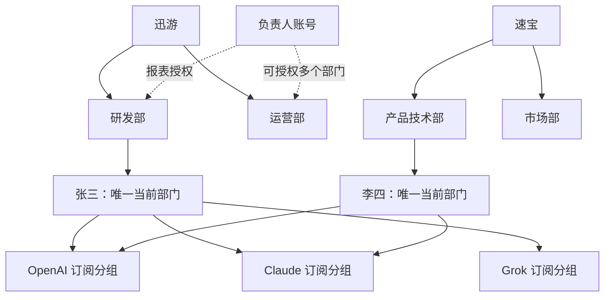
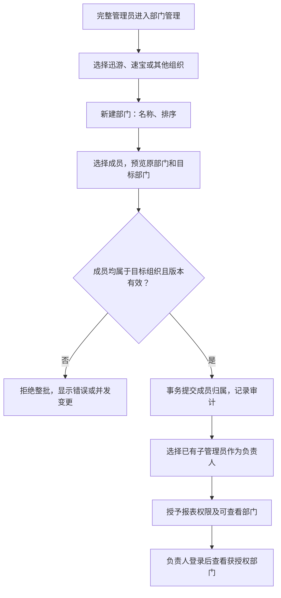
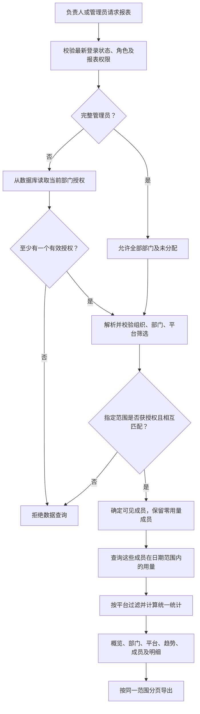
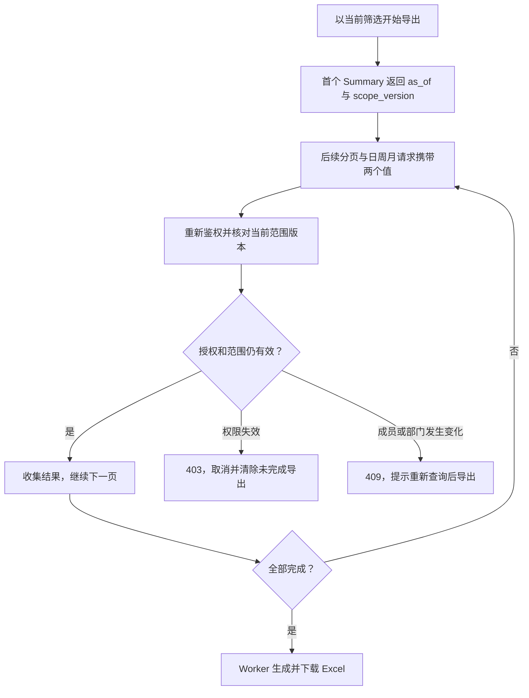

# 组织、部门与多平台用量报表设计

更新：2026-11-04。状态：**已实现并合入本地 main（部门分支 `feature/hy/10207_department_usage` 于 `273b76c35` 合入）；S1–S6 复核修正与 RV1–RV8 本机隔离验收完成；2026-09-21 实现审核遗留的 3 项与上线审核的停用分组问题已于 2026-11-03 修复。部署状态未核验。**

本文是"组织下部门维度、部门负责人报表与受限额度重置"功能的唯一文档，包含需求边界、数据模型与迁移、权限与并发合同、接口、代码地图、易错点、验收证据和验证方式。原实施方案（S1–S6、RV1–RV8）、设计审核、代码审核、实现审核、2026-09-29 上线审核、验收清单与性能记录都已并入本文：仍有效的要求写成规则，验收与性能结论写进 §11，被否决的建议写进 §13.1。审核原文与证据目录（含截图、工作簿、计时与 SQL 计划 JSON）已移出仓库，最后存在于提交 `26f6363af`（可用 `git show 26f6363af:<路径>` 查看，如 `docs/delivery/2026-09-19-department-usage/acceptance.md`、`docs/reviews/organization-department-usage-design-review-cn.md`）。

边界：组织用量报表本身（汇总 SQL、趋势图、日汇总、性能基线）见 [组织用量报表设计](organization-usage-report-design-cn.md)，本文只写部门维度的增量。后续扩展只链接不复制：[部门负责人管理本部门成员](department-member-management-design-cn.md)（权限 `admin.department_members`、停用来源、负责人备注）；[组织负责人](organization-leader-design-cn.md)（组织授权、组织级范围含未分配成员、组织负责人维护部门、`organization_manager` 停用等级、额度重置对象收紧）。

阅读顺序建议：
- 修改权限、授权或负责人能力：先读 §6 和 §14；
- 修改报表查询、版本或导出：读 §7.4、§8.2 和 §14；
- 修改订阅查询或额度重置：读 §6.1、§8.3 和 §14；
- 修改数据模型或新增组织：读 §5；
- 定位代码：读 §9.3；
- 跑测试或验收：读 §11；上线读 §10。

## 1. 方案摘要

采用"组织 → 部门 → 成员"的人员结构，保留现有 API 分组和平台订阅。部门用于人员归属与管理数据范围，订阅用于模型调用与额度，两套关系互相独立。

| 决策 | 合同 |
| --- | --- |
| 组织 | 沿用当前邮箱域名识别：迅游 `xunyou`、速宝 `wsdashi`、其他 `other` |
| 部门 | 同一套管理功能，每个组织独立配置一级部门；部门名称不写死 |
| 成员 | 每个用户最多一个当前部门，可同时持有多个平台订阅 |
| 负责人 | 复用 `sub_admin`，可查看/导出获授权部门报表，并保留部门内订阅额度重置；不能分配订阅 |
| 用量 | 默认汇总成员所有平台，可按现有有效平台口径筛选、拆分 |
| 历史 | 按当前成员归属统计；人员调岗后，历史用量随当前部门重新归类 |
| 导出 | 页面、日周月明细、Excel 使用同一授权及筛选口径 |
| 工作量 | 首版基础估算 **14–21 人日**；含约 20% 预留，建议排期 **17–26 人日**（§12） |

当前成员口径用于日常团队管理；若后续用于固定部门月度结算，再评审发生时归属（§7.3、§12）。

## 2. 已有基础与本功能边界

| 功能开发前的基础 | 设计影响 |
| --- | --- |
| 组织按当前邮箱精确域名识别；不是独立组织实体 | 部门表直接保存组织键，不建设通用组织管理系统 |
| 用户可关联多个授权分组、多个订阅；API Key 绑定分组 | 不从授权分组、订阅或 API Key 自动推导部门 |
| 组织报表已有 Summary、Periods、Trend 和 Excel Worker | 扩展已有链路，复用时间桶、峰值、分页及导出机制 |
| 原组织汇总为固定三组织比较，忽略选中的组织筛选 | 所有返回区块统一按有效范围过滤，不返回范围外组织汇总 |
| 子管理员原有三项权限，没有组织报表权限及部门范围 | 增加独立权限，不复用具有全站查询能力的 `admin.usage` |
| 子管理员的订阅权限允许单项全量/每日额度重置，以及按筛选批量重置每日额度 | 保留操作，增加部门数据隔离；不开放分配、延期、撤销、恢复或删除订阅 |
| 用量日志没有独立平台快照列；已有有效平台 SQL 表达式 | 复用其平台分类规则，保留"未知平台"，不按模型名猜平台 |

首版包括部门管理、批量成员归属、负责人授权、部门报表、多平台筛选/汇总、Excel、部门内订阅查询与额度重置、审计和回归验证。多级部门、跨部门兼职、部门预算、审批、企业通讯录同步、任意新组织配置及财务结算历史不纳入。负责人自行管理成员、组织负责人已作为后续功能实现（见文首链接）。

## 3. 关系示意图

下图部门名称与人员均为示例；实际名称由各组织管理员配置。



同名部门可以存在于不同组织，由唯一部门 ID 区分。成员所属部门、负责人可查看部门是两种独立关系：负责人本人不必属于所有获授权部门。

## 4. 管理流程与页面

### 4.1 部门与成员配置



| 页面 | 操作与字段 | 权限 |
| --- | --- | --- |
| 部门管理 `/admin/departments` | 组织筛选、部门名称、状态、排序、成员数、负责人；新建、编辑、停用、恢复 | 完整管理员；组织负责人限本组织（见组织负责人设计 §4.2、§5.2） |
| 部门成员弹窗 | 当前成员、搜索本组织用户、批量转入/移出；显示原部门、目标部门 | 同上 |
| 用户管理 | 组织/部门列与筛选；批量分配部门。保留已有分组与订阅操作 | 完整管理员 |
| 负责人授权弹窗 | 选择已有 `sub_admin`，配置可查看部门与三项部门权限；展示其其他管理权限 | 完整管理员 |
| 组织用量报表 | 日期、组织、部门、平台、邮箱；概览、部门汇总、平台汇总、趋势、成员表、导出 | 管理员或已获部门报表授权的子管理员 |
| 现有订阅管理 | 负责人查询获授权部门成员的已有订阅，执行单项全量/每日重置、筛选批量每日重置 | 管理员或已获部门订阅权限的子管理员 |

普通用户不自选、不修改部门。授予负责人权限不隐式升级普通用户角色；管理员先通过用户管理将其设为子管理员。部门负责人可查看、导出部门报表及重置部门成员的订阅额度；不能创建分组、分配或变更订阅、修改额度上限、调整成员归属或授权（成员维护另需 `admin.department_members`，见部门成员管理设计）。

### 4.1.1 独立的"部门管理"页面

管理后台侧栏一级菜单"部门管理"放在"用户管理"之后，路由 `/admin/departments`，页面 `frontend/src/views/admin/DepartmentsView.vue`。它是部门及成员配置的主要入口；后端管理接口同样限制权限。

迅游和速宝共用这个页面，通过组织选择器切换数据，不分别建设页面。组织用量报表继续承担查询和导出，负责人直接进入报表。

| 页面区域 | 展示内容与操作 |
| --- | --- |
| 顶部筛选 | 组织选择、部门状态；组织选项包含迅游、速宝、其他，查看单个组织的部门 |
| 顶部操作 | "新增部门"；当前组织没有部门时显示空态及创建入口 |
| 部门列表 | 部门名称、状态、排序、成员数、负责人、操作；分页表格 |
| 每行操作 | 编辑、成员管理、负责人授权、停用/恢复、查看用量 |
| 编辑弹窗 | 新建时带入当前组织，填写名称和排序；编辑已有部门时所属组织只读 |
| 成员管理弹窗 | 查看当前成员，搜索并勾选本组织用户，批量转入或移出；提交前显示归属变化及"负责人备注将清空"提示 |
| 负责人授权弹窗 | 展示本部门负责人，添加或撤销该部门范围，并配置报表、订阅重置、成员管理三项权限；只能选择已有子管理员 |

点击"查看用量"跳转组织用量报表，并通过路由查询参数预选该组织与部门；报表页解析这两个参数并做授权校验，日期默认当月。停用部门仍允许管理员查看已有成员与报表。

### 4.1.2 页面之间如何分工

| 入口 | 主要用途 | 典型操作 |
| --- | --- | --- |
| 部门管理页 | 从部门角度集中维护组织结构 | 创建研发部 → 批量加入成员 → 指定负责人 |
| 用户管理页 | 从用户角度维护账号及归属 | 找到张三 → 调整其部门；原订阅和分组配置继续保留 |
| 组织用量报表 | 查询与导出 | 选择研发部 → 查看各平台用量及成员明细 |
| 订阅管理页 | 查询已有订阅和重置额度 | 选择部门成员的具体订阅 → 重置全部或每日额度；也可按当前筛选批量重置每日额度 |

两个成员配置入口调用同一部门成员服务，不各自维护一套名单。移出部门只清空部门归属，不删除账号或取消订阅。部门行的负责人操作只增减当前部门授权，保存时保留该负责人在其他部门的授权，并按 §6.2 的授权版本处理并发修改。

### 4.2 部门生命周期

| 场景 | 规则 |
| --- | --- |
| 同组织重名 | 名称去首尾空格、按统一大小写规范比较后拒绝；停用部门也占用名称 |
| 不同组织同名 | 允许，所有关联使用 ID，不按名称匹配 |
| 修改所属组织 | 禁止（触发器 `departments_organization_guard`）；新建目标组织部门并迁移合法成员 |
| 停用部门 | 禁止新增成员和新增负责人授权；保留已有成员及授权，仍可查报表、执行已授权重置、移出成员、撤销授权 |
| 删除部门 | 不提供删除，只提供停用，避免成员和报表关联悬空 |
| 未分配成员 | `department_id = null`；管理员可查"未分配"，部门负责人不获得该范围（组织负责人可以，见其设计 §4.7） |
| 成员订阅到期 | 不改变部门归属；报表按用户状态和用量口径统计 |
| 跨组织邮箱变更 | 239 触发器把旧部门清空、递增成员版本，240 触发器同事务写审计；由管理员重新分配 |
| 用户停用、删除 | 报表沿用 active 且未删除用户口径；其历史用量也不再出现在本管理报表中 |
| 负责人角色降级 | 离开 `sub_admin` 时，角色/权限变化、删除其持有的 grants 与审计在同一事务完成；重新提权不恢复旧授权 |
| 负责人软删除 | 同事务清其持有的 grants；其他记录的 `created_by` 保留。用户删除是软删除（`SoftDeleteMixin`），不触发用户外键的物理删除限制 |
| 负责人临时停用 | 立即禁止管理访问；保留授权关系，恢复后按最新权限与既有授权访问，不等同角色降级 |

授权清理在用户更新/软删除事务中实现，与角色、授权更新共用用户行锁，避免降级/删除完成后被在途授权写回复活。未来如引入物理删除，需另行设计 grants 与 `created_by` 等外键清理。

跨组织邮箱变更覆盖管理员更新、用户资料更新与任何直接写 `users.email` 的路径（由 239 触发器兜底）。任何遗漏产生的组织与部门不匹配记录，在报表查询时按"未分配"处理，不能进入原部门负责人的数据范围。

### 4.3 报表交互

| 访问情况 | 默认行为 |
| --- | --- |
| 完整管理员 | 全部组织、全部部门、全部平台；可依次下钻 |
| 仅有一个授权部门的负责人 | 自动选定该组织和部门，直接展示当月全部平台数据 |
| 同组织多个授权部门 | 默认该组织、"全部授权部门"；可切换具体部门 |
| 跨组织多个授权部门 | 默认"全部授权组织/部门"；选项只列被授权部门所属组织 |
| 有权限但无部门授权 | 显示"尚未配置可查看部门"；仅范围目录可返回空配置，数据查询拒绝 |

选择组织后才展示该组织的部门选项；切换组织清除原部门。部门变化刷新所有统计并把成员页码重置为 1；平台筛选同样作用于全部用量区块。重置只回到当前用户的授权默认范围。

选择一个组织、全部部门时，展示该组织可见部门及管理员可见的"未分配"汇总；选定单部门后只展示该部门数据。全部组织时展示授权范围内的组织汇总，不绘制全部部门长列表。

`other` 的"未分配"仅包含当前筛选内 active、未删除且没有部门归属的其他域名成员；已经分配到 `other` 下部门的人进入对应部门。该桶用于识别待分配成员，实际上接近全部外部注册用户，不默认隐藏。

```text
日期：本月    组织：迅游    部门：研发部    平台：全部    邮箱：搜索

成员人数 / 活跃人数 / 请求数 / 总 Token / 实际消费
部门汇总                      平台汇总
用量趋势                      日 / 周 / 月峰值
成员表：邮箱 | 部门 | 请求 | Token | 实际消费 | 峰值
                                              导出 Excel
```

## 5. 数据模型与迁移

### 5.1 结构

| 数据对象 | 字段 | 约束 |
| --- | --- | --- |
| `departments` | `id`, `organization_key`, `name`, `status`, `sort_order`, `version`, `created_at`, `updated_at` | `organization_key` CHECK 三键；归属组织不可修改；名称组织内唯一；`name` 非空白、≤100 字符 |
| `users.department_id` | nullable bigint，`REFERENCES departments ON DELETE RESTRICT` | 一个用户一个当前部门；只通过部门成员服务写入 |
| `users.department_version` | bigint，默认 0 | 归属变化时由 239 触发器递增，配合旧部门值校验，防止并发转岗覆盖 |
| `department_access_grants` | `user_id`, `department_id`, `created_by`, `created_at` | 主键 `(user_id, department_id)`；外键均 `ON DELETE RESTRICT`；负责人可对应多个部门；报表、订阅、成员管理共用范围 |

部门 `status` 为 `active / inactive`，默认 active；排序默认 0，版本默认 0。部门首版不物理删除。成员版本在转岗、移出及跨组织邮箱变更清空归属时都必须递增（由触发器保证，应用不自行计算）。

组织键不是一张组织表。通用性来自各组织使用相同的部门数据结构和流程；本版不宣称支持任意组织自助创建。新增正式组织时必须同步以下全部位置，并追加迁移（不得改写已应用迁移）：

| 位置 | 内容 |
| --- | --- |
| `239_departments.sql` 的 `departments.organization_key` CHECK | 三键枚举 |
| 239 触发器函数 `maintain_user_department` | 邮箱域名 → 组织的 `CASE` |
| `service.OrganizationForEmail`（`department_service.go`） | Go 侧邮箱 → 组织 |
| `organizationUsageOrganizationExpression`（`organization_usage_repo.go`） | 报表 SQL 组织表达式 |
| `subscriptionOrganizationDomain`（`user_subscription_repo.go`） | 订阅域名匹配 |
| `262_organization_leader.sql` 的 `organization_access_grants` CHECK | 组织授权只允许 `xunyou`、`wsdashi` |
| 前端组织选项、i18n 与测试 | `frontend/src/constants/organizationUsage.ts` 等 |

### 5.2 索引与事务

| 项目 | 设计 |
| --- | --- |
| 部门重名 | 唯一索引 `departments_organization_name_key (organization_key, lower(btrim(name)))`，服务端同样归一化 |
| 部门列表 | `departments_list_idx (organization_key, status, sort_order, id)` |
| 用户归属查询 | `users_department_idx (department_id, id)` |
| 授权查询 | 主键 `(user_id, department_id)`；反向索引 `department_grants_department_idx (department_id, user_id)` |
| 用量查询 | 复用既有 `(user_id, created_at)`；未新建大表索引 |
| 批量转岗 | 单次最多 200 人，ID 去重；按用户 ID 升序锁行，重新检查组织、目标状态及部门版本，全部成功或全部回滚 |
| 授权变更 | 与报表/部门订阅/成员管理权限码及审计原子提交（§6.4） |
| 通用用户更新 | 不接受任意部门字段覆盖；显式字段 mask 保留余额与并发计费保护；权限/角色更新与部门授权入口共用原子版本校验（§6.2） |

批量转岗携带每人的 `expected_department_id` 和 `expected_department_version`。相同状态的重复提交可返回无变化成功（仅完整管理员路径；部门负责人路径另有规则，见部门成员管理设计 §4.1）；任何真正冲突返回 409，并要求刷新预览。部门编辑使用 `version`。

### 5.3 迁移

| 迁移 | 内容 |
| --- | --- |
| `239_departments.sql` | `departments`、`users.department_id/department_version`、`department_access_grants` 与索引；触发器 `users_department_guard`（`maintain_user_department`：跨组织邮箱变更清归属、组织不匹配或停用部门拒绝、版本递增）；`departments_organization_guard`（组织不可改） |
| `240_department_email_change_audit.sql` | `users_department_email_audit`（`AFTER UPDATE OF email`）：邮箱变更清归属时写 `department.email_organization_changed` 审计，`auth_method='database_guard'` |
| `261_department_member_management.sql` | 部门成员管理：`disabled_source`、`department_note` 及触发器（见部门成员管理设计 §3） |
| `262_organization_leader.sql` | 组织负责人：`organization_access_grants`、停用来源三级（见组织负责人设计 §6） |

240 触发器在 `users` 更新中写 `audit_logs`，依赖其可用列及默认值；修改 `audit_logs` 结构时必须复验 `department_repo_integration_test.go` 中的邮箱变更审计断言。清归属与审计同事务，不能吞掉审计异常后继续主操作（§13.1）。

## 6. 权限与查询流程

部门相关权限码：`admin.organization_usage`（部门报表）、`admin.department_subscriptions`（部门订阅查询与额度重置）、`admin.department_members`（成员管理，见部门成员管理设计）。`admin` 保持全量权限；部门负责人使用 `sub_admin`，三项权限分别授予，共用 `department_access_grants` 中的部门范围。部门订阅权限复用现有订阅页面与重置动作，只限定查询和操作对象。



核心约束：`最终范围 = 服务端授权范围 ∩ 用户筛选范围`。筛选只会缩小范围；省略筛选或传 `all` 不能扩大授权。

| 边界 | 处理 |
| --- | --- |
| 修改部门 ID 越权 | 数据接口返回 403，不返回该部门名称、人数或是否存在等额外信息 |
| 非法枚举、日期、ID 或组织部门组合 | 400；对负责人先做授权判断，避免越权对象信息泄露 |
| 撤销报表权限或部门授权 | 下一次请求重新读库即生效；已有在途响应或已下载文件不承诺追回 |
| 组织汇总、人数、峰值 | 与明细同范围；不能只限制人员表 |
| 筛选选项 | 专用 compact 范围接口；负责人不调用完整 `/admin/users`、`/admin/groups/all` 或部门管理接口 |
| 其他管理权限 | 不自动授予全站 `admin.usage`、`admin.subscriptions` 或 Token 分析权限 |
| 订阅权限互斥 | `admin.department_subscriptions` 与全站 `admin.subscriptions` 互斥，`NormalizeAdminPermissions` 拒绝同时配置（`CONFLICTING_ADMIN_PERMISSIONS`） |
| 普通成员 | 继续只查看个人用量；知道部门 ID 不产生管理权限 |
| Admin API Key | 沿用完整管理员语义（`WithDepartmentAdminAPIKey` 标记），不能分发给部门负责人 |

不缓存负责人授权，避免跨实例撤权延迟。授权集合通过 `EXISTS` 或去重成员集合参与 SQL，避免 JOIN 多条 grant 或多份订阅导致消费翻倍。认证中间件 `admin_auth.go` 只注入受信的操作者身份（`WithDepartmentActor`），仓储在每次特权操作前用 `loadDepartmentActor` 重读最新角色、状态与权限；身份不是客户端提交的授权。

组织负责人通过 `organization_access_grants` 获得组织级范围，与部门授权互斥、按操作者类型二选一，不取并集；本节描述部门负责人，组织负责人的范围规则见其设计 §3。

### 6.1 负责人保留额度重置能力

已确认的业务边界：主管理员维护分组、订阅分配及部门成员，负责人保留额度重置操作。部门订阅权限是部门范围的后端约束，不新增给负责人分配订阅的能力。

| 操作 | 主管理员 | 部门负责人 |
| --- | --- | --- |
| 查看订阅、额度进度 | 全部 | 获授权部门成员 |
| 重置单个订阅的日/周/月全部额度或仅每日额度 | 允许 | 获授权部门成员的具体订阅 |
| 按当前筛选批量重置每日额度 | 允许 | 当前筛选与授权部门的交集 |
| 分配、延期、撤销、恢复、删除订阅及通用批量动作 | 允许 | 拒绝 |
| 修改套餐额度上限、余额或 API 分组配置 | 按既有管理员权限 | 拒绝 |
| 编辑部门、调整成员归属、指定负责人 | 允许 | 拒绝 |

组织负责人实现（D5）收紧了重置对象：负责人不能重置本人、admin 及部门内 `sub_admin` 的订阅，见组织负责人设计 §4.5。

额度重置沿用订阅用量窗口语义，不修改历史 `usage_logs`、不清空报表消费、不修改套餐上限或延长订阅。多平台成员按选中的具体订阅重置；批量操作遵循当前已成功应用的部门、用户、分组、平台等筛选，不隐式重置该用户其他平台的订阅。

`admin.department_subscriptions` 是持久的受限权限类型：即使撤销报表权限、删除全部部门授权，订阅查询与重置也必须继续按部门模式处理，无授权则拒绝，绝不能回退全站。原有非部门子管理员的全站订阅权限保持原合同；把其配置成部门负责人时，由主管理员显式把全站订阅权限切换为部门订阅权限（`replace_global_subscriptions`）。

单项重置在同一事务内校验最新操作者权限、授权、订阅所属用户及当前部门，按 ID 顺序锁定操作者和成员，订阅 UPDATE 获取订阅行锁；转岗和撤权使用相容的锁顺序，避免"校验后转岗、随后仍重置"的间隙。批量重置锁定并绑定实际获授权的目标集合，原子更新执行时仍符合 active、未删除、未过期等条件的订阅，不接受客户端提交的授权 ID 集合。

筛选批量重置继续要求 `Idempotency-Key`，复用 `AtomicSuccess` 和提交后缓存失效；请求指纹覆盖部门筛选与实际授权范围，重放前再次校验当前授权。授权失效返回 403，范围变更返回 409，不能依旧权限继续执行。前端只有最新成功查询才能生成确认快照，加载或查询失败时禁止使用旧筛选重置；保留提交防重与审计。

锁范围按实际候选订阅成员收窄，锁内重新鉴权并复用范围结果，避免重复全量解析；出现未锁定的新候选则返回范围变化，不扩大写入。成员分配单次 200 人上限不作为部门总人数或筛选批量重置上限。

两条路径的锁序（计费双表顺序是仓储两个写分支的顺序，不表示每次计费都会写两张表）：

| 路径 | 获取锁的顺序 | 约束与失效条件 |
| --- | --- | --- |
| 需要成员串行保护的额度重置 | `users` → `user_subscriptions`；用户行按 ID 升序锁定 | 与撤权、转岗在用户行串行，随后更新订阅额度 |
| 计费仓储的两个费用分支（`applyUsageBillingEffects`） | `user_subscriptions` → `users` | 网关 command 构造在订阅费用与余额费用之间二选一，当前请求只进入一侧；若未来同一事务混合扣费，两种锁序可能形成 AB-BA 死锁 |

不出现双表锁环依赖 command 二选一，不是仓储强约束，也不是对所有并发路径无死锁的证明。未来引入混合扣费或同事务新增另一张表的写入前，必须先统一锁序并扩充 RV5 回归（目标：无死锁、无丢失更新、锁释放后可继续，不能只证明当次等待没有超时）。保留行锁协议，不改为 advisory lock（§13.1）。

### 6.2 权限修改的统一并发合同

| 入口 | 规则 |
| --- | --- |
| 用户详情 `GET /admin/users/:id` | 返回 `admin_access_version`，对应同一 repeatable-read 快照下的目标用户 ID、角色、规范化权限与排序后的 grant ID 集合；只出现在管理详情，不扩散到公开资料、auth/me 或嵌套浅层用户 DTO |
| `PUT /admin/users/:id` | 显式提交 `role/admin_permissions` 必须携带 `expected_admin_access_version`；资料保存只提交实际改动，不附带旧权限数组。用户创建是显式初始化，不要求版本 |
| `PUT /admin/users/:id/department-scope` | 沿用 `expected_version` 字段名，值采用同一授权版本规则；不保留两套互不相通的并发检查 |
| 写入原子性 | 同事务按统一顺序锁定相关用户、重读最新权限/grants、比对版本，再更新和审计；不能在锁外预读比对后直接覆盖 |
| 冲突与兼容 | 缺版本 400 `ADMIN_ACCESS_VERSION_REQUIRED`、过期 409 `ADMIN_ACCESS_CHANGED`，无写入副作用。只更新普通资料的旧请求兼容，修改权限的旧客户端必须补版本 |

有部门 grant 不意味着有部门订阅权限。允许显式配置"部门报表 + 全站订阅"的一般子管理员组合，但不能把它标成"仅限本部门负责人"；禁止两种订阅权限并存和旧窗口隐式恢复全站权限。完整管理员携带当前版本明确调整权限的正常操作继续支持。版本只是并发条件，操作者仍由可信登录身份与数据库最新权限鉴权；仅隐藏前端勾选项不能作为修复。

`UserEditModal.vue` 流程：每次打开/切换用户调用 `GET /admin/users/:id` 获取详情与 `admin_access_version`，保存详情作为未编辑基线；加载中禁止保存，失败不退回列表旧快照，取消或切换用户时忽略迟到详情。权限按集合比较而非数组顺序；只有角色或规范化权限集合实际变化时，才提交 role、权限集合及预期版本，且三者来自同一详情快照。仅修改备注等资料时不附带这三项。409 刷新详情后重新确认，不自动覆写。

管理详情经 `UserRepository.GetByIDWithAdminAccess`（`user_admin_access.go`）读取，它是仓储必需接口，缺失实现不得静默退回普通用户详情。

### 6.3 管理员查询优化的边界

完整管理员、Admin API Key 及持全站订阅权限的子管理员，在未指定部门的普通订阅查询中，经最新鉴权后不加载全站成员来证明其不受部门限制（普通全站订阅 scope 只读取 actor，1 次 SQL）。管理员指定部门或"未分配"时仍必须执行组织/部门筛选，不能一律短路掉过滤。

管理员写操作只移除为部门限制而添加的不必要成员范围扫描与批量锁；操作者权限、目标订阅和原子更新需要的锁与事务仍保留，不能因 `role=admin` 无条件跳过全部锁或最新鉴权。报表与负责人路径保持同范围查询及必要一致性，不能为性能绕过鉴权或幂等校验。

### 6.4 部门授权写入合同

| 规则 | 说明 |
| --- | --- |
| `department_ids` 全量替换 | 必须显式提供；省略或 `null` 返回 400 `DEPARTMENT_INVALID`；`[]` 清空全部 grants；最多 200 个、正整数、去重 |
| grants 与权限码独立 | grants 集合只由 `department_ids` 决定。只关闭三项权限而 `department_ids` 非空时，grants 保留，以后重新授予任一部门权限即恢复原范围（2026-11-03 用户裁定）。降级/软删除仍清 grants（§4.2） |
| 增量加锁 | 只对新增部门按 ID 批量 `FOR SHARE` 并检查 active/存在，批量插入；保留的授权不再锁部门或重复插入（保留授权可以是已停用部门）。新增停用或不存在部门整批拒绝 |
| 目标限制 | 只接受已是 `sub_admin` 的目标；组织负责人不持有部门授权（D8），其权限只能经组织授权接口修改 |
| 全站订阅切换 | 目标已有 `admin.subscriptions` 且请求授予部门订阅权限时，必须显式 `replace_global_subscriptions`，否则 400 `DEPARTMENT_GLOBAL_SUBSCRIPTION_CONFIRMATION_REQUIRED` |
| `manage_members` | `*bool`：省略保留现状、`false` 撤销（部门成员管理设计 §2） |

## 7. 统计与历史口径

### 7.1 指标

| 指标 | 口径 |
| --- | --- |
| 成员人数 | 范围内 `status=active` 且未删除的用户，包含零用量用户；页面标签为"成员人数"，后端保留 `active_users` 字段兼容 |
| 活跃人数 | 上述成员中，在日期与平台条件内至少有一条用量记录的人数，按用户去重 |
| 请求数 | 满足条件的 `usage_logs` 行数，沿用组织报表，不额外套用 `actual_cost > 0` 过滤 |
| Token | 输入、输出、缓存创建、缓存读取四项及合计；沿用组织报表口径 |
| 消费 | `actual_cost` 合计；不重新计算账单，不使用上游账号成本替代 |
| 峰值与趋势 | 保留北京时间日期桶、周一周界、补零、裁剪和确定性并列规则 |
| 人员总数与分页 | 服务端先做部门与权限过滤，再 count、排序和分页（SQL 内完成） |
| 可加总性 | 请求、Token、费用可按平台加总；跨平台活跃人数不能相加，必须去重 |

平台筛选只限制用量，不改变部门成员总人数。例如研发部 10 人，2 人使用 Grok：选择 Grok 后成员人数仍是 10，活跃人数是 2，其余成员显示零用量。

部门管理列表的成员数包含仍有关联的未删除用户，并区分启用/停用（`member_count`、`active_member_count`）；报表成员人数只含 active 用户，界面标注口径。

### 7.2 多平台处理

复用 `usageLogEffectivePlatformExpr`（`usage_log_repo.go`）：普通分组优先取分组平台，缺失时回退上游账号平台；Composite 分组使用具体上游账号平台。关联读取不因分组或账号软删除而丢弃历史日志；无法识别的平台归入 `unknown`，计入总量。

平台名称沿用平台目录。GPT、Claude 是业务常用称呼，不新增基于模型名称的分类；由其他平台承载的 Claude 模型仍按当前有效平台分类。页面标为"平台"，不是"模型家族"。

本口径依赖当前关联对象的配置，不是历史平台快照；修改平台配置可能改变旧日志的平台分类，报表说明中需体现。需要严格历史归因时，另做快照或配置版本方案。

### 7.3 调岗及历史

| 例子 | 结果 |
| --- | --- |
| 张三当前属于研发部，持有三种平台订阅 | 三个平台全部用量均计入研发部 |
| 张三今天转入运营部，查询上月报表 | 他的上月用量计入运营部，研发部负责人不再看到他的数据 |
| 张三尚未分配部门 | 管理员在该组织的"未分配"中查看；部门负责人不可见 |
| 张三订阅已过期，但用户仍 active | 仍是部门成员，已有用量照常统计 |
| 张三已停用或软删除 | 按组织报表规则排除，不作为历史财务账本 |

界面和 Excel 明示"按当前成员及部门归属统计"。"全部部门"总量等于所选组织范围内各部门与未分配之和，前提是使用相同成员、日期、平台及邮箱筛选。

| 历史数字变化来源 | 当前口径的表现 |
| --- | --- |
| 转岗 | 旧用量随当前成员进入新部门 |
| 成员停用或软删除 | 该成员历史退出当前成员报表；日志不因本功能被清空 |
| 邮箱跨组织变更 | 清部门后按当前邮箱组织进入"未分配"，直到重新归属 |
| 分组/账号平台配置变更 | 旧日志可能按当前关联配置重新分类平台 |

当前成员口径是已确认的日常团队管理口径，不改为发生时快照、不追加书面确认流程。若以后用于固定月度结算，需同时评估日志归属、历史成员、平台快照和存量数据；只增加 `usage_logs.department_id` 只能固定实施之后日志的转岗/换邮箱归属，解决不了停用/删除排除、平台重分类和实施前历史（§13.1）。

### 7.4 查询与导出一致性

`as_of` 只固定用量查询上界，不冻结部门、用户状态或授权。单次 Summary 在 repeatable-read 只读事务内解析范围并读取各统计；多请求之间用 `scope_version` 校验。

`scope_version` 按本次实际查询范围生成，不按操作者全部可见用户生成。输入包含当前操作所需的权限模式、有效授权交集、规范化筛选、选中成员的 ID/邮箱/组织/部门/成员版本及相关部门 ID/名称，固定排序后用 SHA-256 摘要（`HashDepartmentScope`）。先按 active/未删除条件选人，状态导致集合变化时版本必须变化。

保留参与筛选和导出的邮箱、部门名；排除无关成员/部门、未用于输出或筛选的 username、纯排序及更新时间，不直接把包含排序修改的整个部门 `version` 纳入摘要。单部门查询不因其他部门成员变更中断；全站新增 active 成员确实改变范围，应使旧版本失效。版本不是授权凭证，每个请求仍重新鉴权。

两个 `/scope` 接口只提供选项目录及默认值，返回 `catalog_version`，不装载成员。首次 Summary/订阅列表按实际筛选建立 `scope_version`；后续分页、趋势和导出使用该成功响应的版本。目录版本不能传入数据查询或重置 payload 冒充快照，也不能进入权限编辑的 expected 字段。

| 名称 | 绑定对象 | 用途 |
| --- | --- | --- |
| `catalog_version` | `/scope` 返回的授权选项目录 | 目录变化识别，不可充当数据查询快照或权限更新凭证 |
| `admin_access_version` | 被编辑用户的角色、权限、grant 集合 | 用户编辑和负责人授权的原子并发校验 |
| `scope_version` | 本次实际查询范围 | 分页、趋势、导出和筛选重置的范围一致性检查 |



页面以 Summary 建立快照；首个 Trend 与 Summary 用同一候选 `as_of` 并行请求（不带 `scope_version`），仅当其 `scope_version` 与 canonical `as_of` 都与 Summary 一致时展示，否则每周期最多用 Summary 快照重拉一次（2026-10-23 起，原为 Summary 返回后才请求 Trend；该变更由组织用量报表设计负责）。人员翻页和趋势续查复用快照。仅 `REPORT_SCOPE_CHANGED` 可触发一次重新建立快照，持续变化停止；授权失效清数据。导出首响应必须带完整的 `scope_version` 与 `as_of`，后续每页/每个 Sheet 严格核对两者；缺失或变化立即中止，不回退客户端快照、不拼接不同版本。

订阅列表版本按实际部门/用户等生效范围生成；筛选批量重置绑定最近成功列表的筛选与版本，列表加载中或失败立即使旧快照失效。订阅状态、过期与额度写入仍按执行时条件检查，版本不冻结消费或订阅数据。

范围摘要解决成员及授权变化导致的混合导出，不冻结延迟写入或被清理的用量日志；这是管理报表，不承诺数据库历史快照或财务封账一致性。

**备选（未启用）RV3-O：成员创建时间上界。** 开放注册站点可评估在报表成员选择中增加 `users.created_at <= canonical as_of`，使上界之后的新注册不扰动已开始的全站导出。若采用：Summary/Trend/Periods、零用量人数、部门汇总、版本摘要和 Excel 共用同一上界并标注成员口径；已有成员停用、删除、转岗、邮箱和部门标签变化仍使版本失效；不能冻结回填创建时间的导入或迟到日志，也不用于订阅查询及额度重置。采用时须补"新注册不中断、相关旧成员变化仍中断、页与汇总同口径、`created_at` 等于上界包含"的用例，并替换"全站新成员必导致失效"的预期。

## 8. 接口合同

以下路径均以 `/api/v1` 为前缀。错误信封的业务码优先读取 `reason`（`code` 可能是数字 HTTP 状态），兼容中间件的字符串 `code`。

### 8.1 管理接口

| 方法与路径 | 内容 | 权限 |
| --- | --- | --- |
| `GET /admin/departments` | 按组织、状态、关键字分页列部门；返回人数、负责人和版本 | 完整管理员、组织负责人 |
| `POST /admin/departments` | 新建；接收组织键、名称、排序 | 同上 |
| `PUT /admin/departments/:id` | 修改名称、排序、状态；携带 `expected_version` | 同上 |
| `GET /admin/departments/:id/members` | 部门成员名单与当前部门版本，支持状态、关键字过滤；行上带 `manageable` | 同上 |
| `GET /admin/departments/members` | 按显式用户 ID 或组织/部门筛选的成员快照（用户管理页分配弹窗使用） | 同上 |
| `POST /admin/departments/assign-members` | 批量设置 `department_id` 或 null；携带成员 ID 与预期旧部门/版本，单次 ≤200 | 同上 |
| `GET /admin/users/:id/department-scope` | 查询指定负责人的部门授权、权限与版本 | 完整管理员 |
| `PUT /admin/users/:id/department-scope` | 原子替换授权集合与三项权限码（§6.4）；只接受 `sub_admin` 目标 | 完整管理员 |
| `GET /admin/users/:id` | 编辑前加载最新资料与 `admin_access_version`；不为用户列表逐行增加 grant 查询 | 完整管理员 |
| `PUT /admin/users/:id` | 权限/角色字段携带 `expected_admin_access_version`，与部门授权共用事务校验 | 完整管理员 |

组织负责人可用的路由只在 `admin.organization_manage` 白名单内，范围限本组织，规则见组织负责人设计 §5.2。

请求验证拒绝未知字段、无效 ID、重复/超限集合和组织不匹配；授予失败不留下半份授权。成员批量接口只接受显式用户 ID，不提供隐含"所有搜索结果"的后台批处理；成员查询在 SQL 内筛选分页。部门列表分页在规范化阶段拒绝使 `(page-1)*page_size` 溢出的页码。

### 8.2 报表接口

| 方法与路径 | 变化 |
| --- | --- |
| `GET /admin/usage/organization-report/scope` | 返回可见组织、部门、默认筛选及目录 `catalog_version`；无 grant 返回空配置 |
| `GET /admin/usage/organization-report/summary` | 部门/平台/范围版本参数；部门和平台汇总、实际生效范围、`scope_version` |
| `GET /admin/usage/organization-report/periods` | 同一过滤与授权；日周月明细补部门标识及名称 |
| `GET /admin/usage/organization-report/trend` | 同一过滤与授权；保留补零时间轴 |

以上 4 条 GET 是 `admin.organization_usage` 的全部白名单；部门管理写路由不加入。仅持有部门报表与部门订阅权限的账号，登录后优先进入组织报表，同时可进入订阅页；只有部门订阅权限时进入订阅页；持有成员管理权限时顺序为报表 → 订阅 → 我的部门（`getAdminLandingPath`）。其他账号保持原 landing 顺序。

| 查询参数 | 定义 |
| --- | --- |
| `organization` | `all / xunyou / wsdashi / other`；对负责人 `all` 仅表示授权组织 |
| `department_id` | 省略或 `all` 表示范围内全部部门；`unassigned` 仅管理员（及组织负责人）可用；其余必须是正整数 ID |
| 组织部门组合 | 指定数字部门或 `unassigned` 时必须同时指定一个组织；选中部门必须属于该组织 |
| `platform` | 省略或 `all`，或当前平台目录中的值、`unknown`；非法值 400，不拼接任意 SQL |
| `scope_version` | 首次查询可省略；翻页、趋势续查与导出携带上次响应版本，不匹配返回 409 |
| `page` / `page_size` | `page_size` ≤ 1000；`(page-1)*page_size` 溢出返回 400（`normalizeOrganizationUsageQuery`，2026-11-03 修复） |
| 其他参数 | 沿用 `start_date`, `end_date`, `q`, `as_of`, 排序及粒度合同 |

`scope` 返回可选择范围；Summary 返回实际应用范围，前端不自行推断。负责人每个接口都检查报表权限和 grant，包括不传部门的请求。合法的空部门返回零值概览、空成员表和补零趋势，不回退全组织。保留"组织 + 部门"双参数合同；部门管理资源 `/departments/:id/members` 使用独立的 ID 校验（`normalizeDepartmentList` 的 `memberResource` 分支），不借改参数绕过报表校验。

### 8.3 订阅查询与重置接口

| 方法与路径 | 部门权限下的要求 |
| --- | --- |
| `GET /admin/subscriptions/scope` | 返回可见组织/部门、默认筛选和 `catalog_version`，不依赖报表权限，不作为列表/重置快照 |
| `GET /admin/subscriptions` | 增加部门筛选，服务端先应用授权范围再排序分页；部门模式回显 `scope_version` |
| `GET /admin/subscriptions/:id`、`/:id/progress` | 按订阅所属用户校验当前部门；越权返回 403 `DEPARTMENT_SCOPE_DENIED`、不存在 404、数据库错误原样返回（`GetSubscriptionProgress` 不再把全部错误改写成 404，2026-11-03 修复） |
| `GET /admin/users/:id/subscriptions`、`/admin/groups/:id/subscriptions` | 同样按部门收口；分组包含其他部门订阅时只返回获授权部分 |
| `GET /admin/subscriptions/search-users` | `DepartmentHandler.SubscriptionUsers`：完整管理员与 `admin.subscriptions` 全站，`admin.department_subscriptions` 只返回授权部门成员 |
| `GET /admin/subscriptions/search-groups` | `DepartmentHandler.SubscriptionGroups`：负责人仅获取授权成员已有订阅涉及的分组 ID/名称 |
| `POST /admin/subscriptions/:id/reset-quota` | 复用原操作及请求体，事务内校验目标订阅所属部门 |
| `POST /admin/subscriptions/reset-daily-filtered` | 复用严格 JSON、幂等及原子成功合同，可选部门筛选与范围版本；实际授权由服务端注入 |

部门订阅权限只放行以上查询和两个重置 POST（白名单 10 条）；未列出的订阅写操作继续拒绝。现有 GET/POST 必须接入部门范围，不能另做安全新入口却留下旧入口可绕过。订阅页按"全站订阅权限或部门订阅权限"进入，再按具体权限解析范围；`canManageSubscriptions` 仍只允许完整管理员。

相关约束（2026-11-03 起，与部门范围配套）：
- `/admin/subscriptions/assignable-groups` 走 `GroupHandler.SubscriptionAssignmentGroups`，仅全站订阅权限可用。`UserHandler.SearchSubscriptionAssignmentUsers` 不得替换 search-users，否则部门负责人可枚举全站用户。
- 订阅响应统一经 `adminSubscriptionResponse`（`scoped_admin_subscription_response.go`）投影，含幂等重放：JWT 子管理员（全站或部门订阅权限）只保留订阅字段、`user{id,email,username,status}` 与分组的展示/额度字段，不返回 notes、分配人信息及成员余额、通知设置；完整管理员保持完整 DTO。
- 管理端单人/批量分配在停用分组新建订阅返回 `GROUP_NOT_ACTIVE`；已有订阅续期与幂等不受影响。

### 8.4 错误码

| 错误码 | HTTP | 前端处理 |
| --- | ---: | --- |
| `ADMIN_ACCESS_VERSION_REQUIRED` | 400 | 权限/角色写入缺版本，刷新编辑数据后提交 |
| `ADMIN_ACCESS_CHANGED` | 409 | 权限或角色/grant 已变，重新确认，不自动覆盖 |
| `DEPARTMENT_DUPLICATE` | 409 | 提示同组织部门重名 |
| `DEPARTMENT_CONFLICT` | 409 | 部门编辑或成员归属 CAS 冲突，刷新预览 |
| `REPORT_SCOPE_CHANGED` | 409 | 当前查询范围变化，按 §7.4 处理 |
| `DEPARTMENT_INACTIVE` | 400 | 目标停用，不能新增成员或授权 |
| `DEPARTMENT_MEMBER_ORGANIZATION_MISMATCH` | 400 | 成员不属于目标组织，整批不写入 |
| `DEPARTMENT_GLOBAL_SUBSCRIPTION_CONFIRMATION_REQUIRED` | 400 | 明确确认全站订阅权限切换，不误报成员冲突 |
| `DEPARTMENT_INVALID` | 400 | 参数非法（含缺 `department_ids`、分页溢出） |
| `DEPARTMENT_NOT_FOUND` | 404 | 管理员指定的部门不存在 |
| `DEPARTMENT_SCOPE_DENIED` | 403 | 清除保护数据，不能扩大范围或降级为全站 |

错误判断以业务码为准；HTTP 409 不是范围变化的同义词。前端 `departmentErrors.ts` 中只有 `isDepartmentScopeChanged` 识别 `REPORT_SCOPE_CHANGED` 触发范围重载，`departmentErrorKey` 把其他业务码映射为各自文案。成员管理与组织负责人新增的错误码见各自文档。

## 9. 后端、前端与 Excel

### 9.1 后端分层

| 模块 | 职责 |
| --- | --- |
| 部门模块 | `DepartmentHandler / DepartmentService / DepartmentRepository`：部门、成员、授权与事务 |
| 部门范围 | 从受信登录主体解析权限和部门范围；供组织报表、订阅查询和重置共用，不接收客户端提供的授权列表 |
| 订阅服务与仓储 | 列表、详情、进度、筛选选项和两种重置路径接入部门范围，写入时原子校验归属与授权 |
| 组织用量服务 | 参数校验、范围版本、时间合同、统一响应；保持独立服务边界 |
| 组织用量仓储 | 从授权成员集合出发过滤，再关联日期范围内用量；所有聚合共享同一范围构造 |
| 用户仓储 | 授权版本读取、权限写入 CAS、降级/软删除清 grants；不影响通用余额与限额写入 |
| 审计 | 记录操作者、目标部门、成员 ID、变更前后归属和授权变化；不记录凭据 |

SQL 不以订阅表为统计主表，不把同一用户的三份订阅 JOIN 成三份用量。日期过滤保留原始 `created_at` 范围以使用索引；时区转换只用于后续分桶。报表物化 `selected_users`、周期聚合与个人峰值 CTE，从个人峰值直接选全局 champion；Summary 内的总人数、部门总计、平台总计和成员结果使用同一次 SQL 选中的成员集合，Go 不再做第二次成员筛选。

部门及成员列表把过滤、count、排序和分页放在 SQL；部门列表页内人数与负责人批量读取（部门页 4 次 SQL、成员页 3 次，不随页大小增长）。单用户订阅操作不为确认管理员身份加载全站成员。

**备选（未启用）RV4-O：数据库计算摘要。** 可在同一读取事务中对规范化成员投影按 ID 排序后 SQL 聚合并摘要（如 `string_agg(... ORDER BY id)` 后取 `md5`），Go 只接收摘要。采用时必须使用无歧义的结构化/长度编码，明确 NULL、空字符串与空集合，成员摘要、部门标签和权限投影都纳入最终版本；验证稳定排序、特殊字符、空集合、相关变更敏感和无关变更稳定，并记录 EXPLAIN、SQL 内存与耗时。数据库仍需扫描选中数据，不能只以 Go 返回体变小判定性能通过。

### 9.2 前端与导出

| 范围 | 改动 |
| --- | --- |
| 部门页面及弹窗 | 组织下部门列表、成员批量调整、负责人授权，复用 Select/Dialog/DataTable；请求取消统一用每次捕获的 AbortSignal，关闭/切换/卸载作废旧响应 |
| 用户管理 | 部门列、组织/部门筛选、批量分配入口及并发冲突提示 |
| 订阅管理 | 复用页面及重置确认框，增加部门范围和专用选项；负责人隐藏且禁止其他写操作 |
| 报表 Filters | 组织与部门联动；平台筛选；按授权默认值初始化 |
| 报表 Summary | 不再固定渲染三组织；增加当前组织下部门汇总与当前范围平台汇总 |
| 人员表 | 增加部门列，保留服务端排序分页和宽表横向滚动 |
| 页面状态 | 目录预检后由 Summary 建立快照（Trend 规则见 §7.4）；范围切换取消旧请求并清数据；403 清除保护结果，仅范围错误触发一次重试 |
| Excel | 原六个 Sheet 保留，增加"部门汇总""平台汇总"共八个；人员及周期明细增加部门列；公式形态的部门名按字符串写入 |
| 导出元信息 | 组织、部门、平台、归属口径、生成时间、`as_of` 与范围版本 |
| 导出限制 | 保留 Worker、可取消；所有数据 Sheet 合计 100,000 行总预算（含新增汇总），短页直接结束；该总预算严于 Excel 单表上限 |

平台汇总只汇总当前筛选范围，不扩展为"每人每周期每平台"的第二套明细；单独选平台导出即可查看该平台的成员与日周月数据。所有 Sheet 只含本次授权数据，不向负责人导出全站背景对比。

### 9.3 代码地图

| 范围 | 位置 |
| --- | --- |
| 数据模型 | `backend/ent/schema/user.go`、`department*.go`；`backend/migrations/239_departments.sql`、`240_department_email_change_audit.sql` |
| 部门服务 | `backend/internal/service/department_service.go`：`DepartmentService`（`List`、`Save`、`Members`、`Assign`、`GetAccess`、`SetAccess`、`Scope`、`QueryScope`、`SubscriptionGroups`）、`normalizeDepartmentList`、`normalizeDepartmentAssign`、`NormalizeDepartmentFilter`、`DepartmentScope.ValidateSelection`、`HashDepartmentScope`、`OrganizationForEmail`、`WithDepartmentActor`、`WithDepartmentAdminAPIKey`；错误变量 `ErrDepartment*`、`ErrAdminAccess*` |
| 部门仓储 | `backend/internal/repository/department_repo.go`：`loadDepartmentActor`、`lockDepartmentUsers`、`departmentAudit`、`queryDepartments`、`List`、`Save`、`Members`、`Assign`、`SetAccess`、`loadAdminAccess`、`resolveDepartmentScope`、`departmentCatalogForActor` |
| 查询范围 | `backend/internal/repository/department_query_scope.go`：`departmentPredicates`、`departmentMemberPredicates`、`departmentMemberFrom`、`querySelectedDepartmentMembers`、`resolveDepartmentQueryScope`、`departmentQueryScopeForActor`、`departmentSubscriptionUnrestricted`；`department_scope_sql.go`（部门/组织两类操作者的范围 SQL） |
| 订阅范围 | `backend/internal/repository/department_subscription_scope.go`：`applyDepartmentSubscriptionScope`、`checkDepartmentSubscription`、`departmentResetActor`、`dailyResetPredicates`、`beginDepartmentSubscriptionWrite`；`department_subscription_read.go`：`departmentSubscriptionRead`（repeatable-read）、`GetByID`、`ListByUserID`、`ListByGroupID`、`ListAdmin`；`user_subscription_repo.go`：`subscriptionOrganizationDomain` |
| 报表 | `backend/internal/handler/admin/organization_usage_handler.go`、`backend/internal/service/organization_usage_service.go`（`normalizeOrganizationUsageQuery`）、`organization_usage_department.go`（`OrganizationUsageDepartmentFilters.Normalize`）、`backend/internal/repository/organization_usage_repo.go`（`organizationUsageOrganizationExpression`、`organizationUsageSearchPattern`）、`organization_usage_department_repo.go`（`beginScoped`、`scopedSummary`、`scopedPeriods`、`scopedTrend`、`breakdowns`）；平台表达式 `usageLogEffectivePlatformExpr`（`usage_log_repo.go`） |
| 权限版本 | `backend/internal/repository/user_admin_access.go`：`GetByIDWithAdminAccess`、`prepareUserAdminAccessWrite`、`clearUserDepartmentGrants`；`backend/internal/service/admin_user.go` |
| 鉴权与接线 | `backend/internal/service/admin_permission.go`（权限码、`adminPermissionRouteRules`、`NormalizeAdminPermissions`）、`backend/internal/server/middleware/admin_auth.go`、`backend/internal/server/routes/department.go`、`routes/admin.go` |
| Handler | `backend/internal/handler/admin/department_handler.go`（`departmentJSON` 严格解码、`ReportScope`、`SubscriptionScope`、`SubscriptionUsers`、`SubscriptionGroups`）；`subscription_handler.go`、`scoped_admin_subscription_response.go`（`adminSubscriptionResponse`）、`subscription_assignment_options.go` |
| 订阅服务 | `backend/internal/service/subscription_service.go`：`GetSubscriptionProgress`；`admin_group.go`：`GROUP_NOT_ACTIVE` |
| 计费锁序 | `backend/internal/repository/usage_billing_repo.go`：`applyUsageBillingEffects`；网关 command 二选一在 `gateway_usage_billing.go` |
| 前端页面 | `frontend/src/views/admin/DepartmentsView.vue`、`OrganizationUsageView.vue`、`UsersView.vue`、`SubscriptionsView.vue`；`frontend/src/components/admin/department/`（`DepartmentMembersDialog.vue`、`DepartmentAssignmentDialog.vue`、`DepartmentAccessDialog.vue`，说明见该目录 README）；`frontend/src/components/admin/organization-usage/`；`UserEditModal.vue` |
| 前端 API 与导出 | `frontend/src/api/admin/departments.ts`、`organizationUsage.ts`；`frontend/src/utils/organizationUsageReport.ts`、`organizationUsageExportWorker.ts`、`organizationUsageExport.worker.ts`、`departmentErrors.ts` |
| 导航权限 | `frontend/src/router/index.ts`、`frontend/src/components/layout/AppSidebar.vue`、`frontend/src/utils/adminPermissions.ts`（`getAdminLandingPath`）、i18n `locales/{zh,en}/admin/departments.ts`、`organizationUsage.ts` |

## 10. 初始化、上线与回退

| 顺序 | 动作 | 验收点 |
| --- | --- | --- |
| 1 | 备份；应用 239/240，新增表及 nullable 部门字段，现有用户默认未分配 | 原订阅、API Key、调度和计费可继续使用 |
| 2 | 发布后端与前端；暂不向负责人授予报表权限 | 新老请求参数兼容，管理员可完成配置 |
| 3 | 分别建立迅游、速宝部门，按确认名单批量划分 | 同组织校验、未分配人数及分配结果可核对 |
| 4 | 管理员核对组织总量与部门合计，并测试三平台成员 | 总量守恒、不重复、不遗漏零用量成员 |
| 5 | 配置试点负责人，复核权限互斥与部门范围 | 菜单、直连接口、导出均无法查看未授权部门；单项与批量重置不能操作范围外订阅 |
| 6 | 逐步开放更多部门 | 异常率、SQL 耗时、导出成功率可观察 |

不按订阅组自动回填部门。可以把现有分组作为筛选辅助，由管理员确认名单；跨平台多个组、冲突归属和外部邮箱必须人工确认。生产组织名单由主管理员确认后配置，不计入开发工作量。

回退优先撤销部门报表与部门订阅权限并隐藏新入口，保留部门数据。应用回退前先撤销新权限码，避免旧版本无法识别；不能自动把部门订阅权限还原成全站权限。数据库前向迁移，不通过删除新表和字段回退；不用批量改订阅或清理用量来回退报表功能。后续 261/262 的上线顺序与回退见各自文档。

## 11. 验收与验证

### 11.1 必须覆盖

| 类别 | 必须覆盖 |
| --- | --- |
| 通用部门 | 两组织不同部门、跨组织同名、组织内重名拒绝、停用/恢复、未分配 |
| 成员变更 | 跨组织拒绝、批量全成全败、并发转岗 409、重复提交无副作用、跨组织邮箱变更 |
| 权限 | 普通用户拒绝；仅报表权限但无 grant 拒绝；多部门授权；省略参数、all、篡改 ID、越权邮箱搜索、所有明细及选项接口 |
| 额度重置 | 单项/筛选批量仅影响授权部门；多平台订阅不误重置；转岗/撤权并发、幂等重放、缓存失效、旧筛选快照失效；报表权限撤销或 grant 清空后不回退全站 |
| 写权限边界 | 部门负责人分配/延期/撤销/恢复/删除/通用批量订阅操作全部 403；部门与全站订阅权限互斥；重置后历史报表用量不变 |
| 隐蔽泄露 | 未授权组织的总人数、汇总、峰值、趋势、名称、导出 Sheet 均不返回 |
| 多平台 | 一人三个订阅但只统计一人；费用/Token 加总正确；Composite、软删除关联、unknown、零费用日志 |
| 人员口径 | 零用量保留、平台筛选不缩减成员总数、订阅过期不移除成员、停用用户按原口径排除 |
| 时间与历史 | 北京时间日界、周/月、366 天上限、部分周期、调岗后的当前归属语义 |
| 竞态及导出 | 切换组织清部门、取消旧请求、权限撤销、导出途中转岗或改名返回范围变化、八 Sheet 对账、100,000 行上限 |
| 授权输入 | `department_ids` 省略/null 400、`[]` 清空、非空保留列表；Admin API Key 上下文同样适用 |
| 回归 | API Key 分组访问、各平台订阅额度、计费结果、已有子管理员权限保持原合同 |
| 性能 | 30/90/366 天 × 全站/组织/部门/单平台，人员分页和导出均 EXPLAIN 与计时 |

### 11.2 复核修正验收 RV1–RV8（2026-09-20，本机隔离环境）

RV 是复核修正后补的必需验收，与 §13.1 的审核结论对应。两项备选 RV3-O、RV4-O 未启用，不计入必需门禁。

| 编号 | 要求 | 结果与证据 |
| --- | --- | --- |
| RV1 | 两权限写入口原子 CAS；编辑打开/切换时获取详情与版本，失败禁止保存；只改资料不发送角色/权限/版本；旧窗口不能恢复全站权限；合法的"仅报表 grant + 全站订阅"组合不被误拒 | 通过：PG `TestUserAdminAccessIntegration_StaleEditorAndLifecycle`、UserEditModal Vitest、真实 HTTP 六项合同；浏览器旧窗口只改备注不恢复权限，权限冲突刷新后需再确认 |
| RV2 | 降级/软删除同事务清 grants，再提权无复活；与在途授权/重置并发符合事务顺序；临时停用/恢复按既定规则 | 通过：PG 降级/软删除清 grant、再提权不复活及角色审计；两种生命周期事务提交后排队的授权写均被拒；重置持锁期间降级/停用/撤权等待，随后越权操作被拒 |
| RV3 | 单部门忽略无关变化；本范围邮箱/部门名/成员变化被检测；全站新增 active 成员允许失效；三种版本不混用；Summary/Trend/Excel/重置快照衔接 | 通过：PG 无关注册/username/排序稳定、相关邮箱/部门名及全站注册失效；View/订阅测试与 HTTP 证明目录/数据版本分开；浏览器八 Sheet 对账 |
| RV4 | SQL 过滤分页及批量统计、查询次数有界；管理员普通订阅查询不全量装载成员，指定部门仍过滤；同数据前后计时与 EXPLAIN | 通过：PG 部门页 4 次 / 成员页 3 次 / 全站订阅 scope 1 次 SQL；SQL 计划与 50 样本前后比较已记录；成员/订阅列表 p95 未改善如实保留（§11.3） |
| RV5 | command 费用二选一；重置 users→订阅与计费订阅→users 的反序及混合扣费失效条件已记录；真实 PG 覆盖重置 vs 余额扣费/转岗/撤权及身份变化，保留幂等、缓存和历史日志保障 | 通过：PG 真实锁等待覆盖余额扣费、转岗、跨组织邮箱、停用、降级、撤权；既有 command 费用互斥单测、HTTP 幂等/历史不变与浏览器重置通过 |
| RV6 | 权限版本、部门版本、重名、范围变化、部门停用、跨组织、确认替换全站权限均按业务码提示；一般 409 不触发范围重载 | 通过：reason/字符串 code 适配与真实错误信封测试；权限冲突中文浏览器验证；仅 `REPORT_SCOPE_CHANGED` 触发范围重试 |
| RV7 | 修复后 Go/前端/PG/浏览器/HTTP/Excel/构建及固定基线性能复验；审计触发器断言复用 | 通过：Go default/unit、11 组 PG、前端 329 files / 2,459 tests、lint/typecheck/build、normal/embed build；HTTP/浏览器/XLSX、12 组原规模 p95 门槛全部通过 |
| RV8 | 设计/验收/wiki/组件文档一致；必要合成产物入库、无凭据、链接可达 | 通过（当时）；证据目录现已移出仓库，见文首 |

2026-09-19 首版基线验收（D1–D5 部门与成员、A1–A5 权限与重置、R1–R4 报表口径与版本、E1 导出、U1–U2 用户管理与导航、T1–T6 迁移/生成/测试/性能/回归）全部通过，其中与 RV 重叠的项以 RV 结果为准。基线中可复用的结论：隔离库实际应用 239/240；Ent/Wire 重新生成前后 SHA-256 无漂移，`go mod tidy -diff` 无输出；14 个真实 HTTP 越权入口全部 403；`pg_stat_activity` 确认撤权等待重置行锁；负责人实际登录直达组织报表，只有授权菜单。

2026-09-21 代码审核后的精简：业务代码净减少 156 行（18 个源文件），移除重复查询校验、SQL 后的二次成员筛选、保留授权的重复锁/插入、旧并行趋势状态、无版本导出与无版本用户详情回退；新增反例覆盖授权锁范围、迟到响应、数据库错误传播、分页溢出、导出快照。复验：Go default/unit 全量、12 组真实 PG、前端 331 files / 2,480 tests、导出专项 54 项、lint/typecheck/build、normal/embed 均通过；Go 增量 lint（默认与 integration 标签仓储）0 issues。该轮未重跑浏览器验收。

2026-09-21 只读实现审核（相对 main 共 192 个文件，深审 126 个手写文件）：无跨组织/跨部门越权、无空授权或撤权后回退全站的漏洞；bug 0、建议 3（§15 已修复项）。

### 11.3 性能

环境：隔离 PostgreSQL 18.1，本机合成 600 用户、219,600 条用量日志，每组 10 样本，p95 取排序最大样本；门槛 p95 < 3,000 ms，不放宽。计时含仓储完整 Summary 与权限范围解析，不是 HTTP 端到端 SLA，也不覆盖生产并发或其他硬件。测试入口 `TestDepartmentUsagePerformanceIntegration`（`department_usage_performance_integration_test.go`），需 `DEPARTMENT_USAGE_RUN_PERFORMANCE=1`。

Summary p95（ms）：

| 天数 | 范围 | 09-19 基线 | 09-20 修复后 | 09-21 精简后 |
| ---: | --- | ---: | ---: | ---: |
| 30 | 全部范围 | 343 | 180 | 246 |
| 30 | 单组织 | 381 | 107 | 138 |
| 30 | 单部门 | 326 | 90 | 129 |
| 30 | 单平台 | 375 | 201 | 196 |
| 90 | 全部范围 | 769 | 544 | 585 |
| 90 | 单组织 | 458 | 280 | 312 |
| 90 | 单部门 | 319 | 237 | 250 |
| 90 | 单平台 | 325 | 288 | 234 |
| 366 | 全部范围 | 1,794 | 1,627 | 1,621 |
| 366 | 单组织 | 818 | 730 | 764 |
| 366 | 单部门 | 786 | 711 | 713 |
| 366 | 单平台 | 2,846 | 951 | 822 |

09-21 中位数：366 天全部范围 1,559 ms，其余均低于 800 ms。09-19 基线的 366 天单平台 p95 2,846 ms 接近门槛，是 10 个样本中的单个慢值；优化前诊断曾出现周/月导出接近 50 秒、摘要超过 3 秒，最终通过物化选中用户、周期聚合与个人峰值、从个人峰值选 champion 取得结果，未放宽阈值。

周期分页（单部门，导出首末页合计，不是全部分页或生成 XLSX 的耗时），09-20 修复后：30 天 day/week/month 126/103/47 ms（6,000/1,000/200 行）；90 天 257/164/141 ms（18,000/2,800/600 行）；366 天 813/550/501 ms（73,000/10,600/2,400 行）。

管理员接口前后比较（`department_admin_performance_integration_test.go`，首版 `a9c53a9f6` 对修复树，600 用户/40 部门/600 订阅，ANALYZE 后预热一次、顺序 50 样本，p95 取第 48 项）：

| 场景 | 中位数前 → 后 ms | p95 前 → 后 ms |
| --- | ---: | ---: |
| 部门列表 | 57.750 → 6.187 | 280.440 → 46.467 |
| 成员列表 | 4.500 → 4.345 | 8.248 → 21.862 |
| 订阅列表 | 10.398 → 9.555 | 57.364 → 69.283 |
| 订阅详情 | 8.629 → 5.070 | 22.483 → 9.536 |
| 单项重置 | 19.184 → 8.565 | 39.413 → 29.590 |

成员列表和订阅列表的 p95 变慢，不能宣称所有尾延迟改善；这两个场景没有约定 SLA，上线后按真实数据与负载监测。查询次数（`department_query_count_integration_test.go`）：部门页大小 1 和 200 都是 4 次应用 SQL，成员页 3 次，全站订阅 scope 1 次 actor 查询（不含事务控制）。小夹具 EXPLAIN 的顺序扫描不外推大表计划。5,000 用户/200 部门未测，不作容量承诺，也不自动继承 3 秒门槛。

### 11.4 验收证据类型与结论

证据目录 `docs/delivery/2026-09-19-department-usage/` 已移出仓库（见文首）；只保留结论，不搬数据。全部为合成测试账号，无密码或 token。

| 证据 | 类型 | 结论 |
| --- | --- | --- |
| `http-acceptance.json`（09-19）、`rv-http-legacy.json`（09-20） | 真实 HTTP 结果 | 14 个越权入口全部 403；`all` 只表示授权范围；幂等重放不清后来用量；撤权后读与重放拒绝；外部门额度与历史用量不变 |
| `rv-http-contracts.json` | 真实 HTTP 结果 | 权限版本必填、旧版本拒绝、资料差量保存、显式切换全站订阅权限、目录版本与查询版本分离 |
| `leader-report.png`、`leader-subscriptions.png` | 浏览器截图 | 负责人只看到授权部门的报表与订阅 |
| `rv-access-conflict.png` | 浏览器截图 | 旧编辑窗口保存时显示中文冲突提示，刷新后撤销未确认的权限勾选 |
| `rv-subscriptions-reset.png` | 浏览器截图 | 负责人只看到研发部 4 个订阅；Grok 单项日额 $1→$0，批量日限重置成功，周/月用量保持 |
| `test-department-grok.xlsx`、`rv-department-grok.xlsx` | 实际下载的工作簿 | 八个 Sheet；Grok 单平台 2 成员 / 1 活跃 / 1 请求 / 36 Token / $3，零用量成员保留，无外部门（速宝）数据。三平台合计页面为 2 成员 / 1 活跃 / 3 请求 / 72 Token / $6 |
| `rv-performance.json` | 结构化计时 | 与 §11.3 的 09-20 修复后数值一致（12 组 report 与 9 组 periods，含管理员接口前后 50 样本） |
| `rv-query-plans.json` | 实际 SQL 与 EXPLAIN（JSON 格式） | 记录部门页/成员页/订阅 scope 各次应用 SQL 及计划；小夹具下 `users` 等为顺序扫描，结论仅用于证明查询次数有界，不外推大表计划 |

### 11.5 命令

在 `backend/` 下执行；Go 工具链、`GOTMPDIR`、嵌入式 PG 与 Ent/Wire 生成的本机约束见 `llm-wiki/wiki/ops.md`。真实 PostgreSQL 指向新建空库；显式 skip 或因缺 Docker/Redis 跳过的用例不算通过，退出码 0 不能把"跳过"解释为"通过"。

```bash
# CI 单测门禁
go test -tags=unit -p 1 -count=1 ./...
# 默认标签全量
go test -p 1 -count=1 ./...
# 真实 PostgreSQL
SUB2API_POSTGRES_ONLY_INTEGRATION_DSN='postgres://...' \
  go test -tags=integration -p 1 -count=1 ./internal/repository \
  -run 'TestDepartment|TestOrganizationUsage|TestUserAdminAccessIntegration' -v
# 性能（需显式开关）
DEPARTMENT_USAGE_RUN_PERFORMANCE=1 SUB2API_POSTGRES_ONLY_INTEGRATION_DSN='postgres://...' \
  go test -tags=integration -p 1 -count=1 ./internal/repository \
  -run '^(TestDepartmentUsagePerformanceIntegration|TestDepartmentAdminPerformanceIntegration)$' -v
# 构建与依赖
go build ./cmd/server && go build -tags=embed ./cmd/server
go mod tidy -diff
```

前端在 `frontend/` 下执行：`pnpm typecheck`、`pnpm lint:check`、`pnpm test:run`、`pnpm build`（含 i18n 检查）。专项：

```bash
pnpm exec vitest run src/components/admin/department src/components/admin/organization-usage src/views/admin src/utils src/api src/router src/i18n
```

本机旧版 golangci-lint 对 go1.27 的结论不可信；Windows 下 `backup_pg_dumper` 的 3 个用例依赖 `sh`，PATH 缺 Git `usr/bin` 时失败，属环境边界，应在 CI 或补齐 PATH 后重跑并保留真实退出码。

### 11.6 最近结果与边界

| 日期 | 项 | 结果 |
| --- | --- | --- |
| 2026-09-20 | RV7 全量复验（§11.2） | 通过 |
| 2026-09-21 | 精简后复验（§11.2） | 通过；未重跑浏览器 |
| 2026-09-29 | 上线前审核（部门分支 `273b76c35`，版本 0.2.8） | 构建、typecheck、lint、前端构建、定向后端测试通过；结论 NO-GO。与本功能相关的阻断：§15 列出的 3 项代码问题与停用分组分配；真实 PG integration 因无 Docker 被跳过，不算通过。其余阻断（`AccountsView` 测试的未处理 rejection、`sh` 环境、GPT 额度真实采集、govulncheck、上游 0.2.9 版本策略）不属于本功能 |
| 2026-11-03 | 上述代码问题修复（`hotfix/hy/0000_department_review_followups`） | 当前 main 已包含：`SetAccess` 缺 `department_ids` 返回 400、`GetSubscriptionProgress` 原样返回错误、组织用量分页溢出 400、停用分组新建订阅 `GROUP_NOT_ACTIVE` |
| 2026-11-04 | 组织负责人实现的回归 | 其文档 §15.3 记录了包含 `TestDepartment*`、`TestOrganizationUsage*`、`TestUserAdminAccessIntegration` 的真实 PG 与 unit 结果 |

曾出现的首次失败与处理（不能把失败或中断的命令记成通过）：SQLite 域名计数夹具通过带 PG 行锁的 `repo.Delete` 造数据失败，改用 Ent 软删除夹具；排队授权测试预期 400，实际行锁检查返回更严格的 403，修正断言、未改业务行为；测试名拼错报告 "no tests to run"，不算通过；旧测试替身未实现新增的必需接口 `GetByIDWithAdminAccess` 导致编译失败，补替身而不恢复生产兜底；导出专项旧夹具后续 Sheet 未回显 canonical 时间，修正为真实合同后通过。

环境边界：专用 PostgreSQL 18.1、Redis 8.10.2、隔离 API/Vite，只用合成账号、空凭据禁用上游账号，未连接业务库或调用实际模型。验收期间主工作区有另一任务的截图/Excel 改动（html2canvas 依赖未就绪导致构建失败），前端测试与构建在隔离副本完成，那些改动不属于本功能。

## 12. 工作量与排期

首版从头建设的原始预算，不代表实际工时。估算基于熟悉本项目的开发人员，1 人日约 8 小时有效工作，含编码、自测、评审修正、联调和上线准备；不含等待业务确认、生产审批及整理真实人员名单；精度约 ±30%。

| 工作包 | 主要内容 | 人日 |
| --- | --- | ---: |
| 数据建模与迁移 | 部门、成员字段、授权关系、索引、Ent/Wire | 1–1.5 |
| 部门与成员后端 | 管理 API、批量分配、并发控制、邮箱组织校验、审计 | 1.5–2 |
| 权限与数据范围 | 新权限、scope、所有查询隔离、撤权、landing | 2–3 |
| 报表后端 | 部门/平台筛选与汇总、统一统计、范围版本 | 2–3 |
| 前端页面 | 部门管理、用户归属、负责人授权、报表联动 | 2–3 |
| Excel | 新 Sheet、元信息、版本校验、取消与行数限制 | 1–1.5 |
| 部门订阅与重置隔离 | 复用查询/重置，补范围校验、并发/幂等、前端范围及专项回归 | 2–3 |
| 联调与验证 | 权限负向测试、数据库集成、多平台对账、性能复测、回归 | 2–3 |
| 文档及上线准备 | Wiki、初始化说明、试点验收、回退步骤 | 0.5–1 |
| **基础合计** | | **14–21** |
| **建议预算** | 增加约 20% 风险预留并取整 | **17–26** |

| 可选扩展或风险 | 追加量级 | 状态 |
| --- | ---: | --- |
| 按用量发生时部门归属、任职生效区间及历史查询 | +4–7 人日 | 未做；需重新明确零用量人数与离职用户的历史口径，无证据的旧历史不能准确回填 |
| 多级部门及父部门汇总/授权继承 | +3–5 人日 | 未做 |
| 负责人自行管理成员及对应权限/审计 | +2–3 人日 | 已作为独立功能实现，实际估算 6–8 人日（部门成员管理设计 §11） |
| 重构任意组织配置与邮箱映射 | +2–4 人日 | 未做 |
| 独立治理峰值 SQL 或大型导出性能 | +2–4 人日 | 未做；基础范围含复测与必要小调整 |

## 13. 已确认决策与审核取舍

| 决策 | 结论 | 改变后的影响 |
| --- | --- | --- |
| 历史归属 | 当前成员口径，用于日常团队管理；不追加书面确认 | 若用于部门结算，改发生时归属并追加排期 |
| 部门层级 | 一级部门、每人一个主部门 | 多级或多部门兼职会改变权限继承、去重及汇总 |
| 负责人职责 | 查看、导出及重置获授权部门成员的订阅额度；不能分配订阅 | 成员与订阅分配由完整管理员维护（成员维护后来另设 `admin.department_members`） |
| 撤销部门权限与 grants | 只关权限不清 grants，重新授予即恢复（2026-11-03） | 若改为"撤销权限即清 grants"，需同时改 `SetAccess` 与前端弹窗预期 |
| 报表参数 | 保留"组织 + 数字部门"双参数合同 | 仅传部门 ID 推导组织是可选简化，会扩大兼容面，未做 |
| 备选 RV3-O / RV4-O | 未启用 | 启用时按 §7.4、§9.1 补专属验证，不能混用两种成员口径的预期 |

### 13.1 已否决的方案

- 已否决：删除 `users.department_version`、只用行锁加 `expected_department_id`。原因：无法识别 A→B→A 往返调岗，版本号是唯一能让旧预览失效的信号。
- 已否决：在 240 审计触发器中 `EXCEPTION WHEN OTHERS` 吞掉审计异常。原因：破坏"清归属与审计同事务"的原子保证；`audit_logs` 列均有默认值，无故障证据。依赖改为由集成测试保护（§5.3）。
- 已否决：用 `WHERE EXISTS(grants)` 写进 UPDATE 来替代 `users` 行锁。原因：READ COMMITTED 下 UPDATE 子查询按语句快照评估，快照后提交的撤权或转岗不可见，关不住"校验后撤权/转岗、随后仍重置"的窗口。
- 已否决：本版引入 `pg_advisory_xact_lock(user_id)` 替代 `users` 行锁。原因：只替换撤权、转岗、重置三个入口不足以覆盖全部授权/角色/状态/邮箱/归属写入；若测量证明必要，须先覆盖所有写入口并定义统一锁序，单独设计。
- 已否决：grant 非空时一律拒绝写入 `admin.subscriptions`。原因："部门报表 + 全站订阅"是合法的一般子管理员组合；真正的问题是旧窗口覆盖，已由 §6.2 的版本 CAS 解决。
- 已否决：完整管理员无条件跳过所有锁与最新鉴权。原因：权限、目标订阅和原子更新所需的锁仍必要，只移除为部门限制而加的成员扫描与锁（§6.3）。
- 已否决：把部门负责人特性视为范围膨胀而延期。原因：查看本部门、保留额度重置、不能分配订阅是已确认的业务需求。
- 已否决：`scope_version` 排除 email/status。原因：邮箱与部门名参与筛选、标签和导出，成员启停改变集合，排除会漏检相关变化；只排除 username、排序、更新时间和范围外对象。
- 已否决：管理员查询也要求全站查询忽略新注册成员。原因：默认当前成员口径下全站新增 active 成员确实改变范围；如需忽略，走 RV3-O 备选。
- 已否决：`other` 组织下隐藏"未分配"桶。原因：该桶用于识别待分配成员，改为在 §4.3 说明含义。

## 14. 关键约束与易错点

以下都是审核或复核中实际发现过的问题。每条是今后修改时必须保持的规则；"依据"说明违反后会怎样。

| # | 规则 | 依据 | 落点与测试 |
| --- | --- | --- | --- |
| K1 | 修改 `role`/`admin_permissions` 的所有入口都走同一授权版本 CAS，锁内重读后比对 | 管理员 A 打开负责人 M 的编辑窗（快照 `[admin.subscriptions]`），管理员 B 经 department-scope 把 M 切换为部门订阅权限并写 grant，A 保存旧数组后 M 重新获得全站订阅权限且 grant 仍在 | §6.2；`user_admin_access.go`、`admin_user.go`、`UserEditModal.vue`；`TestUserAdminAccessIntegration_StaleEditorAndLifecycle` |
| K2 | 用户离开 `sub_admin` 或软删除时同事务清其 grants | 曾经降级只清权限码不清 grant；部门列表按 `role='sub_admin'` 过滤后残留 grant 不可见，重新提权后旧范围直接复活 | §4.2；`clearUserDepartmentGrants` |
| K3 | `SetAccess` 的 `department_ids` 必须显式提供，`[]` 才清空 | 省略时 Go 得到 nil，`pq.Array(nil)` 绑成 SQL NULL，`NOT (department_id = ANY(NULL))` 不命中任何行，旧 grant 留下而权限码被改写；Admin API Key 与裸 JSON 可触发 | §6.4；`DepartmentService.SetAccess` |
| K4 | `scope_version` 只摘要本次实际查询范围，三种版本各用其位 | 曾对管理员摘要全站 active 用户（含 username/status）与部门 `updated_at`，任何注册或改名都中断管理员导出；前端曾把目录版本传入数据查询 | §7.4；`department_query_scope.go`、`HashDepartmentScope` |
| K5 | 完整管理员与 Admin API Key 的普通订阅读取不加载全站成员；指定部门/未分配仍加 SQL 谓词 | 曾每次订阅读写都全表扫描 active 用户，单项重置重复解析范围约 3 次并锁管理员自身用户行 | §6.3；`departmentSubscriptionUnrestricted`；`department_query_count_integration_test.go` |
| K6 | 部门列表、成员列表在 SQL 内过滤、count、分页，页内人数与负责人批量查 | 曾取全部部门后在 Go 内切片，每行再 2 条查询；成员列表每次打开都装载全站用户 | §9.1；`List`、`Members` |
| K7 | 错误按业务码区分；只有 `REPORT_SCOPE_CHANGED` 触发范围重载 | 曾复用 `DEPARTMENT_CONFLICT` 表示"需确认替换全站订阅"，前端把任何 409（含重名、转岗冲突）当成范围变化，跨组织与停用部门同为一个 400 | §8.4；`departmentErrors.ts`；`departmentErrors.spec.ts` |
| K8 | 只把"确实无记录"映射为 404 或业务错误，其他数据库错误与越权错误原样返回 | 部门查询曾把 DB 中断改写为"无权限/无效部门"；订阅进度接口把越权与 DB 错误都改写成 404 | `department_lookup_test.go`；`GetSubscriptionProgress` |
| K9 | 分页在进入仓储前拒绝 `(page-1)*page_size` 溢出 | amd64 上 `page` 可达 `math.MaxInt`，乘法回绕后负 OFFSET 被 PG 拒绝，或回绕成较小正 OFFSET 返回错误页，报表与导出不一致 | `normalizeDepartmentList`、`normalizeOrganizationUsageQuery`；`TestDepartmentMembersValidateBeforeQuery` |
| K10 | 导出首响应必须带 `scope_version` 与 `as_of`，后续每页/每个 Sheet 严格核对 | 首响应缺版本时曾继续导出，后续页也不核对时间上界，可能拼接不同时刻的数据 | §7.4；`organizationUsage.ts`；导出专项 |
| K11 | 授权保存只锁新增部门（`FOR SHARE`）并批量插入 | 逐部门加锁、逐条 `INSERT ON CONFLICT` 时，持有旧部门排他锁的事务会阻塞只是"保留"该部门授权的保存 | §6.4；PG 授权锁范围用例 |
| K12 | 管理详情必须经 `GetByIDWithAdminAccess`，不得用可选接口加运行时类型断言 | 缺少实现时会静默退回无版本的普通详情，前端拿不到版本却能保存 | `TestAdminUserDetailRequiresVersionedReader` |
| K13 | 计费保持订阅费用与余额费用二选一；新增混合扣费前先统一锁序 | 重置锁序 `users → user_subscriptions` 与计费 `user_subscriptions → users` 相反，混合扣费会形成 AB-BA 死锁 | §6.1；RV5 |
| K14 | 订阅 compact 用户搜索只能用 `DepartmentHandler.SubscriptionUsers` | 改用 `UserHandler.SearchSubscriptionAssignmentUsers` 会让部门负责人枚举全站用户 | §8.3 |
| K15 | 报表计数与汇总用 `EXISTS` 或去重成员集合，不 JOIN grant 或订阅 | 多条 grant 或一人多份订阅会让消费成倍计算 | §6、§9.1 |
| K16 | 修改 `audit_logs` 结构时复验 240 触发器 | 触发器在 `users` 更新中插入审计；列不兼容会让邮箱更新整体失败 | §5.3；`department_repo_integration_test.go` |
| K17 | 文档状态与证据要一致，不能用旧基线冒充新结果 | 曾把"已实现并通过验收"写在验收文件自身仍"待收口"之前；证据目录被 `docs/*` 忽略规则挡住、未入库导致审核误判"证据不存在" | §11 |

## 15. 状态与待办

| 项 | 状态 |
| --- | --- |
| 代码 | 部门分支已合入本地 main（`273b76c35`）；2026-11-03 修复已在 main |
| 已修复的审核遗留 | ① `SetAccess` 省略 `department_ids` 不清 grant（K3）；② 订阅进度把所有错误改写成 404（K8）；③ 组织用量分页溢出（K9）；④ 订阅分配候选未过滤停用分组（`GROUP_NOT_ACTIVE`） |
| 部署 | 未核验 |
| 发布门禁 | 2026-09-29 NO-GO 中与本功能相关的代码项已修复；合入 main 后是否在 CI 完整重跑真实 PG integration（无 skip）与 govulncheck，未在本文核验 |
| 生产准备 | 配置真实部门/成员名单；按实际数据做容量评估（5,000 用户/200 部门未测）；上线后监测成员列表与订阅列表尾延迟 |
| 备选 | RV3-O 成员创建时间上界、RV4-O SQL 内摘要未启用 |
| 后续功能 | 部门成员管理、组织负责人已实现，见文首链接；它们修改了授权弹窗、范围 SQL 与停用来源，改动本功能时同时跑三者的测试 |
