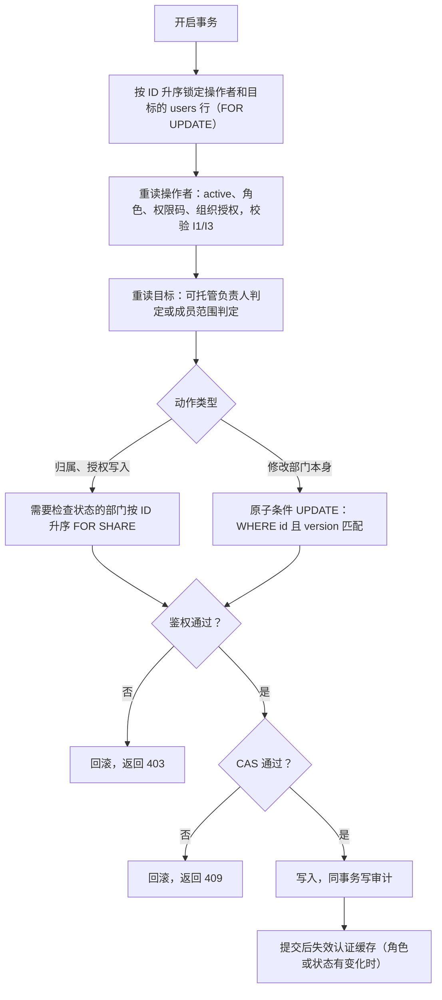

# 组织负责人权限设计

更新：2026-11-05。状态：**首版（D1–D8）已合入 main（`26f6363af`）。2026-11-04 用户提出权限扩展（§1.1，决策 D9–D12），2026-11-05 按设计审核补齐 5 处缺口后，用户确认 D11 写入范围，扩展已在分支 `feature/hy/10229_organization_leader_powers` 实现（未提交、未部署）。线上尚未配置任何组织或部门负责人。D9/D10 取代原 D5。**

本文是组织负责人功能的唯一文档，包含需求、规则、接口、代码位置、易错点和验证方式。审核原文不保留在仓库中，凡是对后续修改有约束的结论都已写入正文。前置功能：[组织、部门与多平台用量报表设计](organization-department-usage-design-cn.md)、[部门负责人管理本部门成员设计](department-member-management-design-cn.md)。

阅读顺序建议：
- 修改权限或范围：先读 §3 和 §14；
- 修改接口：读 §5；
- 定位代码：读 §10；
- 跑测试或验收：读 §15、§16。

## 1. 需求与闭环检查

用户需求（2026-11-03）：

- 新增"组织负责人"角色，可以创建本组织的部门、分配部门负责人；
- 具备部门负责人的全部权限，范围是整个组织；
- 此前只有完整管理员能做这些；组织负责人只能被授权为某些部门的负责人，看不到整个组织。

"组织负责人 = 部门负责人的全部能力 × 全组织范围 + 新建部门 + 任命负责人"能构成三级结构。但照原描述直接实现有 9 处不闭环，需要补规则：

| # | 缺口 | 不补会怎样 | 规则 |
| --- | --- | --- | --- |
| G1 | "任命负责人"本质是提权：要把普通用户改成 `sub_admin` 并写入权限码 | 组织负责人可以把任何人变成后台账号，或授出超出自己的权限 | 只能任命本组织 active 的普通用户；只能授出自己持有的三项部门能力；只能授权本组织的部门（§4.1） |
| G2 | 权限码挂在用户上，部门授权挂在部门上 | 某负责人还有其他组织的部门授权或全站权限时，组织负责人改他的勾选，会连带改变他在组织外的能力 | 定义"可托管负责人"；不满足条件的负责人只读显示"由管理员维护"（§3.3） |
| G3 | 撤销负责人时只删授权，会留下"有权限码、无范围"的 `sub_admin` | 无效后台账号越积越多，组织负责人又清理不了 | 撤销 = 删授权 + 清权限码 + 降回 `user`，同一事务完成（§4.1） |
| G4 | "整个组织"不等于各部门之和：未分配成员不属于任何部门；按部门逐个授权时，新建的部门不会自动进入范围 | 看不到未分配的人；报表组织总数对不上；每建一个部门都要管理员补授权 | 新增组织级授权，范围按组织动态计算，包含未分配成员（§3、§4.7） |
| G5 | 部门负责人能启用组织负责人停用的成员 | 下级可以撤销上级的决定 | 停用来源增加 `organization_manager` 等级，只升不降（§4.4） |
| G6 | 组织负责人之间、组织负责人对自己 | 互相任命或修改权限，构成横向提权 | 组织负责人只能由完整管理员配置；任何负责人都不能操作自己（§2） |
| G7 | 部门订阅额度重置原先不排除操作者本人和管理员账号（`checkDepartmentSubscription` 与批量重置候选查询） | 组织负责人必然在自己的组织范围内，可以无限重置自己的额度 | 所有按范围限定的重置都排除本人和 `admin`；部门负责人只能重置普通用户（§4.5） |
| G8 | `other` 组织包含所有外部注册用户 | `other` 的负责人可以把任意外部用户提升为后台账号 | 只开放迅游、速宝（D1） |
| G9 | 组织负责人原有的部门授权 | 三项能力是账号级的，会把他原来只读的其他组织部门顺带开放成员管理和额度重置；若按"部门授权 ∪ 组织授权"判断，还会获得那个部门的组织级能力 | 组织负责人不能持有任何部门授权（D8）；组织管理动作只按组织授权判断；两者并存时一律拒绝（§3.1、§3.2） |

另外两点已确认边界，不算缺口：组织负责人可以编辑、停用、恢复部门（D2），可以在组织内一步转岗（D3）。

### 1.1 2026-11-04 权限扩展

用户需求（2026-11-04）：

- 组织负责人可以重置本组织所有人的额度（D9：包括 `admin` 和本人）；
- 部门负责人可以重置包含自己在内的额度（D10：本人 + 授权部门内全部非 `admin` 成员）；
- 组织负责人可以为本组织的人分配、延期、撤销（删除）、恢复订阅（D11）；
- 组织负责人可以删除本组织用户、重置密码（D12），具备"本组织范围内接近管理员"的权限。
- 前提：线上还没有配置任何组织或部门负责人，取代 D5 不涉及存量账号的行为变化。

扩展打破了首版两条不变式（"下级不能操作上级或同级"、"负责人不能操作自己"），只对额度重置和组织负责人的订阅写入放开（§2）。逐项补的规则：

| # | 缺口 | 不补会怎样 | 规则 |
| --- | --- | --- | --- |
| G10 | 后台重置不限次数、不计自助次数；负责人可以重置自己 | 负责人的日额度上限对自己失效（原 G7 的风险） | 用户接受该风险（D9/D10）。重置本人在审计里单独标记 `extra.self=true`，便于管理员复查；不新增次数限制（§4.5） |
| G11 | "重置对象"与"可管理对象"不再相同：组织负责人能重置 `admin`，但不应能撤销 `admin` 的订阅或删除 `admin` | 若沿用"一个谓词管所有订阅入口"，要么 `admin` 的订阅也能被撤销，要么看得到却重置失败 | 订阅入口拆成两个谓词：可见/可重置对象 `subscriptionResetTargets`，可写订阅对象 `subscriptionManageTargets`；列表逐行返回 `can_manage`，界面按它隐藏写操作（§4.5、§4.8） |
| G12 | 分配订阅等于把付费资源给出去；`admin.subscriptions`（全站分配）与 `admin.department_subscriptions` 互斥 | 组织负责人要么拿不到分配能力，要么拿到全站分配能力 | 不复用全站权限码；组织级订阅写入随 `admin.organization_manage` 捆绑（D7 的固定捆绑扩大），目标在事务内按组织校验；可分配分组与全站订阅子管理员相同（`SubscriptionAssignmentGroups`）（§4.8） |
| G13 | 批量分配的部分用户越权 | 部分写入、部分拒绝，结果难以核对 | 整批先鉴权，任一目标越权整批 403、不写入（与 §4.3 一致） |
| G14 | 删除用户会软删账号并删除其全部 API Key，不可由组织负责人撤销 | 误删或越权删除负责人、管理员 | 只能删除本组织 `role=user`、非本人；负责人须先撤销身份再删除；带成员 CAS；前端二次确认（§4.9） |
| G15 | 重置密码后组织负责人可以用该账号登录，查看其 API Key、余额等（冒用） | 权限从"管理"扩大到"以他人身份操作" | 用户接受（D12）。只对本组织 `role=user`；密码变化使该用户已有会话失效；审计记录操作者与目标，不记录密码（§4.9） |
| G16 | `/admin/users*` 一组接口包含角色、权限、余额、并发、分组、平台额度等全局能力 | 开放给组织负责人会越过本文所有范围规则 | `/admin/users*` 仍只给完整管理员；组织负责人用新增的 `/admin/organization/users/*` 专用接口，只做删除与重置密码（§5.2） |
| G17 | 延期接口带幂等：同一幂等键重放时直接返回首次的存档响应，不再进入 service | 授权缩减（撤销组织授权、目标被提为管理员）后，旧键重放仍返回该订阅数据，事务内的鉴权被绕过 | 带幂等的订阅写入口在重放前按当前授权鉴权，事务内再鉴权一次（与 `prepareDepartmentReset` 相同的两处校验）（§4.8） |
| G18 | 分配弹窗对非管理员调用 `search-users` 选人，而 `search-users` 按可重置对象返回，含 `admin` | 组织负责人能选中 `admin` 等不可写对象，提交后整批 403（K9 的同类问题） | `search-users` 增加 `purpose=assign`，按可写对象 `subscriptionManageTargets` 返回；分配弹窗只用这个模式（§4.8） |
| G19 | 订阅读取只看 active 账号，写入若按"未删除"判定 | 停用用户的订阅能被分配、撤销，却在列表里看不到，也拿不到 `can_manage` | 可写对象同样只含 active 账号，且必须是可重置对象的子集；要操作停用用户的订阅，先在「我的部门」启用（§4.8） |

## 2. 角色体系

| 角色 | 实现 | 范围 | 由谁配置 |
| --- | --- | --- | --- |
| 完整管理员 | `role=admin`，或传统全权 Admin API Key | 全站 | — |
| 组织负责人 | `sub_admin` + `admin.organization_manage` + 三项部门能力 + 组织授权；**不持有部门授权** | 授权组织内的全部部门和未分配成员 | 只有完整管理员 |
| 部门负责人 | `sub_admin` + 1–3 项部门能力 + 部门授权 | 授权部门 | 完整管理员；或本组织的组织负责人（仅限可托管负责人） |
| 普通成员 | `role=user` | 本人 | — |

受限管理密钥（`middleware/admin_auth.go` 的 `authenticateScopedAdminRequest`，策略在 `pkg/adminaccess/`）按方法和路径逐条放行，未登记即拒绝。部门管理、`department-scope` 和本功能新增的路由都没有登记，受限密钥不能调用。不能因为审计主体是 `admin` 就放宽策略。

| 能力 | 完整管理员 | 组织负责人 | 部门负责人 |
| --- | --- | --- | --- |
| 查看、导出用量报表 | 全站 | 本组织（含未分配成员和组织汇总） | 授权部门 |
| 查询订阅、重置额度 | 全站 | 本组织全部账号（含 `admin`、本人）（D9） | 本人 + 授权部门内全部非 `admin` 成员（D10） |
| 分配、延期、撤销、恢复订阅 | 全站 | 本人、本组织普通用户和可托管负责人（D11） | 否 |
| 成员加入、移出部门 | 全部 | 本组织 | 授权部门（只能从未分配成员中加入） |
| 组织内转岗 | 全部 | 本组织 | 否 |
| 启用/停用成员、修改用户名 | 全部 | 本组织的普通用户（含未分配） | 授权部门的普通用户 |
| 负责人备注 | 只读 | 本组织中已分配部门的普通用户 | 授权部门的普通用户 |
| 新建、编辑、停用、恢复部门 | 全部 | 本组织 | 否 |
| 任命、调整、撤销部门负责人 | 全部 | 本组织的可托管负责人 | 否 |
| 配置组织负责人 | 是 | 否 | 否 |
| 重置密码、删除账号 | 是 | 本组织 `role=user`，不含本人（D12） | 否 |
| 余额、并发/限额、分组、平台额度、邮箱、角色权限，访问 `/admin/users` | 是 | 否 | 否 |

不变式（实现和测试都按此校验）：

1. 下级不能操作上级或同级：部门负责人只能作用于 `role=user`；组织负责人只能作用于 `role=user` 和本组织的可托管负责人；组织负责人只能由完整管理员配置。**例外：额度重置（D9/D10）与组织负责人的订阅写入（D11）按 §4.5、§4.8 的对象范围。**
2. 任何负责人都不能操作自己（任命、改权限、启停用、转岗、删除、重置密码）。**例外：重置自己的额度（D9/D10）、给自己分配/延期/撤销/恢复订阅（D11）。**
3. 授出的能力 ⊆ 自己持有的能力；授出的范围 ⊆ 自己的组织授权。
4. 组织管理动作（部门维护、任命、转岗）只按组织授权判断，永远不使用部门授权。
5. 范围每次都在事务内从数据库重新读取，不信任客户端提交的范围，也不缓存。

## 3. 权限模型

### 3.1 权限码、组织授权与 I1–I4

- 权限码 `admin.organization_manage`，菜单键 `organization_manage`，前端路由 `/admin/departments`。
- 表 `organization_access_grants(user_id, organization_key, created_by, created_at)`，主键 `(user_id, organization_key)`，`organization_key` 用 CHECK 限定为 `xunyou`、`wsdashi`（D1）。

| 编号 | 不变量 | 说明 |
| --- | --- | --- |
| I1 | 组织授权非空 ⇔ 持有 `admin.organization_manage` | 双向 |
| I2 | 持有 `admin.organization_manage` ⇒ 同时持有 `admin.organization_usage`、`admin.department_subscriptions`、`admin.department_members` | **单向**（D7）。三项能力不能反推组织身份，普通部门负责人可以只持三项能力而没有组织授权 |
| I3 | 组织授权非空 ⇒ 部门授权为空 | D8 |
| I4 | 持有 `admin.organization_manage` ⇒ `role=sub_admin` | `NormalizeAdminPermissions` 对非 `sub_admin` 返回空权限 |

- 捆绑中含 `admin.department_subscriptions`，所以它与全站 `admin.subscriptions` 互斥的规则照旧；目标已持有全站订阅权限时，需要 `replace_global_subscriptions` 显式确认。
- 管理员可以另外授予组织负责人全站类权限（例如 `admin.usage`），这些权限组织负责人不能转授。
- 一个账号可以被授权多个组织。组织负责人本人的邮箱组织不必等于所领导的组织，但他任命的人必须属于该组织。

`NormalizeAdminPermissions(role, permissions)` 只拿到权限数组，只校验 I2、I4（缺捆绑项返回 `ErrOrganizationScopeEndpointRequired`）。I1、I3 涉及授权表，由每个写入口在事务内维护。全部写入口如下，缺一不可：

| 写入口 | 规则 |
| --- | --- |
| `POST /admin/users`（`service/admin_user.go` `CreateUser`） | 请求权限含 `admin.organization_manage` 返回 400 `ORGANIZATION_SCOPE_ENDPOINT_REQUIRED` |
| `PUT /admin/users/:id` 通用编辑（`repository/user_repo.go` `Update`） | 最终角色为 `sub_admin` 且 `admin.organization_manage` 的有无发生变化时返回 400 `ORGANIZATION_SCOPE_ENDPOINT_REQUIRED`；目标持有它时去掉捆绑能力，同样被 I2 拒绝。角色离开 `sub_admin` 时，经 `clearUserDepartmentGrants` 同事务清除组织授权和部门授权 |
| 软删除（`user_repo.go` `Delete`） | 经 `clearUserDepartmentGrants` 同事务清除组织授权 |
| `PUT /admin/users/:id/department-scope`（`department_repo.go` `SetAccess`） | 目标持有组织授权时整体拒绝，返回 400 `ORGANIZATION_SCOPE_ENDPOINT_REQUIRED` |
| `PUT /admin/users/:id/organization-scope`（§5.1） | 唯一可以写入组织授权和 `admin.organization_manage` 的入口 |
| `PUT /admin/organization/leaders/:id`（§5.2） | 目标必须没有组织授权（§3.3），只写部门授权和三项能力 |

`loadDepartmentActor` 读取操作者时同时读取组织授权（`OrganizationGrants`）。发现以下任一情况，一律返回 403 `DEPARTMENT_SCOPE_DENIED`，不取并集：
- 持有 `admin.organization_manage` 与"组织授权存在"不一致（违反 I1）；
- 组织授权与部门授权同时存在（违反 I3）。

这两种情况只可能来自缺陷或手工改库。

### 3.2 范围计算（唯一口径）

由 I3，一个 `sub_admin` 要么是组织级操作者（有组织授权），要么是部门级操作者（有部门授权或都没有）：

```text
组织级操作者（组织授权非空）：
  部门范围 = { d | d.organization_key ∈ 组织授权 }
  成员范围 = { u | 邮箱组织(u) ∈ 组织授权 }                       -- 含未分配成员

部门级操作者：
  部门范围 = { d | (actor, d) ∈ department_access_grants }
  成员范围 = { u | u.department_id ∈ 部门范围 且 部门组织 = 邮箱组织(u) }
```

- 所有部门类范围 SQL 都由 `repository/department_scope_sql.go` 生成，按操作者类型二选一，不写成 `OR` 并集。这样即使 I3 被破坏，范围也不会扩大。原先散落的 8 处 `EXISTS(... department_access_grants ...)` 已全部改走该文件。新增的范围调用点必须同样走这里。用 `grep department_access_grants` 自查：该表只应出现在 `department_scope_sql.go`、操作者与授权读取、授权写入和清理处。
- 组织范围是动态的：新建的部门、新注册的同域名用户自动进入范围。组织没有任何部门时，范围依然有效。
- 组织级成员范围按邮箱组织判定，不依赖 `d.organization_key`，所以查询必须 LEFT JOIN 部门。部门与邮箱组织不一致而落入"未分配"的历史记录，组织负责人仍能看到并重新分配。
- 三项能力码决定"能做什么"，上述范围决定"对谁做"。

### 3.3 可托管负责人

组织负责人只能修改满足以下全部条件的 `sub_admin`，判定在事务内锁行之后进行（SQL：`managedLeaderPredicate`）：

| 条件 |
| --- |
| 不是操作者本人，且未删除 |
| 邮箱组织 ∈ 操作者的组织授权 |
| 权限码 ⊆ {`admin.organization_usage`, `admin.department_subscriptions`, `admin.department_members`} |
| 没有组织授权 |
| 所有部门授权的所属组织都 ∈ 操作者的组织授权（部门授权可以为空） |

不满足条件的负责人在列表中只读展示其在操作者组织内的部门名和"由管理员维护"，不返回其组织外的授权和其他权限码。

## 4. 业务规则

### 4.1 任命、调整、撤销部门负责人

请求体 `{department_ids, report, reset_quota, manage_members, expected_version}` 为严格 JSON，五个字段都必须出现：`department_ids` 必须是数组（可以为空，不能为 null），三项能力是布尔值，`expected_version` 是字符串。字段省略、为 null 或有未知字段，返回 400。

| `department_ids` | 三项能力 | 目标为本组织 active 的 `role=user` | 目标为可托管负责人 |
| --- | --- | --- | --- |
| 非空 | 至少一项为 true | **任命**：`role` 改为 `sub_admin`，写入所选能力和部门授权 | **调整**：用请求中的集合整体替换能力和部门授权 |
| 空 | 全部为 false | 400 | **撤销**：删除部门授权，`admin_permissions=[]`，`role` 改为 `user` |
| 非空 | 全部为 false | 400 | 400 |
| 空 | 至少一项为 true | 400 | 400 |

- 每个部门都必须属于操作者的组织授权（不使用部门授权）。新增的部门必须是 active，保留的部门可以是已停用部门。
- 授出的能力 ⊆ 操作者持有的能力。在 I2 下恒成立，代码中仍然校验。
- 请求表示目标**全部**部门授权的最终集合。编辑前必须调用 `GET /admin/organization/leaders/:id`，取得完整授权和同一事务内的版本。不能用列表接口按单个组织投影出来的数据拼请求，否则会覆盖另一组织的授权。
- 多组织时，弹窗按组织分组展示全部授权，保存前显示本次新增、移除的部门；撤销负责人身份需要二次确认。"撤销某个部门""撤销某组织内的全部部门""撤销负责人身份"都表达为最终集合，不另设接口。
- 判定顺序：
  1. 本人或不可托管的目标返回 403 `ORGANIZATION_LEADER_PROTECTED`；
  2. 部门不在组织内返回 403；
  3. 版本不一致返回 409 `ADMIN_ACCESS_CHANGED`；
  4. 最后对新增部门做 `FOR SHARE` 的 active 校验，失败返回 400 `DEPARTMENT_INACTIVE`。
- 版本用 `admin_access_version`，哈希输入增加组织授权。组织授权为空的账号保持原有哈希输入，避免上线后所有打开的编辑窗口同时报 409。
- 角色或权限变化提交后失效认证缓存。降为 `user` 后，如果他属于某个部门，就重新成为该部门的可管理成员；负责人备注不因角色变化而清空。
- 新任命的负责人首次进入后台，需完成现有的合规确认（`/admin/compliance`）。
- 管理员撤销某个组织负责人时，他任命过的部门负责人保持不变：授权属于部门，`created_by` 只用于审计。
- 完整管理员在 `department-scope` 上的既有规则不变（可以保留"有能力、无授权"的状态等）；本节规则只适用于组织负责人的接口。

### 4.2 部门维护

- 新建：`organization_key` 必须 ∈ 操作者的组织授权，否则 403。
- 修改名称、排序，停用、恢复：携带 `expected_version`，执行原子条件 UPDATE（`WHERE id AND version` 并校验组织）。命中 0 行时再判定部门归属：组织外或不存在返回 403，组织内才返回 409 `DEPARTMENT_CONFLICT`。
- 沿用现有规则：组织内名称唯一、所属组织不可修改、不物理删除；停用部门保留成员和授权，但不能加入新成员或新增授权。
- 修改部门本身时**不先取 `FOR SHARE`**（原因见 §7）。

### 4.3 成员归属与转岗

组织负责人复用管理员的批量归属接口 `POST /admin/departments/assign-members`（`department_repo.go` `Assign`），增加以下限制：

- 目标部门属于操作者的组织授权且为 active，或为 `null`（移出到未分配）；目标部门不存在时，对组织负责人返回 403。
- 每个成员都必须满足 `organizationTransferTargets` 的判定：
  - 邮箱组织 ∈ 操作者的组织授权；
  - `role=user` 或可托管负责人；
  - 未删除，且不是操作者本人。
- 先对整批成员鉴权，任一不通过整批返回 403、不做任何写入；鉴权通过后再做 CAS，不通过返回 409。

成员被移出后仍在组织范围内（变为未分配），所以沿用管理员接口"目标状态已相同即视为无变化成功"的重试语义。

部门负责人的接口 `/admin/department-members/assign` 语义不变：只能从未分配成员中加入、移出本部门，不能转岗。组织负责人在「我的部门」使用的"调整部门"走 `assign-members`。

### 4.4 停用来源层级

| 来源 | 等级 | 写入者 | 可以启用的角色 |
| --- | ---: | --- | --- |
| `department_manager` | 1 | 部门负责人 | 部门负责人、组织负责人、完整管理员 |
| `organization_manager` | 2 | 组织负责人 | 组织负责人、完整管理员 |
| `other` | 3 | 完整管理员、内容审计、系统 | 完整管理员（只能在用户管理中启用） |

- 显式停用只升不降。组织负责人对 `department_manager` 停用的成员再次停用，来源升为 `organization_manager`；对 `organization_manager` 或 `other` 再次停用，来源不变。
- 操作者等级只由操作者类型决定：组织级操作者写 `organization_manager`，部门级操作者写 `department_manager`。由于 I3，不存在两种身份叠加。
- migration 262 替换 `maintain_user_disabled_source()` 和 CHECK 约束：按等级比较，降级时触发 23514；不修改已应用的 migration 261。仅改用户名、备注、余额时，不影响停用来源。
- `can_enable` 按操作者等级计算（`enableableDisabledSources`）。完整管理员经成员接口可以解除 `department_manager` 和 `organization_manager` 两级停用。
- 用户管理页和「我的部门」都显示"组织负责人停用"标签。

### 4.5 订阅可见与额度重置的对象

| 操作者 | 可查询、可重置的对象（`subscriptionResetTargets`） |
| --- | --- |
| 部门负责人 | 本人（不要求本人是部门成员）+ 授权部门内全部 active 成员，`role` 为 `user` 或 `sub_admin`（含其他部门负责人、组织负责人、受限账号运维等），不含 `admin`（D10） |
| 组织负责人 | 本人 + 邮箱组织 ∈ 组织授权的全部 active 账号，含 `admin`、其他组织负责人、其他子管理员、未分配成员（D9） |
| 完整管理员、持全站订阅权限的子管理员 | 不变 |

- D9/D10 取代原 D5。原 G7 的风险（负责人可无限重置自己）由用户接受；重置本人时部门审计写 `extra.self=true`（§8）。
- 所有订阅**读取和重置**入口使用同一个对象谓词 `subscriptionResetTargets`：列表、详情、进度、`search-users`、`search-groups`、按用户/分组列订阅、单条重置、按筛选批量重置。这样不会出现"能看到但重置失败"，也无法从某个入口绕过过滤。
- 订阅**写入**（分配、延期、撤销、恢复）只对组织负责人开放，用更窄的 `subscriptionManageTargets`（§4.8），它必须是 `subscriptionResetTargets` 的子集（同样只含 active 账号）。列表和详情逐行返回 `can_manage`，值与写入校验出自同一个谓词；前端只按它显示写操作按钮。
- 组织级操作者在这些入口中按邮箱组织判定并 LEFT JOIN 部门，未分配成员的订阅同样可查可重置；本人的订阅即使邮箱组织不在授权内也可见、可重置。
- 范围变化使 `scope_version` 变化；线上尚未配置负责人，无存量快照兼容问题。

### 4.6 用量报表与版本

- 组织负责人：
  - 组织选项为授权组织，即使该组织还没有部门；
  - 部门选项为组织内全部部门（含已停用），并且可以选择 `unassigned`；
  - 组织汇总按全组织口径，与完整管理员看到的结果一致（包含该组织邮箱下 `admin` 账号的用量，只读）；
  - `organization=all` 表示全部授权组织。
- `DepartmentScope.FullOrganizations` 表示可按全组织口径查看的组织。`ValidateSelection` 和报表仓储（`organization_usage_department_repo.go` 的 `breakdowns`）判断"未分配/组织汇总"时，条件是"`Unrestricted`，或组织 ∈ `FullOrganizations`"。组织级操作者的 `Organizations` 直接取 `FullOrganizations`。**不得**为了绕过"没有部门即拒绝"而把 `Unrestricted` 设为 true。
- `catalog_version`、`scope_version` 的哈希输入只在 `FullOrganizations` 非空时追加组织信息；组织授权为空的操作者保持原有输入结构。但"输入结构不变"不等于"版本不变"：订阅对象集合（首版 D5，扩展后 D9/D10）一变，实际成员集合就变，`scope_version` 必须变化，旧快照按 409 拒绝。
- 授权缩减后，旧页面继续翻页、导出或重置时，先按最新授权鉴权：选中的组织已不在授权内返回 403；仍在授权内但成员集合变化返回 409 `REPORT_SCOPE_CHANGED`。

### 4.7 「我的部门」与未分配成员

- 组织负责人的部门选择器包含组织内全部部门和各授权组织的"未分配"（选项值 `unassigned:<组织>`）。选"全部"时包含授权组织的未分配成员。
- 部门负责人看不到、也不能管理未分配成员，只能在"添加成员"候选中搜索到他们；请求 `unassigned` 返回 400。
- 可管理行（`manageable`）只有 `role=user`。特权账号（`sub_admin`、`admin`，含组织负责人）在成员列表中只读显示：没有任何操作，不返回负责人备注。它们的订阅是否可见、可重置另按 §4.5（D9/D10 后可见、可重置），订阅写操作按 `can_manage`（§4.8）。
- 组织没有任何部门时，组织负责人也能打开页面管理未分配成员：`ManagedScope` 对组织级操作者以 `FullOrganizations` 非空作为放行条件。

未分配成员的接口合同（只对组织级操作者放开，部门级操作者保持原样）：

| 项 | 合同 |
| --- | --- |
| 成员 DTO | `ManagedDepartmentMember.DepartmentID *int64`、`DepartmentName *string`；TS 为 `number \| null`、`string \| null`。未分配行返回 null 和当前 `department_version` |
| 列表与更新的 SQL | 组织级操作者不加 `d.id IS NOT NULL`，改用 LEFT JOIN 加邮箱组织谓词 |
| 更新的成员 CAS | `expected_department_id` 省略返回 400；显式 `null` 表示"确认目标当前未分配"（handler 读原始 JSON，设置 `ExpectedUnassigned`），与 `expected_department_version` 一起做 CAS。前端始终发送该字段 |
| 允许的操作 | 启用/停用、修改用户名、经"调整部门"加入部门 |
| 负责人备注 | 未分配成员写备注返回 400 `DEPARTMENT_INVALID`：备注跟随部门归属周期，加入部门时会被清空 |
| 旧页面 | "未分配 → 某部门 → 未分配"之后，旧页面用旧版本提交返回 409（`department_version` 每次归属变化都递增） |

### 4.8 组织负责人的订阅写入（D11）

| 项 | 规则 |
| --- | --- |
| 动作 | 单个分配 `assign`、批量分配 `bulk-assign`、延期 `:id/extend`、撤销 `:id/revoke`（`DELETE :id` 同义，即"删除订阅"）、恢复 `:id/restore`。`bulk-action`（批量延期/撤销）不开放 |
| 可写对象 `subscriptionManageTargets` | 本人 + 本组织（邮箱组织 ∈ 组织授权）active 的 `role=user` + active 的可托管负责人（§3.3，`managedLeaderPredicate`）。**不含 `admin`、其他组织负责人、不可托管的子管理员**：这些账号的订阅只读、可重置（§4.5）。写入沿用首版"下级"层级，只放开本人。可写对象必须是可重置对象（§4.5）的子集：停用用户的订阅既不可见也不可写，要操作先在「我的部门」启用（受 §4.4 停用来源层级约束，管理员停用的账号由管理员处理）（G19） |
| 分配候选 | `GET /admin/subscriptions/search-users?purpose=assign`：按 `subscriptionManageTargets` 返回，与写入校验同一谓词；分配、批量分配弹窗只用这个模式。不带 `purpose` 时仍按 §4.5 的可重置对象返回（筛选用）。部门负责人带 `purpose=assign` 返回 403；完整管理员、全站订阅子管理员行为不变；`purpose` 为其他值返回 400（G18） |
| 可分配分组 | 与全站订阅子管理员相同：`SubscriptionAssignmentGroups` 返回的启用中订阅型分组；有效期上下限、分组状态（停用分组不能新建订阅，`GROUP_NOT_ACTIVE`）沿用管理员规则 |
| 与全站订阅子管理员的差别 | 全站订阅子管理员（`admin.subscriptions`）的路由白名单只有分配、批量分配和额度重置，没有延期、撤销、恢复；组织负责人按用户选择（D11）多出这三项，但只限本组织的可写对象。全站订阅子管理员的行为不变 |
| 鉴权位置 | handler 不信任请求里的用户 ID；service/仓储在写事务内锁目标 `users` 行后重读范围，越权返回 403 `DEPARTMENT_SCOPE_DENIED`。延期/撤销/恢复先按订阅 ID 取所属用户再判定，订阅不存在与越权同样返回 403，不披露存在性 |
| 幂等重放 | 延期（`admin.subscriptions.extend`）带幂等，重放不经过 service。组织负责人请求在进入幂等执行**之前**先按当前授权做一次只读鉴权（同上，403 不披露存在性），事务内再鉴权一次；授权缩减后用旧键重放返回 403，不返回存档响应（G17）。分配、撤销、恢复目前不带幂等，今后若加，同样遵守 |
| 批量分配 | 一个事务：先按 ID 升序锁操作者和全部目标并重读范围，任一目标越权整批 403、无写入（G13）；锁保持到提交，期间提权、撤权都要等待。鉴权通过后逐人写入，每人一个 SAVEPOINT：该人的业务失败（如已有订阅冲突、审计写入失败）只回滚该人并计入逐人结果；范围类错误（`DEPARTMENT_SCOPE_DENIED`、`REPORT_SCOPE_CHANGED`）或 SAVEPOINT 本身失败则整批回滚返回错误，不混入逐人结果（K20） |
| 幂等与复用 | 沿用 `assignSubscriptionWithReuse` 的复用/续期语义 |
| 响应 | 经 `adminSubscriptionResponse` 投影，与部门订阅一致（不返回 `assigned_by`、`notes` 等） |
| 部门负责人 | 仍不能分配、延期、撤销、恢复订阅（部门功能首版需求）：写路由不在其白名单内（403 `ADMIN_PERMISSION_DENIED`）；即使绕过白名单，事务内鉴权要求 `admin.organization_manage` 与组织授权，也返回 403 |
| 实现 | 由 `SubscriptionService` 的 `AssignSubscription`、`BulkAssignSubscription`、`ExtendSubscription`、`RevokeSubscription`、`RestoreSubscription` 入口判定：只有 JWT 子管理员（`HasSubAdminAccountRestrictions`）且不持 `admin.subscriptions` 时走范围写入；完整管理员、管理密钥、全站订阅子管理员、兑换/支付等系统上下文保持原路径。范围写入每次单独开事务，鉴权、写入、审计同事务，提交后再失效一次订阅缓存 |

### 4.9 组织负责人的用户管理（D12）

| 动作 | 接口 | 对象 | 规则 |
| --- | --- | --- | --- |
| 重置密码 | `POST /admin/organization/users/:id/password` | 本组织 `role=user`、未删除、非本人，不限启停用状态 | 严格 JSON `{password}`，密码强度沿用管理员改密校验。鉴权、写 `password_hash`、审计 `organization.user_password_reset`（不记录密码）在同一事务内。旧会话失效不需要额外写入：`TokenVersion` 没有数据库列，由 `email+password_hash` 指纹推导（`resolvedTokenVersion`），新密码使旧 access/refresh token 校验失败，与管理员改密一致 |
| 删除用户 | `DELETE /admin/organization/users/:id` | 同上 | 严格 JSON `{expected_department_id, expected_department_version}`（与成员更新同一 CAS，`expected_department_id` 可为 null 表示未分配）。鉴权、CAS、删除 API Key、软删账号、审计 `organization.user_delete` 在同一事务内，提交后失效认证缓存（见下方"删除与改密的事务"） |
| 已有能力 | `/admin/department-members/*` | 见 §4.7 | 启用/停用、修改用户名、负责人备注不变；管理员备注仍不披露 |

删除与改密的事务（现有删除链路不能直接复用）：

- 现状：`adminServiceImpl.DeleteUser` 在事务外读用户、列 API Key；仓储 `userRepository.deleteUser` 先调 `prepareUserAdminAccessWrite`，其中 `loadDepartmentActor(ctx, q, "")` 只放行 `role=admin`，组织负责人调用会返回 403。**不得放宽这项检查**，它是管理员删除路径的守卫。
- 做法：把 `deleteUser` 中"清理授权、删除身份关联、软删用户"拆成不含操作者检查的内部步骤，管理员路径和组织路径共用；管理员路径保持现有检查和行为不变。
- 组织路径在一个 Ent 事务内依次执行（审计用 `departmentAudit` 写在同一事务，Ent 事务 client 可作为 `sqlExecutor`）：
  1. `lockDepartmentUsers` 按 ID 升序锁操作者和目标的 `users` 行；
  2. `loadDepartmentActor(ctx, q, AdminPermissionOrganizationManage)` 重读操作者（active、权限码、组织授权、I1/I3）；
  3. 重读目标：未删除、`role=user`、非本人、邮箱组织 ∈ 组织授权，否则 403（目标不存在也是 403）；
  4. 删除时校验 `expected_department_id` / `expected_department_version`，不符返回 409；
  5. 在锁内列出目标的 API Key，逐个 `DeleteWithAudit`（复用事务），再执行共用的删除步骤；
  6. 写审计，提交；提交后按 Key 和用户 ID 失效认证缓存。
- 改密同样按 1–3 鉴权后写 `password_hash` 和审计，再提交。
- 任一步失败整体回滚：不会出现"Key 已删、用户未删"或"有审计、无删除"。

- 负责人（`sub_admin`）不能被组织负责人直接删除或改密：先在负责人弹窗撤销身份（降回 `user`）再操作。
- 不开放：创建用户、改邮箱、余额、并发/限额、替换分组、平台额度、角色与权限码、API Key 管理、`/admin/users*`（G16）。
- 前端入口在「我的部门」可管理行的操作菜单：重置密码（输入框 + 确认）、删除（二次确认，显示将删除其 API Key）。

## 5. 接口合同

路径都以 `/api/v1` 为前缀。

### 5.1 配置组织负责人（仅完整管理员）

| 方法与路径 | 内容 |
| --- | --- |
| `GET /admin/users/:id/organization-scope` | 复用 `department-scope` 的读取处理：返回 `organizations`、`permissions`、目标现有的 `department_ids`（用于转换确认）、`version` |
| `PUT /admin/users/:id/organization-scope` | 严格 JSON `{organizations, expected_version, replace_global_subscriptions, replace_department_grants}`；目标必须已是 `sub_admin`。`organizations` 必须显式为数组：省略或 null 返回 400，只有 `[]` 表示撤销。`expected_version` 必须是非空字符串。两个确认开关可以省略，省略视为 false，只有 JSON `true` 表示确认 |

- `organizations` 非空：写入组织授权，补齐四项捆绑权限。目标仍有部门授权时，`replace_department_grants` 必须为 true，否则返回 400 `ORGANIZATION_DEPARTMENT_GRANTS_CONFIRMATION_REQUIRED` 且不做任何写入；为 true 时在同一事务内删除这些部门授权并写审计（D8，不静默删除）。
- `organizations` 为 `[]`：删除组织授权和 `admin.organization_manage`，保留三项能力，账号回到"有能力、无授权"的合法状态（数据查询与重置均拒绝）。之后管理员可以在 `department-scope` 中给他分配部门，或在通用编辑中调整。
- 加锁、版本、审计（`organization.grant_scope`）沿用 `department-scope` 的做法；成功后失效认证缓存。

### 5.2 组织负责人可用的接口（`admin.organization_manage` 路由白名单）

| 方法与路径 | 说明 |
| --- | --- |
| `GET /admin/organization/scope` | 返回授权组织（`full_organizations`）、组织内部门、可转授的能力（`delegable_permissions`） |
| `GET /admin/departments` | 复用；非管理员只返回授权组织的部门；组织参数越权返回 403 |
| `POST /admin/departments` | 复用；`organization_key` 越权返回 403 |
| `PUT /admin/departments/:id` | 复用；按 §4.2 判定 |
| `GET /admin/departments/members`、`GET /admin/departments/:id/members` | 复用；组织或部门越权返回 403；`unassigned` 只能用于授权组织。每行是 `DepartmentMemberRow`（内嵌 `DepartmentMember`，另加 `manageable`）：完整管理员恒为 true；组织负责人用 `organizationTransferTargets` 判定，与 `Assign` 是同一个查询 |
| `POST /admin/departments/assign-members` | 复用；按 §4.3 限制 |
| `GET /admin/organization/leaders` | 参数 `organization`、`q`、分页。列出本组织邮箱的 `sub_admin`，以及持有本组织部门授权的 `sub_admin`（不含 `admin` 和本人）。字段：`id, email, username, departments`（只含本组织部门）`, permissions`（仅可托管时返回）`, managed`。只用于浏览，不作为编辑快照 |
| `GET /admin/organization/leaders/:id` | 编辑前读取。可托管负责人：返回全部部门授权（按组织分组）、三项能力和同一事务内的 `version`；不可托管：返回 403 `ORGANIZATION_LEADER_PROTECTED`，不披露组织外的授权和其他权限码 |
| `GET /admin/organization/leader-candidates` | 参数 `organization`、`q`（去空格后至少 2 个字符），最多 20 条：本组织 active 的普通用户 `id, email, username, department, version` |
| `PUT /admin/organization/leaders/:id` | 按 §4.1 处理任命、调整、撤销 |
| `GET /admin/subscriptions/assignable-groups` | 复用（D11）；可分配分组，与全站订阅子管理员相同 |
| `POST /admin/subscriptions/assign`、`POST /admin/subscriptions/bulk-assign` | 复用（D11）；目标按 §4.8 在事务内校验，批量整批鉴权 |
| `POST /admin/subscriptions/:id/extend`、`POST /admin/subscriptions/:id/revoke`、`DELETE /admin/subscriptions/:id`、`POST /admin/subscriptions/:id/restore` | 复用（D11）；先取订阅所属用户，再按 §4.8 校验；延期在幂等重放前也校验（G17） |
| `GET /admin/subscriptions/search-users?purpose=assign` | 复用并新增参数（D11）；分配候选按可写对象返回（G18）。路由本身已在 `admin.department_subscriptions` 白名单内 |
| `POST /admin/organization/users/:id/password` | 新增（D12）；§4.9 |
| `DELETE /admin/organization/users/:id` | 新增（D12）；§4.9 |

- 部门管理与订阅写路由加入了 `admin.organization_manage` 的白名单，因此这些复用接口在服务/仓储层逐个按组织授权校验范围，并用篡改参数的测试覆盖。订阅写路由对完整管理员和全站订阅子管理员的行为不变；部门负责人（无 `admin.organization_manage`）调用仍返回 403 `ADMIN_PERMISSION_DENIED`。
- `/admin/organization/*` 只对组织负责人开放，完整管理员调用返回 403 `DEPARTMENT_SCOPE_DENIED`；管理员使用 `department-scope`、`organization-scope` 和用户管理。
- `department-scope`、`organization-scope` 和 `/admin/users*` 不对组织负责人开放；`bulk-action` 不开放。

### 5.3 现有部门能力接口

`/admin/department-members/*`、组织用量报表、部门订阅相关接口的路径不变，范围按 §3.2 扩展，未分配成员合同见 §4.7。

### 5.4 错误码

| 错误码 | HTTP | 前端处理 |
| --- | ---: | --- |
| `ORGANIZATION_LEADER_PROTECTED` | 403 | 提示"该账号由管理员维护"，刷新列表 |
| `ORGANIZATION_SCOPE_ENDPOINT_REQUIRED` | 400 | 提示到"组织负责人"配置中修改 |
| `ORGANIZATION_DEPARTMENT_GRANTS_CONFIRMATION_REQUIRED` | 400 | 列出将被清除的部门授权，要求管理员确认 |

`DEPARTMENT_SCOPE_DENIED`、`DEPARTMENT_CONFLICT`、`DEPARTMENT_INVALID`、`ADMIN_ACCESS_CHANGED`、`DEPARTMENT_INACTIVE`、`DEPARTMENT_MEMBER_ENABLE_DENIED`、`REPORT_SCOPE_CHANGED` 沿用原有含义。映射在 `frontend/src/utils/departmentErrors.ts`（`DEPARTMENT_INVALID` 对应 `invalidRequest` 文案）。

### 5.5 动作矩阵与拒绝顺序

"组织级"列指组织负责人，"部门级"列指部门负责人；"—"表示该角色没有此动作。

| 动作 | 接口 | 必要能力 | 组织级范围 | 部门级范围 | 可操作目标 | 状态 / CAS |
| --- | --- | --- | --- | --- | --- | --- |
| 查看、导出报表 | 组织用量报表 | `organization_usage` | 授权组织全部成员，含未分配；零部门组织有效 | 授权部门成员 | 只读，不限角色 | `scope_version` |
| 查询订阅、重置额度 | 订阅入口（§4.5） | `department_subscriptions` | 本人 + 组织全部账号（含 `admin`），含未分配 | 本人 + 授权部门全部非 `admin` 成员 | active | 批量重置沿用幂等键与 `scope_version` |
| 分配、延期、撤销、恢复订阅 | 订阅写入口（§4.8） | `organization_manage` | 本人 + 组织 `role=user` + 可托管负责人 | — | active；不含 `admin`、其他组织负责人、不可托管子管理员 | 锁目标用户行；批量整批鉴权；延期在幂等重放前鉴权 |
| 重置密码 | `POST /admin/organization/users/:id/password` | `organization_manage` | 组织 `role=user`，含未分配 | — | 不含本人；不限启停用 | 锁目标用户行，鉴权与写入同事务 |
| 删除用户 | `DELETE /admin/organization/users/:id` | `organization_manage` | 组织 `role=user`，含未分配 | — | 不含本人；不限启停用 | `expected_department_id`（可为 null）+ `expected_department_version`；鉴权、CAS、删除、审计同事务 |
| 成员列表 | `GET /admin/department-members` | `department_members` | 组织内部门 + 未分配 | 授权部门 | 全部显示；`role=user` 可操作；特权账号只读，不返回负责人备注 | — |
| 加入、移出本部门 | `POST /admin/department-members/assign` | `department_members` | 组织内 active 部门 | 授权部门 | `role=user` | 每人 `expected_department_id` / `version` |
| 启停用、改用户名 | `PUT /admin/department-members/:id` | `department_members` | 组织成员，含未分配 | 授权部门成员 | `role=user`，不含本人 | `expected_department_id`（可为 null）+ `version` |
| 负责人备注 | 同上 | `department_members` | 组织内已分配部门的成员 | 授权部门成员 | `role=user` | 同上 |
| 转岗 | `POST /admin/departments/assign-members` | `organization_manage` | 组织内 active 部门或未分配 | — | `role=user` 或可托管负责人，不含本人 | 每人 `expected_department_id` / `version` |
| 部门列表、部门成员 | `GET /admin/departments*` | `organization_manage` | 授权组织 | — | 成员全部显示；`manageable` 与"转岗"一行的可操作目标一致，其余只读、不可勾选 | — |
| 新建部门 | `POST /admin/departments` | `organization_manage` | `organization_key` ∈ 组织授权 | — | — | 同组织重名 409 |
| 编辑、停用、恢复部门 | `PUT /admin/departments/:id` | `organization_manage` | 部门所属组织 ∈ 组织授权 | — | — | `expected_version`，原子条件 UPDATE |
| 负责人列表、详情 | `GET /admin/organization/leaders*` | `organization_manage` | 授权组织 | — | — | 详情返回 `version` |
| 任命、调整、撤销 | `PUT /admin/organization/leaders/:id` | `organization_manage` | 部门 ∈ 组织内部门 | — | active 普通用户或可托管负责人 | `expected_version`（`admin_access_version`） |
| 配置组织负责人 | `PUT /admin/users/:id/organization-scope` | 完整管理员 | — | — | `sub_admin` | `expected_version` |

统一拒绝顺序：
1. 请求格式错误（未知字段、缺字段、类型错误）返回 400；
2. 锁内重读后鉴权失败（能力、范围、目标是否可操作）返回 403；
3. CAS 冲突返回 409。

部门停用等业务状态错误沿用各接口原有的判定位置。目标在本次请求前已变得不可操作时，一律先返回 403，不因版本也已变化而返回 409。

## 6. 数据模型与迁移

`backend/migrations/262_organization_leader.sql`：

- 新建 `organization_access_grants`：外键 `ON DELETE RESTRICT`，反向索引 `(organization_key, user_id)`；
- `users_disabled_source_check` 改为三个取值；`CREATE OR REPLACE FUNCTION maintain_user_disabled_source()` 用 CASE 计算等级，原状态为 disabled 且新等级低于旧等级时触发 23514；
- 不需要回填，上线时还没有组织负责人。

I1–I3 跨表，不用数据库触发器强制，由 §3.1 的写入口在事务内维护；`loadDepartmentActor` 读取时对违例拒绝（fail closed）。

没有 Ent schema。Ent 的复合主键只支持连接两个实体的边表（`department_access_grant.go` 是 User 与 Department 之间的 Through 表），组织键不是实体，`ent generate` 会失败。该表只通过原生 SQL 访问。

## 7. 事务与并发

所有写操作沿用部门写入锁协议，锁顺序为 `users → departments → 授权表`：



部门锁按用途区分：

- 归属变更、新增授权只需确认部门存在且为 active，用 `FOR SHARE`，多个部门按 ID 升序加锁。保留的已有授权不要求 active。
- 修改部门本身（改名、排序、停用、恢复）**不先取 `FOR SHARE`**，直接执行原子条件 UPDATE。否则两个事务各持同一部门的共享锁再同时 UPDATE，会互相等待而死锁：PostgreSQL 终止其中一方，返回 40P01，而不是约定的 409。

| 并发场景 | 结果 |
| --- | --- |
| 管理员撤销组织负责人，同时他在任命负责人或新建部门 | 双方都锁组织负责人的用户行，串行执行；撤销先提交时，他的写操作锁内重读到无授权，返回 403 |
| 两个组织负责人同时调整同一个负责人 | 锁目标用户行并做版本 CAS，后提交者返回 409 |
| 组织负责人撤销某负责人，同时该负责人在操作成员 | 双方都锁该负责人的用户行；撤销提交后，成员操作重读权限，返回 403 |
| 管理员把目标改成持有全站权限，同时组织负责人在调整他 | 管理员先提交：组织负责人锁内重读到目标已不可托管，返回 403（不是 409）；组织负责人先提交：管理员按版本返回 409 |
| 两个组织负责人同时编辑或停用同一部门 | 后到者在行锁上等待；前者提交后，后者的条件 UPDATE 命中 0 行，返回 409；不得出现 40P01 或 500 |
| 停用部门，同时向该部门转岗或新增授权 | 转岗/授权先拿到 `FOR SHARE`：停用等待其提交，已有成员和授权保留；停用先提交：转岗/授权读到 inactive，返回 400 `DEPARTMENT_INACTIVE` |
| 组织负责人删除用户，同时管理员把该用户提为 `sub_admin` 或组织负责人把他任命为部门负责人 | 双方都锁该用户行：提权先提交，删除锁内重读到 `role=sub_admin`，返回 403；删除先提交，提权读到用户已删除而失败 |

## 8. 审计

| action | extra |
| --- | --- |
| `organization.grant_scope` | 管理员配置组织授权的前后值，含因 D8 被清除的部门授权 |
| `organization.leader_appoint` / `organization.leader_update` / `organization.leader_revoke` | 目标用户，以及前后的角色、能力、部门授权；只在有实际变化时写 |
| `organization.clear_user_grants` | 角色变更或删除账号时清理的组织授权 |
| `department.save`、`department.assign_members`、`department.manager_update_member` | 沿用；组织负责人操作时 `extra.actor_scope=organization`（`withActorScope`） |
| 部门订阅重置（单条、批量） | 沿用；目标含操作者本人时 `extra.self=true`（G10） |
| `organization.subscription_assign` / `organization.subscription_extend` / `organization.subscription_revoke` / `organization.subscription_restore` | 组织负责人的订阅写入：目标用户、订阅、分组、有效期变化；本人为目标时 `extra.self=true` |
| `organization.user_password_reset`、`organization.user_delete` | 目标用户与删除的 API Key 数；不记录密码；与写入同事务（§4.9） |

## 9. 前端

| 范围 | 实现 |
| --- | --- |
| 管理员用户管理 | `UserEditModal.vue` 打开 `OrganizationScopeDialog.vue`：选择组织，说明四项权限捆绑授予；目标有部门授权或全站订阅权限时需勾选替换确认；只有提交 `[]` 才撤销。`admin.organization_manage` 在通用权限勾选中始终锁定，组织负责人的三项捆绑能力也锁定；`UserCreateModal.vue` 不提供该选项。`UsersView.vue` 状态列显示"组织负责人停用" |
| 部门管理 `DepartmentsView.vue` | 组织负责人模式：组织选项来自 `/admin/organization/scope` 的 `full_organizations`；隐藏授权弹窗，改为"部门负责人"弹窗 `OrganizationLeaderDialog.vue`（列表、候选、编辑三视图；编辑读取详情接口，按组织分组显示增删；撤销需点击两次确认）；不调用 `/admin/users` 等完整管理员接口 |
| 部门成员弹窗 `DepartmentMembersDialog.vue` | 只能勾选 `manageable` 的行；不可操作的行显示"只读"并禁用复选框，"选择本页"也跳过（`selectable`）。添加模式仍跳过已在目标部门的成员 |
| 我的部门 `MyDepartmentView.vue` | 组织负责人：部门选项包含 `unassigned:<组织>`；未分配行的部门列为空，备注不可编辑；可管理行有"调整部门"入口（走 `departmentsAPI.assign`），"移出"只对已分配成员提供；停用来源显示"组织负责人停用" |
| 订阅、报表 | `SubscriptionsView.vue`、`OrganizationUsageView.vue`、`OrganizationUsageFilters.vue`：`full_organizations` 中的组织可以选择"未分配"；不可重置的对象不出现在列表中。组织负责人在订阅页显示分配/批量分配按钮，分配弹窗的用户搜索带 `purpose=assign`（`searchAssignmentUsers`），行内延期、撤销、恢复只对 `can_manage=true` 的行显示（D11）；部门负责人不显示写操作 |
| 用户管理（D12） | 「我的部门」可管理行增加"重置密码""删除用户"（仅组织负责人），删除二次确认并提示会删除 API Key；不调用 `/admin/users*` |
| 导航与落地 | `AppSidebar.vue`、`router/index.ts`（`/admin/departments` 的 `adminPermission`）、`utils/adminPermissions.ts`（持有组织管理码时首先落地到部门管理页）、中英文文案（`i18n/locales/*/admin/departments.ts`、`overview.ts`） |

## 10. 代码地图

| 范围 | 位置 |
| --- | --- |
| 迁移 | `backend/migrations/262_organization_leader.sql` |
| 权限码与白名单 | `service/admin_permission.go`：`AdminPermissionOrganizationManage`、目录项、路由白名单、`OrganizationLeaderDepartmentPermissions`、`NormalizeAdminPermissions` 的 I2 校验 |
| 统一范围 SQL | `repository/department_scope_sql.go`：`departmentActorIsOrganizationLeader`、`departmentRowScope`、`departmentMemberScope`、`departmentSubscriptionTargets`、`managedLeaderPredicate` |
| 操作者与版本 | `repository/department_repo.go`：`loadDepartmentActor`（读组织授权，I1/I3 违例拒绝）、`loadAdminAccess`、`departmentCatalogForActor`；`department_query_scope.go`：`scope_version`、`scanManagedDepartmentMember`、`enableableDisabledSources` |
| 双模式部门接口 | `department_repo.go`：`List`、`Save`、`Members`、`Assign`；成员行标记 `departmentMemberRows` |
| 组织负责人接口 | `repository/organization_leader_repo.go`：`SetOrganizationAccess`、`OrganizationLeaders`、`OrganizationLeader`、`OrganizationLeaderCandidates`、`UpdateOrganizationLeader`、`organizationTransferTargets`、`authorizeOrganizationTransfer`、`authorizeOrganizationFilter`、`authorizeDepartmentOrganization`、`withActorScope`；`service/organization_leader.go`；`handler/admin/department_handler.go`；`server/routes/department.go` |
| 未分配成员 | `service/department_service.go`（`ManagedDepartmentMember`、`ManagedMemberUpdateInput.ExpectedUnassigned`、`ValidateSelection`、`ManagedScope`）；`department_repo.go` `UpdateManagedMember`；handler 识别 `expected_department_id` 为 null |
| 订阅 | 对象谓词在 `repository/department_scope_sql.go`：`subscriptionResetTargets`（读取与重置，替换原 `departmentSubscriptionTargets`）、`subscriptionManageTargets`（写入）。读取与重置入口：`department_subscription_scope.go`（`checkDepartmentSubscription`、批量候选）、`department_repo.go` `SubscriptionGroups`、`department_query_scope.go`（`querySelectedDepartmentMembers` 的 `departmentTargets` 模式、`DepartmentScopeQuery.AssignTargets`）。写入鉴权：`repository/organization_subscription_write.go`（`CurrentSubscriptionWriter` 重读身份类别、`AuthorizeSubscriptionWriteUsers`、`AuthorizeSubscriptionWriteByID`、`ManageableSubscriptionUsers`、`RecordSubscriptionWrite`）；`service/subscription_organization_write.go`（`subscriptionWriteScope` 按动作 assign/manage 判定全站订阅子管理员）。handler：`subscription_handler.go` 的 `markManageable`（`can_manage`）、`Extend` 的 `PrecheckSubscriptionWrite`；`department_handler.go` `SubscriptionUsers` 的 `purpose=assign`。重置审计的 `extra.self` 在 `user_subscription_repo.go` |
| 组织用户管理 | `repository/organization_user_repo.go`（`organizationUserWrite`、`ResetOrganizationUserPassword`、`DeleteOrganizationUser`），`departmentRepository` 为此持有 Ent client（`NewDepartmentRepository(client, db)`）；共用步骤 `user_repo.go` `deleteUserRecords`、`api_key_repo.go` `softDeleteAPIKey`；管理员路径 `deleteUser` 保留 `prepareUserAdminAccessWrite`。service：`organization_leader.go`（`OrganizationUserDeleteInput`、密码至少 6 个字符）；handler：`department_handler.go`；路由：`server/routes/department.go` |
| 报表 | `repository/organization_usage_department_repo.go`（`breakdowns` 中的未分配与组织汇总） |
| 写入口守卫 | `service/admin_user.go` `CreateUser`；`repository/user_repo.go` `Update`；`repository/user_admin_access.go` `clearUserDepartmentGrants`；`department_repo.go` `SetAccess` |
| 前端 | §9 所列文件；API 与类型在 `frontend/src/api/admin/departments.ts`（`DepartmentMemberRow`、`ORGANIZATION_LEADER_ORGANIZATIONS` 等）、`frontend/src/types/index.ts` |
| 组件说明 | `frontend/src/components/admin/department/README.md`、`components/admin/user/README.md` |

## 11. 验收清单

| 类别 | 必须覆盖 |
| --- | --- |
| 权限 | 无权限码或无组织授权返回 403；访问其他组织的部门、成员、报表、订阅、负责人返回 403；篡改 `organization_key`、`department_id`、`:id`；不能访问 `/admin/users`、`department-scope`、`organization-scope`；受限管理密钥调用新路由被拒绝 |
| 混合授权（D8） | 固定场景"某人只有速宝部门 B 的报表权 → 管理员配置迅游组织授权"：未确认返回 400 且无写入；确认后 B 的授权被清除并审计，B 的成员、额度、部门维护、授权写入均未获得新能力；直接提交 B 的 ID 进行部门编辑、任命、转岗返回 403；管理员对组织负责人调用 `department-scope` 返回 400；用 SQL 制造 I3 违例后所有部门类接口返回 403 |
| 捆绑 | 普通部门负责人持三项能力、无组织授权合法；`POST /admin/users` 带组织管理码返回 400；通用编辑去掉捆绑能力返回 400 且无部分写入；撤销组织身份后保留三项能力，随后可在 `department-scope` 中成为部门负责人 |
| 任命 | 本组织普通用户任命成功，角色、权限、授权原子写入；目标为其他组织用户、已停用用户、`admin`、持全站权限的 `sub_admin`、持跨组织授权的负责人、其他组织负责人、本人时返回 403；授出超出自身的能力被拒绝；部门已停用返回 400；§4.1 表中各字段组合，以及字段省略、null 返回 400 |
| 多组织编辑 | 目标在两个组织都有授权：从任一组织打开后无修改保存、只改一个部门、撤销，另一组织的授权都不会被意外覆盖；管理员并发改权时返回 403 或 409 |
| 撤销 | 降为 `user`、授权清空、认证缓存失效，再访问后台返回 403；降级后作为普通成员可被部门负责人管理 |
| 范围 | 新建的部门自动进入组织范围；报表中组织总量 = 各部门之和 + 未分配，与完整管理员看到的结果一致 |
| 未分配 | 零部门组织中，未分配成员可以列表、改名、按停用来源启停用、查询和重置订阅；部门负责人仍不能管理未分配成员；`expected_department_id` 省略返回 400、null 通过；"未分配 → 分配 → 未分配"后旧编辑返回 409；未分配行写备注返回 400 |
| 部门成员弹窗 | 当前成员和添加两种模式下，混合页（普通成员、本人、admin、同级组织负责人、可托管负责人、不可托管负责人）中只有普通成员和可托管负责人可勾选；"选择本页"只提交可勾选行并成功；篡改请求加入受保护 ID 时整批 403，无部分写入；完整管理员全部可勾选 |
| 层级 | 部门负责人不能启用组织负责人停用的成员；来源只升不降；组织负责人若是某部门成员，在该部门负责人的成员列表中只读显示，在订阅入口中可见、可重置（D10），没有写操作 |
| 额度（D9/D10） | 部门负责人能重置本人（不是部门成员时也能）和授权部门内的 `user`、`sub_admin` 成员，不能重置部门内 `admin`、其他部门成员；组织负责人能重置本人和本组织全部账号（含 `admin`、其他组织负责人），不能重置其他组织账号；重置本人审计含 `extra.self=true`；§4.5 的每个订阅读取/重置入口使用同一对象范围 |
| 订阅写入（D11） | 组织负责人可以给本人、本组织普通用户、可托管负责人分配/延期/撤销/恢复；对 `admin`、其他组织负责人、不可托管子管理员、其他组织用户返回 403；批量分配含一个越权目标整批 403 且无写入；`can_manage` 与写入结果一致；`search-users?purpose=assign` 只返回可写对象（不含 `admin`、其他组织负责人），部门负责人带该参数返回 403，不带参数时结果不变；停用用户的订阅不可见、写入返回 403，启用后可写；延期成功后撤销组织授权（或把目标提为 `admin`），用同一幂等键重放返回 403 而不是存档响应；部门负责人调用写路由返回 403；全站订阅子管理员与管理员行为不变；停用分组新建返回 `GROUP_NOT_ACTIVE` |
| 用户管理（D12） | 组织负责人能重置本组织 `role=user` 的密码（旧 access/refresh token 失效）、删除（API Key 同时删除）；停用用户同样可操作；对本人、负责人、`admin`、其他组织用户、不存在的用户返回 403；删除的 CAS 冲突返回 409；在删除的最后一步（写审计）注入失败时整体回滚，Key、用户、审计都没有变化；与提权并发时按 §7 一次成功一次 403；管理员删除路径行为不变（非 `admin` 操作者调用管理员删除仍被拒绝）；`/admin/users*` 仍返回 403；受限管理密钥调用新路由被拒绝 |
| 并发（真实 PostgreSQL） | §7 表中的场景，使用两个不同操作者和并发屏障；同时编辑或停用同一部门，断言一次成功、另一次 409，不以 40P01 或 500 为预期；停用部门与转岗、新增授权竞争 |
| 版本兼容 | 无组织授权的账号：`admin_access_version`、`catalog_version` 上线前后不变；`scope_version` 随 D9/D10 的对象集合变化（线上尚无负责人，不需要兼容旧快照） |
| 请求合同 | `organization-scope` 的 `organizations` 省略、null 返回 400，`[]` 撤销；确认开关只认 JSON `true`；`expected_version` 为空返回 400 |
| 回归 | 现有部门负责人、部门管理、报表、订阅、用户管理的全部用例。按 D5 断言"不能重置本人、`admin`、部门内 `sub_admin`"的用例（如 `DisableSourcesAndSubscriptionTargets`）按 D9/D10 改写，并在提交说明中逐条列出，不能当作回归失败直接删除 |

权限和范围的正确性必须由真实 PostgreSQL 测试证明，不能用请求成功或界面隐藏代替。

## 12. 已确认决策

D1–D8 由用户于 2026-11-03 确认：D1–D7 采纳设计方建议；D8 由用户在第一轮设计审核后选定。D9–D12 由用户于 2026-11-04 提出并确认，D9/D10 取代 D5。

| 编号 | 问题 | 确认结果 |
| --- | --- | --- |
| D1 | `other` 组织是否允许设组织负责人 | 不允许，CHECK 只放行 `xunyou`、`wsdashi` |
| D2 | 除新建外，能否编辑、停用、恢复部门 | 允许（不存在物理删除） |
| D3 | 能否在组织内一步完成转岗 | 允许。效果等同于"先移出、再加入"，不增加新权力，还避免成员中途处于未分配状态 |
| D4 | 是否增加 `organization_manager` 停用来源 | 增加，否则下级可以撤销上级的停用 |
| D5 | 额度重置排除本人和 `admin`；部门负责人只能重置普通用户 | 2026-11-03 采纳；**2026-11-04 被 D9/D10 取代**（首版已实现，扩展实现时改写） |
| D6 | 撤销负责人时是否自动降为 `user` | 是 |
| D7 | 四项能力是否固定捆绑 | 固定捆绑（单向：组织管理 ⇒ 三项能力）；"只看全组织报表"之类的组合不在本次范围 |
| D8 | 组织负责人能否同时持有部门授权（包括其他组织的部门） | 不允许。把现有部门负责人升为组织负责人时，管理员须显式确认清除原部门授权，否则拒绝，不静默删除；需要管理两个组织就授予两个组织 |
| D9 | 组织负责人重置额度的对象 | 本组织所有人，包括 `admin` 和本人 |
| D10 | 部门负责人重置额度的对象 | 本人 + 授权部门内全部成员（非 `admin`，含其他子管理员） |
| D11 | 组织负责人的订阅管理 | 开放分配、批量分配、延期、撤销（删除）、恢复；可分配分组与全站订阅子管理员相同。写入对象为本人 + active 普通用户 + active 可托管负责人，不含 `admin`、其他组织负责人（用户于 2026-11-05 确认） |
| D12 | 组织负责人的用户管理 | 在已有启停用、改用户名、负责人备注之外，开放重置密码和删除本组织普通用户；不含创建、余额、并发/限额、分组、平台额度、角色权限 |

## 13. 上线与回退

上线顺序：执行迁移 262 → 发布所有实例的新版本 → 确认所有实例都已运行新版本 → 管理员配置试点组织负责人 → 核对范围与层级边界 → 逐步开放。

- 混合版本期间不配置组织负责人：旧实例不认识 `admin.organization_manage`（`NormalizeAdminPermissions` 会按未知权限拒绝），也不执行 I1–I3、D9–D12 和未分配成员合同。
- 线上尚未配置任何部门或组织负责人，D9/D10 取代 D5 不需要提前告知。

回退：

1. 停止配置新的组织负责人；在新版本上通过 `organization-scope` 撤销全部组织负责人（组织授权和组织管理码被删除，三项能力保留）；
2. 等待在途写入结束后，再替换应用；
3. 保留新表和三值 CHECK。旧代码不会写入 `organization_manager`，其 `can_enable` 只认 `department_manager`，所以被组织负责人停用的成员回退后只能由管理员启用，不会被越权解封；
4. 组织负责人任命的部门负责人回退后是普通的部门负责人，旧代码可以正常处理；
5. 回退到首版会恢复 D5 的重置范围（不能重置本人和 `admin`），并失去 D11/D12 的订阅写入与用户管理；回退前组织负责人做过的分配、删除不会被撤销。

## 14. 关键约束与易错点

以下都是审核或复核中实际发现过的问题。每条是今后修改时必须保持的规则；"依据"说明违反后会怎样。

| # | 规则 | 依据 | 落点与测试 |
| --- | --- | --- | --- |
| K1 | 范围按操作者类型二选一生成，绝不取"部门授权 ∪ 组织授权"；组织管理动作只看组织授权 | 三项能力是账号级的，取并集会把成员管理、额度重置扩散到组织外的部门，部门维护和任命还会获得那个部门的组织级能力 | `department_scope_sql.go`、`loadDepartmentActor`；`TestOrganizationLeaderIntegration_GrantLifecycle` |
| K2 | I2 是单向的：三项能力不能反推组织负责人身份 | 写成双向会把合法的"三项能力部门负责人"判为非法 | `NormalizeAdminPermissions`；`admin_permission_test.go` |
| K3 | 编辑负责人必须以详情接口的完整授权和同事务版本为基础 | 多组织操作者在单个组织视图下保存"替换全部授权"，会覆盖另一组织的授权 | `OrganizationLeader`、`OrganizationLeaderDialog.vue`；`AppointUpdateRevoke`、`OrganizationLeader.spec.ts` |
| K4 | 未分配成员：DTO 部门字段可空；`expected_department_id` 省略返回 400、null 表示确认未分配；组织级查询 LEFT JOIN，不加 `d.id IS NOT NULL`；零部门组织可用；不借 `Unrestricted` 绕过 | 原接口假定成员一定有部门，组织负责人会看不到或改不了未分配成员；JSON 的 null 和省略若都解析成 nil，会把格式错误当成确认 | §4.7；`UnassignedMembersAndDepartments`、`TestDepartmentManagedUpdateDistinguishesNullFromOmittedDepartment` |
| K5 | 修改部门本身只用原子条件 UPDATE，不先取 `FOR SHARE` | 共享锁升级会死锁，返回 40P01 而不是 409 | `Save`；`ConcurrentDepartmentWrites` |
| K6 | 哈希"输入结构不变"不等于"版本不变"：对象集合变化（D5，以及取代它的 D9/D10），`scope_version` 就必须变 | 为保持版本不变而保留或排除对象，等于绕过当时的范围规则 | §4.6。`scope_version` 由实际成员集合计算，排除对象后自动变化；这是跨版本行为，单一代码版本内无法直接断言，没有专门用例。无组织授权账号的哈希输入结构由 `GrantLifecycle` 断言 |
| K7 | 成员列表对特权账号只读显示；订阅入口按 §4.5 的重置对象显示，写操作按 `can_manage` | "全部显示"与"部门负责人看不到组织负责人"两种说法曾互相矛盾，已按此统一；D9/D10 后订阅入口可见特权账号 | §4.7、§4.5 |
| K14 | 订阅的"可见/可重置"与"可写"是两个谓词，各自在所有对应入口复用；`can_manage`、分配候选（`search-users?purpose=assign`）与写入校验出自同一个谓词；可写对象是可重置对象的子集（都只含 active） | 组织负责人能重置 `admin` 但不能撤销其订阅；共用一个谓词会放大写入范围，各写各的会出现看得到按钮却 403、选得到人却整批 403，或写得进去却看不到（G11、G18、G19） | `department_scope_sql.go`；`SubscriptionWrites`、`TestSubscriptionListMarksManageableRows` |
| K15 | 组织负责人的用户管理只走 `/admin/organization/users/*`，`/admin/users*` 永不加入子管理员白名单 | 通用用户接口带角色、权限、余额等字段，任何"复用 + 过滤字段"都容易漏（G16） | `TestOrganizationManageRouteWhitelist`（`/admin/users*` 为 false） |
| K16 | 订阅写入越权与订阅不存在都返回 403 | 区分 404/403 会让组织负责人探测其他组织的订阅 ID | `AuthorizeSubscriptionWriteByID`；`SubscriptionWrites` |
| K17 | 带幂等的范围写入口，在幂等重放前按当前授权鉴权，事务内再鉴权 | 重放直接返回存档响应、不进入 service，只在事务内鉴权会让撤权后的旧键继续拿到数据（G17） | `prepareDepartmentReset`、`Extend` 的 `PrecheckSubscriptionWrite`；`TestSubscriptionExtendPrechecksBeforeReplay`、`SubscriptionWrites` |
| K18 | 不放宽管理员删除路径的 `prepareUserAdminAccessWrite`；组织删除另走同事务的组织鉴权，共用的只是不含操作者检查的删除步骤 | 放宽会让所有持部门能力的子管理员经管理员删除路径删人；事务外鉴权会在提权并发时删掉刚被任命的负责人 | `organization_user_repo.go`、`deleteUserRecords`；`UserManagement` |
| K19 | 已标记为子管理员的请求在服务层重读到 `role=user`、删除或停用时必须拒绝，不能解释为无限制写入；延期重放预检、`can_manage` 计算也遵守。重读到 `admin` 视为管理员，持 `admin.subscriptions` 的子管理员只走其已获授权的全站动作，不能放行延期/撤销/恢复（K21） | 2026-11-05 独立 PG 复现：管理员降级后，`SubscriptionWriteScoped` 返回 false，分配先提交跨组织订阅，随后读取才返回 403；重放预检返回 nil | 原降级问题已独立复核通过：分配 403、零写入，延期重放预检 403；正式回归 `TestOrganizationLeaderIntegration_DemotedActorIsNeverUnrestricted` 通过。权限替换的另一边界见 K21 |
| K20 | G13 的整批鉴权须与写入共用同一事务里锁定的操作者及全部目标；权限失败不得降为逐人业务失败 | 2026-11-05 独立 PG 复现：无锁初检后把第二目标提升为 admin，首人订阅仍提交，批量返回 1 成功 / 1 失败 | 已修复：`bulkAssignScopedSubscription` 单事务加锁、逐人 SAVEPOINT（`RunSubscriptionWriteStep`）、`abortsScopedBatch`；`TestOrganizationLeaderIntegration_BulkAssignLocksWholeBatch`（事先提权整批 403 零写入；加锁后发起的提权等到批量提交；单人审计失败只回滚该人）。原复现的钩子挂在已删除的无锁初检上，修复后不再触发 |
| K21 | 请求中途身份/权限替换后，必须同时按当前身份校验动作权限与目标范围；不能组合旧组织身份的延期/撤销/恢复能力与新 `admin.subscriptions` 的全站范围。重放预检同样遵守 | 2026-11-05 独立 PG 复现：组织负责人请求进入后撤销组织授权并改授 `admin.subscriptions`；当前 `CanAccessAdminRoute(...extend)` 为 false，但预检返回 nil，其他组织订阅实际延长 24 小时，违反 §4.8 全站订阅子管理员不具备延期权限的合同 | 已修复：仓储 `CurrentSubscriptionWriter` 返回管理员/全站订阅子管理员/范围子管理员三类，服务层 `subscriptionWriteScope` 对全站订阅子管理员只放行分配（assign、bulk-assign），延期、撤销、恢复与重放预检一律 403；未知类别按最受限处理。回归 `TestOrganizationLeaderIntegration_GrantSwapKeepsActionChecks`（撤组织授权并改授 `admin.subscriptions` 后：预检、延期、撤销、恢复 403，到期时间、状态、审计均不变；分配按全站执行、不带 `can_manage`），去掉修复时该用例在预检处失败 |
| K8 | `organizations` 省略或 null 返回 400，只有 `[]` 撤销；确认开关只认 JSON `true` | 格式错误的请求不能被当成撤销 | handler `SetOrganizationAccess`；`TestOrganizationScopeRequiresExplicitOrganizations` |
| K9 | 列表上的"可操作"标记与写入校验必须是同一个查询（`organizationTransferTargets`）；新增转岗限制只改这一处 | 部门管理页曾复用管理员弹窗，本人、admin 等也能被勾选，"选择本页"后整批 403，普通成员也没移动 | `departmentMemberRows`、`authorizeOrganizationTransfer`、`DepartmentMembersDialog.vue` 的 `selectable`；`MemberRowsMatchTransferRules`、`DepartmentManagement.spec.ts` |
| K10 | `manageable` 只是当前快照的选择提示，不替代服务端授权；写入仍在锁内重读并整批拒绝 | 读取后可能撤权、角色变化或部门停用 | `Assign` |
| K11 | 新增权限码必须同步更新 unit 合同：权限目录项数、`TestSubAdminWriteWhitelistStaysNarrow` 的写路由白名单 | `admin_permission_test.go` 带 `//go:build unit`，默认标签跑不到；CI 的 `make test-unit` 会失败 | §15 的 unit 命令 |
| K12 | 组织授权表不加 Ent schema，只用原生 SQL | Ent 复合主键只支持实体间的边表 | §6 |
| K13 | 设计中要求的界面标签和状态要逐项核对实现 | "用户管理页显示组织负责人停用"曾在两轮复核中都被遗漏，2026-11-04 才补上 | `UsersView.vue`、`UsersView.spec.ts` |

## 15. 验证

### 15.1 命令

在 `backend/` 下执行。本机 Go 1.27.x；本机 golangci-lint 版本过旧，结果不可信。

```bash
# CI 单测门禁（与 make test-unit 相同）
go test -tags=unit -count=1 ./...
# 权限专项（admin_permission_test.go 只在 unit 标签下编译）
go test -tags=unit -count=1 ./internal/service -run 'AdminPermission|SubAdminWrite|OrganizationManage'
# 真实 PostgreSQL：DSN 指向新建的空库（无 Docker 时用本机嵌入式 PG）
SUB2API_POSTGRES_ONLY_INTEGRATION_DSN='postgres://...' \
  go test -tags=integration -p 1 -count=1 ./internal/repository \
  -run 'TestOrganizationLeader|TestDepartment|TestOrganizationUsage|TestUserAdminAccessIntegration|SubscriptionSelfReset' -v
```

前端在 `frontend/` 下执行：`pnpm typecheck`、`pnpm lint:check`，以及

```bash
pnpm exec vitest run src/components/admin src/views/admin/__tests__ src/utils src/router src/components/layout src/i18n
```

### 15.2 测试清单

| 文件 | 内容 |
| --- | --- |
| `repository/organization_leader_integration_test.go` | 6 个真实 PG 用例：`GrantLifecycle`、`UnassignedMembersAndDepartments`、`AppointUpdateRevoke`、`DisableSourcesAndSubscriptionTargets`（2026-11-05 按 D9/D10 改写，见下）、`ConcurrentDepartmentWrites`、`MemberRowsMatchTransferRules` |
| `repository/organization_leader_extension_integration_test.go` | 扩展的真实 PG 用例：`DemotedActorIsNeverUnrestricted`（K19）、`BulkAssignLocksWholeBatch`（K20）、`GrantSwapKeepsActionChecks`（K21）、`SubscriptionWrites`（D11 写入对象、整批鉴权、`can_manage`、`purpose=assign`、延期/撤销/恢复与不存在的订阅、重放预检随提权与撤权失效）、`UserManagement`（D12 改密与删除的对象、CAS、审计注入失败整体回滚、API Key 墓碑、与提权的先后） |
| `handler/admin/organization_leader_extension_handler_test.go` | 删除请求 null/省略、改密请求体、`purpose` 参数、延期重放前预检、`can_manage` 只对范围子管理员返回 |
| `handler/admin/organization_leader_handler_test.go` | 严格请求体：`organizations` 的省略/null/`[]`、任命字段组合、成员更新的 null 与省略 |
| `service/admin_permission_test.go`（unit 标签） | I2 捆绑、`TestOrganizationManageRouteWhitelist`、目录项数、写白名单 |
| `components/admin/department/__tests__/OrganizationLeader.spec.ts` | 组织授权弹窗、负责人弹窗 |
| `components/admin/department/__tests__/DepartmentManagement.spec.ts` | 受保护行只读、"选择本页"只提交可操作行 |
| `views/admin/__tests__/MyDepartmentView.spec.ts` | 未分配成员、调整部门、组织负责人停用来源；重置密码（最少 6 位）、删除用户（二次确认、成员快照）、部门负责人与只读行不显示 |
| `views/admin/__tests__/SubscriptionsView.spec.ts` | 组织负责人显示分配，行内写操作只对 `can_manage` 行；部门负责人即使行带 `can_manage` 也只能重置 |
| `views/admin/__tests__/UsersView.spec.ts` | "组织负责人停用"标签 |
| `utils/__tests__/adminPermissions.spec.ts` | 组织负责人落地页 |

`DisableSourcesAndSubscriptionTargets` 的改写（D5 → D9/D10）：部门负责人可见/可重置本人、部门内组织负责人；新增不在部门内的部门负责人只能见本人；组织负责人可重置本人、`admin`、其他部门负责人；断言重置本人审计带 `extra.self`。部门负责人仍不能重置部门内 `admin` 和未分配成员。`TestSubAdminWriteWhitelistStaysNarrow`、`TestOrganizationManageRouteWhitelist` 补入 D11/D12 路由。

随接口变化机械更新的既有测试：`department_member_handler_test.go` 的替身（部门字段改为可空），`DepartmentManagement.spec.ts`（补 auth store mock，成员夹具改为 `DepartmentMemberRow`）。

### 15.3 最近结果（本机）

| 日期 | 项 | 结果 |
| --- | --- | --- |
| 2026-11-04 | `go test -tags=unit ./...` | 61 个包通过，0 失败 |
| 2026-11-04 | 默认标签：service、repository、handler、server、adminaccess；`go build ./...`；`go vet`（含 integration 标签的 repository） | 通过 |
| 2026-11-04 | 嵌入式 PG 18.3 空库，15.1 的筛选 | 75 个顶层用例通过，0 失败；5 个性能/环境专项按开关跳过（`TestDepartmentAdminPerformanceIntegration`、`TestDepartmentUsagePerformanceIntegration`、`TestOrganizationUsagePostgresEnvironment`、`TestOrganizationUsageRepositoryExplainAnalyze`、`TestOrganizationUsageRollupIntegration_ProductionShapedBenchmark`） |
| 2026-11-04 | 前端 typecheck、lint；15.1 范围 | 177 个文件 / 1313 个用例通过（用户页标签补丁之前）；补丁后 `UsersView.spec.ts` 13 个用例通过 |
| 2026-11-04 | Codex 独立复核 | 隔离 PG 18.1 上 75 个用例通过；Go unit 权限与接口专项 228 个顶层用例通过；前端专项 72 个用例通过；未发现 P1/P2 |
| 2026-11-05 | 扩展：`go build ./...`、`go vet ./internal/...`；`go test -tags=unit ./...`；默认标签的 handler、repository、server、cmd | unit 61 个包通过，0 失败；其余通过 |
| 2026-11-05 | 扩展：嵌入式 PG 18.3 空库，15.1 的筛选 | 77 个顶层用例通过（含 2 个扩展用例），0 失败；同上 5 个专项按开关跳过。另在同实例跑订阅、用户、API Key 仓储回归筛选，通过 |
| 2026-11-05 | 扩展：前端 typecheck、lint、全量 Vitest、build | 424 个文件 / 3474 个用例通过；build 通过 |
| 2026-11-05 | 扩展独立审核（Codex）：Go unit 权限/订阅/接口专项、PG 18.1 空库、前端专项与 typecheck | unit 196 个顶层用例通过；PG 77 通过 / 5 按开关跳过；前端 4 文件 / 77 用例及 typecheck 通过。额外两个边界复现未通过，确认 K19（P1）、K20（P2）；原始证据保存在仓库外 |
| 2026-11-05 | K19/K20 修复后：嵌入式 PG 18.3 空库，15.1 的筛选；订阅、用户、API Key 仓储回归；Codex 的 K19 复现（overlay） | 79 个顶层用例通过（新增 K19、K20 两个），0 失败，5 个专项按开关跳过；仓储回归通过；K19 复现通过（403、零写入） |
| 2026-11-05 | 修复独立复核：unit 权限/订阅/接口专项、PG 18.1 空库、三个独立边界测试 | unit 196 通过；PG 79 通过 / 5 按开关跳过。独立测试 2 通过（降级 403 零写入及重放拒绝；NOWAIT 验证操作者和全部目标持锁、后项权限错误整批订阅与审计回滚），1 失败（K21 权限替换后跨组织延期）。前端无新增代码变更，本次未重复前端检查；复现通过 overlay 注入，证据位于仓库外 |
| 2026-11-05 | K21 修复后：`go build ./...`、`go vet`（含 unit/integration 标签）；`go test -tags=unit` service、handler、server、repository；嵌入式 PG 18.3 空库，15.1 的筛选；去掉修复后单跑新用例 | unit 9 个包通过；PG 80 个顶层用例通过（新增 K21），0 失败，5 个专项按开关跳过；去掉修复时 `GrantSwapKeepsActionChecks` 在重放预检处失败，恢复后通过 |
| 2026-11-05 | K21 独立复核，固定提交 `2a26e3730`：unit 权限/订阅/接口专项、PG 18.1 空库、原样复用上次三个独立边界测试 | unit 196 通过；PG 80 个现有用例与 3 个独立用例全部通过，5 个性能/环境专项按配置跳过。权限替换后预检与延期均 403，到期时间变化 0 秒；降级零写入、全批持锁与权限失败整批回滚仍通过。K19–K21 均已独立复核闭合，未发现新的 P1/P2；原始证据在仓库外，未改业务代码 |

未覆盖：浏览器端到端、真实 Redis 与多实例、混合版本发布、可信 golangci-lint。前端全量测试和构建已有上表实施记录，本次独立审核仅复跑专项与 typecheck。

## 16. 状态与待办

| 项 | 状态 |
| --- | --- |
| 首版代码 | 已合入 main（`26f6363af`），未部署，线上未配置负责人 |
| 2026-11-04 扩展（D9–D12） | 设计五处缺口已补齐，D11 范围用户已确认；K19、K20、K21 均已在固定提交 `2a26e3730` 独立复核通过，代码审核未发现新的 P1/P2。浏览器、真实 Redis/多实例等发布前验收仍未完成。扩展在 `feature/hy/10229_organization_leader_powers`，未合入 main、未部署 |
| 浏览器验收 | 未进行。至少走一遍：管理员配置组织负责人（含替换部门授权的确认）→ 组织负责人登录后落地部门管理页 → 新建部门 → 任命、调整、撤销负责人 → 部门成员弹窗勾选（受保护行只读）→「我的部门」未分配成员与调整部门 → 报表与订阅的"未分配" → 停用来源标签 |
| 发布前 | 按 §13 的顺序发布；浏览器验收补走组织负责人的分配/延期/撤销/恢复订阅、「我的部门」重置密码与删除用户 |
| 工具 | 本机 golangci-lint 不可用，提交前依赖 CI 的 lint 结果 |
