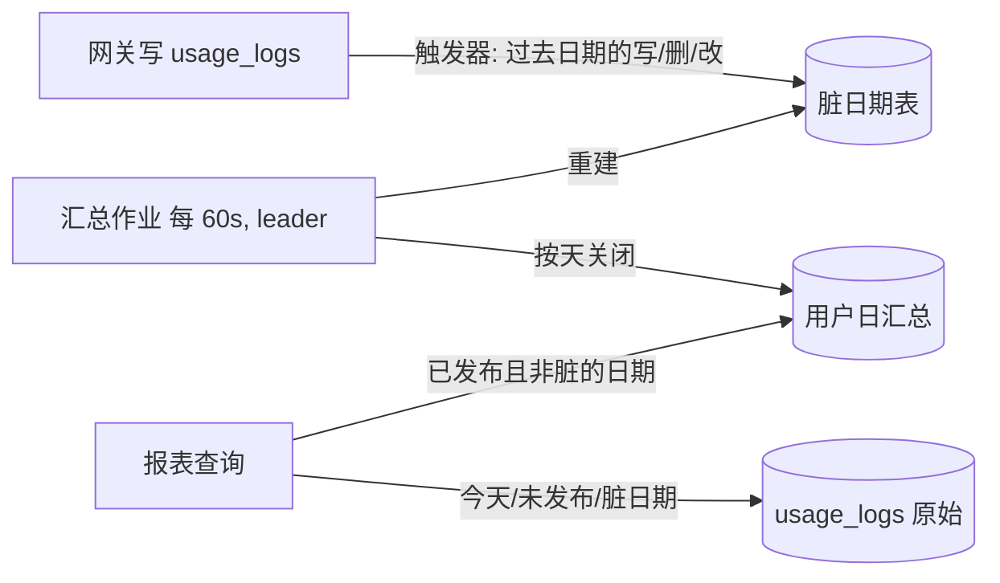

# 组织用量报表日汇总设计文档（根治查询慢）

## 文档状态

| 项目 | 内容 |
| --- | --- |
| 状态 | 已实现，本地验证完成，待上线；§12 的业务口径待确认 |
| 日期 | 2026-10-23 |
| 涉及页面 | `/admin/organization-usage`（Summary / Periods / Trend / Excel 导出） |
| 接口变化 | 无（请求参数、响应结构、口径均不变） |
| 新增迁移 | `backend/migrations/246_organization_usage_daily_rollups.sql` |
| 配置 | `organization_usage.rollup_enabled`（默认 `true`，环境变量 `ORGANIZATION_USAGE_ROLLUP_ENABLED`） |
| 固定时区 | `Asia/Shanghai`（与报表合同一致，不跟随服务端时区配置） |
| 前置文档 | [`organization-usage-report-design-cn.md`](./organization-usage-report-design-cn.md)、[`organization-usage-trend-chart-design-cn.md`](./organization-usage-trend-chart-design-cn.md)、[`organization-department-usage-design-cn.md`](./organization-department-usage-design-cn.md) |

## 1. 背景与目标

### 1.1 生产现状（2026-10-23 实测，PostgreSQL 15.13）

| 项目 | 数值 |
| --- | --- |
| `usage_logs` | 约 328 万行，堆 1.7GB，索引 3.1GB（26 个） |
| 本月（10-01~10-23） | 80 万行，约 3.5 万行/天，占全表 24% |
| active 用户 | 135 |
| 浏览器耗时 | scope 40ms，summary 5.19s，trend 1.77s |
| 已上线的临时优化 | 前端 Summary/Trend 并行；报表事务 `jit=off`、`work_mem=64MB` |
| 汇总行数（§12 实测） | 13 个完整北京日：61.7 万条原始日志对应 4,237 行候选汇总，平均每天 326 行，压缩约 145 倍 |
| 原始日志保留 | 部署默认 90 天（`dashboard_aggregation.retention.usage_logs_days`），最早日志 2026-07-24 |

`summary` 由三条查询组成：组织汇总、成员与日/周/月峰值、平台/部门拆分。这三条和 `trend` 一样，都对 `usage_logs` 做整表 Seq Scan，每条读 20 万页（1.6GB）后再按时间过滤。根因是报表从原始日志实时聚合，耗时与所选日期范围内的日志行数成正比：

- 选 90 或 366 天时等于扫整张表，并会随业务量继续变慢；
- JIT、`work_mem`、前端并行只能削掉常数部分，无法改变这一规律。

### 1.2 目标

- 默认本月加载：summary 目标 < 0.5s，trend 目标 < 0.3s；366 天范围 < 1.5s（数值以 §12 实测行数复核）。
- 结果与现在逐字段一致：口径、筛选、`as_of` 快照、当前成员/组织/部门归属语义不变。唯一差异是 `actual_cost` 末位精度（§7.5）。
- 不阻塞网关写入 `usage_logs`，热路径不新增行锁。
- 汇总缺失、落后或被关闭时，自动退回原始日志路径（即当前行为）；改配置并重启进程即可回退。

### 1.3 非目标

- 不改变报表口径，不把组织、部门写进汇总（归属仍按查询时的 `users` 当前值计算）。
- 不保留超出原始日志保留期的数据：汇总严格镜像 `usage_logs`，日志被清理后汇总同步消失。
- 不改动上游的 `/admin/groups` 分组日汇总（`usage_group_daily_rollups`）及其触发器。

## 2. 方案概览



- **汇总表**：每行是一个“北京日 × 用户 × 分组 × 账号”的请求数、四类 Token 和费用之和。
- **读路径**：日期范围拆成两部分。已发布、且不是脏日期的那些天读汇总表；今天、尚未发布的日期和脏日期读原始日志，先在 SQL 里聚合成同样的形状。两部分 `UNION ALL` 后接入现有 CTE，后面的峰值、Champion、分页、补零逻辑不动。
- **写路径**：后台作业每次只处理一天，每天一个短事务。依次是关闭“昨天及以前”的日期，以及重建被登记为脏的日期。`usage_logs` 上的触发器只往脏日期表登记日期，不读状态行、不加锁。

## 3. 汇总维度

| 报表需要 | 汇总如何满足 |
| --- | --- |
| 成员、组织、部门筛选与归属 | 只存 `user_id`；组织（邮箱域名）、部门、active 状态在查询时按 `users` 当前值计算，与现语义一致 |
| 日/周/月桶 | 存北京自然日 `bucket_date`；周（周一起）、月由 `date_trunc` 从日期推导，结果与按时间戳分桶相同 |
| 平台筛选与平台拆分 | 存 `group_id`、`account_id`；查询时 `LEFT JOIN groups/accounts` 按当前值计算有效平台，分组或账号平台后改时与现行为一致 |
| `as_of` 精确上界 | 只有完整的日才读汇总；`as_of` 当天读原始日志，截到精确时刻 |

不直接把平台写进汇总。原因是那样会把平台固化成汇总时刻的值，改变“当前值”语义，还需要给 `groups`/`accounts` 加触发器做全量重建。这个思路留作备选：若 §12 实测每天汇总行数过大（例如超过 1 万），再评估。

生产实测（§12）：完整日每天 70–459 行汇总，平均 326 行，压缩约 145 倍；按此外推，30 天约 1 万行，366 天约 12 万行。维度无需改成按平台汇总。

## 4. 数据模型

```sql
-- 组织用量报表：按北京自然日 × 用户 × 分组 × 账号聚合的 usage_logs 镜像。
CREATE TABLE IF NOT EXISTS usage_user_daily_rollups (
    bucket_date            DATE           NOT NULL,           -- Asia/Shanghai 自然日
    user_id                BIGINT         NOT NULL,
    group_id               BIGINT         NOT NULL DEFAULT 0, -- 0 表示 usage_logs.group_id IS NULL
    account_id             BIGINT         NOT NULL,
    requests               BIGINT         NOT NULL,
    input_tokens           BIGINT         NOT NULL,
    output_tokens          BIGINT         NOT NULL,
    cache_creation_tokens  BIGINT         NOT NULL,
    cache_read_tokens      BIGINT         NOT NULL,
    actual_cost            DECIMAL(24,10) NOT NULL,
    computed_at            TIMESTAMPTZ    NOT NULL DEFAULT NOW(),
    PRIMARY KEY (bucket_date, user_id, group_id, account_id)
);

-- 单行发布水位：bucket_date < closed_before 的日期已至少完整发布一次；NULL 表示未初始化。
CREATE TABLE IF NOT EXISTS usage_user_rollup_state (
    id            SMALLINT PRIMARY KEY CHECK (id = 1),
    closed_before DATE,
    updated_at    TIMESTAMPTZ NOT NULL DEFAULT NOW()
);
INSERT INTO usage_user_rollup_state (id) VALUES (1) ON CONFLICT (id) DO NOTHING;

-- 脏日期：已发布后原始日志又发生变化、需要重建的日期。只追加，同一天可有多行。
CREATE TABLE IF NOT EXISTS usage_user_rollup_dirty_days (
    id          BIGSERIAL PRIMARY KEY,
    bucket_date DATE NOT NULL,
    marked_at   TIMESTAMPTZ NOT NULL DEFAULT NOW()
);
CREATE INDEX IF NOT EXISTS idx_usage_user_rollup_dirty_days_bucket_date ON usage_user_rollup_dirty_days (bucket_date);
```

- 主键以 `bucket_date` 开头，报表按日期范围读取时直接走主键范围扫描。部门负责人范围很小时，可再评估 `(user_id, bucket_date)` 索引；首版不加。
- 已核对 `usage_logs` 的字段约束：`account_id`、`user_id` 非空，`group_id` 可空（用 0 代替，因为可空列不能进主键），Token 是 int，`actual_cost` 是 `decimal(20,10)`。汇总 Token 用 bigint，费用用 `DECIMAL(24,10)` 留出累加余量。

### 4.1 触发器（登记脏日期）

所有触发器都通过 `mark_user_usage_rollup_dirty_day(day)` 登记：

```sql
-- 每个事务为每天插入一行自己的标记；同一事务内每天只登记一次。
INSERT INTO usage_user_rollup_dirty_days (bucket_date) VALUES (p_day);
PERFORM set_config('sub2api.user_rollup_dirty_' || to_char(p_day, 'YYYYMMDD'), 't', true);
```

- **为什么只追加**：如果按日期唯一并用 `ON CONFLICT DO NOTHING`，标记已存在时写入方不会留下自己的标记；作业若在写入方提交前认领并重建该天，这次改动就永久丢失（典型场景是保留期分批删除最老的一天）。改成 `ON CONFLICT DO UPDATE` 虽能防丢，但写入方会按天持有标记行锁，跨日事务按相反顺序修改会死锁（复审 F2 已复现）。只追加时每个写入方插入自己的行，互不冲突、不加锁、不会死锁；作业认领时只能删除已提交的标记，写入方未提交的标记提交后仍在，该天会被再次重建，读者也会对该天读原始日志。当天的普通网关写入不写标记。
- **初始化不清空脏标记**：初始化只把水位设为当时读到的 `MIN(created_at)` 所在日期。若有更早日期的日志在读取之后并发提交，它的标记会让该天在水位之前保持“脏”，随后被重建，而不会被当成空的已发布日期（复审 F1）。
- **INSERT**：语句级 + transition table，每条批量 INSERT 执行一次，按日期升序登记“已过去的日期”。最后 10 分钟内写入的当天数据也登记（见 §7.3 的宽限窗口）。
- **DELETE**：行级 `AFTER DELETE`，登记 `OLD` 的日期。和上游分组触发器一样用行级，以覆盖外键级联和直接写分区。同一事务内同一天只在第一行时写标记，其余行只查一次事务级设置，保留期每批 5000 行不会写 5000 次。
- **UPDATE**：行级 `AFTER UPDATE OF ...`（带 `WHEN` 过滤）登记新旧日期，覆盖直接写分区。另有一个语句级 `AFTER UPDATE` 触发器（`REFERENCING OLD TABLE ... NEW TABLE ...`，按 `id` 配对比较相关列），覆盖分区表上跨分区移动的 UPDATE：这种 UPDATE 会被转换为 DELETE + INSERT，行级 UPDATE 和语句级 INSERT 都不会触发。当前代码没有更新这些列的路径，这是兜底。
- **TRUNCATE**：语句级，清空汇总表并把 `closed_before` 置 NULL，让作业重新初始化。
- **按月 DROP 分区**：不会触发任何触发器。`dropUsageLogsPartitionWithRollupInvalidation` 在同一事务里调用 `markOrganizationUsageRollupRangeDirty`，把该 UTC 月覆盖的北京日期（当月 1 日至次月 1 日）全部登记为脏。

## 5. 后台汇总作业

新增本地服务 `OrganizationUsageRollupService`，仓储方法放在 `organization_usage_rollup_repo.go`，通过 Wire provider 接入。生命周期参照现有本地后台任务（Start/Stop），不挂在上游的 `DashboardAggregationService` 上，有两个原因：

- 不受 `dashboard_aggregation.enabled` 开关影响；
- 避免上游合并冲突。

调度：

- 时间轮每 60 秒执行一次；用 `tryAcquireSingletonLeaderLock`（leader 键 `organization-usage:rollup:leader`）保证多实例只有一个在跑；
- 每个事务先 `SELECT ... FROM usage_user_rollup_state FOR UPDATE` 作为数据库层面的二次互斥；
- 单次运行有时间预算（例如 45 秒）和处理天数上限，没处理完的留到下次。

每次运行依次执行：

1. **初始化**：`closed_before IS NULL` 时，把它设为 `MIN(usage_logs.created_at)` 的北京日期；表为空时设为今天。
2. **关闭日期**：当 `closed_before < 北京日期(clock_timestamp() - 10 分钟)` 时，令 D = `closed_before`，在一个事务里依次执行：
   - `DELETE FROM usage_user_rollup_dirty_days WHERE bucket_date = D`（先认领脏标记）；
   - `DELETE FROM usage_user_daily_rollups WHERE bucket_date = D`；
   - `INSERT ... SELECT ... FROM usage_logs WHERE created_at >= D 00:00 AND created_at < D+1 00:00 GROUP BY ...`，走 `idx_usage_logs_created_at`，一天约 3.5 万行；
   - `UPDATE ... SET closed_before = D + 1`。

   每天一个事务，循环推进。
3. **重建脏日期**：取 `bucket_date < closed_before` 的脏日期，按日期升序。每个日期一个事务：先 `DELETE ... WHERE bucket_date = D RETURNING`，认领成功才删旧汇总、重算该天。`bucket_date >= closed_before` 的标记先保留，关闭该天时一并认领。
4. **对账（集群范围每小时一次）**：比较已发布的最近 3 天的“汇总合计”与“原始合计”（请求数、四类 Token、费用）。不一致时登记脏日期，并打 warn 日志。节奏通过 `usage_user_rollup_state.reconciled_at` 条件更新来抢占，多实例轮换 leader 时也只执行一次。这是 §7.3 残余风险的自愈兜底。

和上游分组汇总的区别：上游的同步事务在整个重建期间持有状态行的 `FOR UPDATE`，网关 INSERT 触发器要拿同一行的 `FOR KEY SHARE`，所以重建期间日志写入会排队；另外保留期清理会把水位拉回最早日期，每 6 小时触发一次全量重建。本方案的触发器不碰状态行，也不锁标记行：当天写入不写标记，过去日期的写入只追加自己的标记（见 §4.1）。保留期清理只把被删的那几天登记为脏，只重建那几天。

首次回填：生产约 90 天，每天一个事务约 0.1–0.3 秒，总计不到 1 分钟，分摊在启动后的前几次运行里。回填期间读路径自动对未发布日期走原始日志，不会退化到比现在更慢。

单次运行发布或重建 7 天及以上时，作业会执行 `ANALYZE usage_user_daily_rollups`。本机实测，刚批量写入、尚无统计信息的汇总表会让个别报表查询出现 12–19 秒的异常计划；补 ANALYZE 后消失。

## 6. 读路径改造

### 6.1 汇总读取计划（Go 侧，在现有只读 repeatable-read 报表事务内）

在 `beginScoped` 打开的同一事务里，读取 `closed_before` 和范围内的脏日期，计算读取计划：

- `endTime` 沿用现有逻辑：`min(as_of, end_date + 1 天 00:00)`。
- `rollupEnd = min(closed_before, endTime 的北京日期（向下取整）)`，是不含的上界。满足以下任一条件时 `rollupEnd = start_date`，即全部走原始日志：汇总未初始化、开关关闭、或 `rollupEnd < start_date`。
- **读汇总的日期**：`[start_date, rollupEnd)` 去掉脏日期。
- **读原始日志的区间**：范围内的每个脏日期，加上尾段 `[max(startTime, rollupEnd 00:00), endTime)`，相邻区间合并后作为两个数组参数传入。

`as_of` 落在过去时（例如导出续页），`rollupEnd` 自动截到 `as_of` 所在日，当天截至 `as_of` 的部分读原始日志，快照语义不变。

### 6.2 SQL 形状

把 `organization_usage_repo.go` 里原来的 `organizationUsageRowsCTE`（逐行读 `usage_logs`）替换为下面的 `usage_days` 加 `usage_rows`：

```sql
usage_days AS (
    SELECT r.bucket_date AS local_date, r.user_id, NULLIF(r.group_id, 0) AS group_id, r.account_id,
           r.requests, r.input_tokens, r.output_tokens, r.cache_creation_tokens, r.cache_read_tokens, r.actual_cost
    FROM usage_user_daily_rollups r
    WHERE r.bucket_date >= $start_date AND r.bucket_date < $rollup_end
      AND NOT (r.bucket_date = ANY($dirty_dates::date[]))
      AND r.user_id IN (SELECT user_id FROM active_users)
    UNION ALL
    SELECT (ul.created_at AT TIME ZONE 'Asia/Shanghai')::date, ul.user_id, ul.group_id, ul.account_id,
           COUNT(*), SUM(ul.input_tokens), SUM(ul.output_tokens),
           SUM(ul.cache_creation_tokens), SUM(ul.cache_read_tokens), SUM(ul.actual_cost)
    FROM unnest($raw_starts::timestamptz[], $raw_ends::timestamptz[]) AS raw(s, e)
    JOIN usage_logs ul ON ul.created_at >= raw.s AND ul.created_at < raw.e
    WHERE ul.user_id IN (SELECT user_id FROM active_users)
    GROUP BY 1, 2, 3, 4
),
usage_rows AS (
    SELECT d.user_id, d.local_date, d.requests::bigint AS requests,
           d.input_tokens::bigint AS input_tokens, ...,
           (d.input_tokens + d.output_tokens + d.cache_creation_tokens + d.cache_read_tokens)::bigint AS total_tokens,
           d.actual_cost  -- 保持 numeric，最终输出列才转 double precision
    FROM usage_days d
    LEFT JOIN groups g ON g.id = d.group_id
    LEFT JOIN accounts a ON a.id = d.account_id
    WHERE /* department_platform：沿用 usageLogEffectivePlatformExpr */
)
```

下游要同步改动的点：

- 所有 `COUNT(*)::bigint AS requests` 改成 `SUM(requests)`。
- `usage_totals`、`period_aggregates`、Trend 聚合中的费用都保持 numeric，只在 Summary/Periods/Trend/拆分的最终输出列转 `double precision`。
- 分桶表达式从 `local_created_at` 改成 `local_date::timestamp`，周、月的 `date_trunc` 结果不变。
- `breakdowns`（`organization_usage_department_repo.go`）的平台/部门拆分改用同一数据源。
- Summary、Periods、Trend、导出共用同一份读取计划。
- 原始日志部分用 `unnest` 后 JOIN，让每个区间各自命中 `created_at` 索引，避免对整个月按条件过滤。

### 6.3 开关与回退

新增配置 `organization_usage.rollup_enabled`（环境变量 `ORGANIZATION_USAGE_ROLLUP_ENABLED`），默认 `true`。配置只在进程启动时读取，修改后需重启应用进程才生效。设为 `false` 时 `rollupEnd = start_date`，全部走原始日志，结果与现行为一致。这个开关有两个用途：生产紧急回退，以及测试里的参照实现（§10）。读路径不依赖作业是否在运行：作业落后时，读原始日志的尾段会变长，查询变慢但结果依然正确。

## 7. 正确性论证

### 7.1 不变量

在读事务的快照中，对任一满足 `D < closed_before` 且 D 不在脏日期表中的日期，汇总表中 D 的各行之和等于 `usage_logs` 在 `[D 00:00, D+1 00:00)` 内按同维度聚合的结果。读路径只在满足不变量的日期上读汇总，其余日期读原始日志，所以结果与纯原始路径一致。

### 7.2 快照一致性

- 报表在 repeatable-read 只读事务内读取 state、脏日期、汇总和原始日志，四者属于同一快照。
- 作业在同一事务内更新汇总、state 和脏日期；触发器的脏标记与引起它的日志变更在同一事务提交。
- 因此读者要么看到“变更 + 标记”，要么两者都看不到。

### 7.3 迟到写入与并发

已确认迟到写入真实存在：批量图片结算、OpenAI Live 会以原始时间写 `created_at`；网关日志也是异步批量插入。

| 情形 | 结果 |
| --- | --- |
| 迟到行在作业的聚合语句开始前提交 | 被聚合（READ COMMITTED 下每条语句取新快照，认领在聚合之前执行） |
| 迟到行在聚合语句开始后才提交 | 它的脏标记一起提交并留存；读者对该日改读原始日志；下次运行重建 |
| 作业认领标记时，写入方的标记尚未提交 | 认领只删除已提交的标记，不等待写入方；写入方提交后其标记仍在，该天读原始日志并在下次运行重建（集成测试 `WriterMarkSurvivesConcurrentRebuild`） |
| 两个事务按相反顺序修改同两天 | 标记互不冲突，不加锁，不会死锁（集成测试 `CrossDayWritersDoNotDeadlock`） |
| 初始化时并发写入早于 `MIN(created_at)` 的历史日志 | 标记保留，该天在水位之前保持脏并被重建（集成测试 `InitializationKeepsEarlierConcurrentMark`） |
| 某天最后 10 分钟内写入的当天数据 | 触发器提前登记为脏（宽限窗口），关闭该天时一并认领 |
| 跨午夜的写入事务 | 作业在午夜后 10 分钟才关闭前一天。漏数需要同时满足：触发器在 23:50 之前执行（因此没登记）、写入事务在 00:10 之后才提交，即事务保持打开超过 20 分钟。网关写入是短事务，不会出现；即便出现，§5 的每小时对账也会检出并重建 |

### 7.4 删除与修改

保留期清理、管理员清理任务和单条删除都会经过 DELETE 触发器，登记被删数据的日期，重建后汇总与原始日志一致。完全被删光的日期，重建后该日汇总行为零行。

### 7.5 数值精度

改造前是先把每行 `actual_cost` 转成 double 再求和。改造后无论数据来自汇总还是原始日志，费用都以 numeric 精确求和，只在最终输出时转换一次 double。因此汇总开、关两种模式结果逐位相同（等价性测试用 `require.Equal` 比较整个结果）。

与改造前的旧结果相比：生产本月 80 万行样本中，底层差异最大约 3.3e-10，但仍有个别值在按 6 位小数舍入时跨过边界（1,343 个分组中有 2 个，例如 454.173373 → 454.173374）。新值是精确值；不能承诺固定小数位展示与旧版本永远相同。Token 和请求数是整数，完全一致。

## 8. 性能预期

| 场景 | 现状 | 预期（待 §12 行数复核） |
| --- | --- | --- |
| 本月 summary | 5.19s | < 0.5s：读约 2–5 万行汇总，加今天约 3.5 万行走索引 |
| 本月 trend | 1.77s | < 0.3s |
| 90 天 / 366 天 | 扫全表，随数据量线性增长 | 只随天数线性增长：366 天约 10–40 万行汇总 |
| 网关写入 | — | 当天数据：每条 INSERT 语句多一次 transition table 扫描（一般 1 到一个批次的行数），无锁、无写入，预计为微秒级。过去日期：每事务每天插入一行标记，不加锁 |
| 后台作业 | — | 每天约 0.1–0.3s 关闭一次；脏日期按需重建；每小时对账扫描 2 天数据 |

今天的尾段原始数据走 `created_at` 索引，读取量是当天的日志量，与所选范围长短无关。

### 8.1 本机实测（2026-10-23，嵌入式 PostgreSQL 16.9，非生产 SLA；生产为 15.13）

生产形态基准 `TestOrganizationUsageRollupIntegration_ProductionShapedBenchmark`：135 个用户、3 个账号，每天 4.7 万条、共 30 天（141 万行）日志；查询“本月 + 当天截至 15:00”，管理员全量范围；预热 1 次后取 7 次样本。29 天汇总共 11,745 行（约 405 行/天），发布耗时 1.1 秒。

| 接口 | 原始日志 中位/最大 ms | 日汇总 中位/最大 ms |
| --- | ---: | ---: |
| Summary（组织汇总 + 成员/峰值 + 拆分） | 3068 / 3122 | 138 / 160 |
| Trend（按日） | 1028 / 1057 | 35 / 36 |

两种模式结果逐位一致。既有部门性能测试的夹具每用户每天只有约 1 条日志，汇总后几乎不压缩，只用来确认没有退化：366 天全量中位数从 2526ms 降到 1986ms，所有档位 p95 都在 3 秒以内。

## 9. 上线与回滚

1. **迁移**：创建三张表和触发器。`CREATE TRIGGER` 会对 `usage_logs` 短暂加 SHARE ROW EXCLUSIVE 锁，建议在低峰执行。
2. **部署代码**：`enabled` 默认开启，作业从启动开始逐日回填，读路径对已发布的日期自动生效。
3. **验收**：对所有已发布日期逐日比较汇总与原始合计（SQL 附在实施文档中）；浏览器 Network 复测 summary/trend；对新 SQL 做 `EXPLAIN (ANALYZE, BUFFERS)`。
4. **回退**：设 `organization_usage.rollup_enabled: false`（或环境变量 `ORGANIZATION_USAGE_ROLLUP_ENABLED=false`）并重启应用进程，即回到原始路径，无需改库。如需彻底移除，新增一个迁移删除触发器和表，不修改 246。

## 10. 测试计划与实现入口

实现文件：迁移 `backend/migrations/246_organization_usage_daily_rollups.sql`；读路径 `backend/internal/repository/organization_usage_rollup_plan.go`（读取计划与参数绑定）、`organization_usage_repo.go`（`organizationUsageDaysCTE`）、`organization_usage_department_repo.go`（拆分查询）；作业 `organization_usage_rollup_repo.go` 与 `backend/internal/service/organization_usage_rollup.go`；配置 `internal/config/config.go`；Wire `ProvideOrganizationUsageRepository`、`ProvideOrganizationUsageRollupService`。

已实现的测试：

- 单元：`organization_usage_rollup_plan_test.go`（读取计划边界、合并、绑定）、`organization_usage_repo_test.go`（sqlmock 按关闭汇总模式匹配）、`service/organization_usage_rollup_test.go`（作业编排、预算、对账节流、ANALYZE）、`migrations/group_usage_rollup_migration_test.go`（`-tags unit`，迁移不含行锁）。
- 集成（`-tags integration`）：`organization_usage_rollup_integration_test.go` 覆盖下列计划项；另含反向对照（篡改汇总后结果确实改变）以及需手动开启的生产形态基准。

原计划项：

- **等价性集成测试（PostgreSQL）**：随机生成多日、多用户、多分组/账号/平台的日志，再随机组合范围、`as_of`、组织/部门/平台/邮箱筛选和负责人范围。断言 Summary、Periods、Trend、拆分在 rollup 开与关两种模式下结果相同。覆盖已发布、脏、未发布、今天尾段四类日期的混合。
- **触发器**：迟到插入会登记脏日期；当天插入不登记；最后 10 分钟内的插入会登记；DELETE/UPDATE 登记新旧日期；TRUNCATE 会重置。
- **作业**：逐日关闭；关闭时认领标记；用两个连接模拟“重建期间迟到插入”，确认标记留存且下一轮修复；保留期清理只重建受影响的日期；多实例时 leader 互斥。
- **回归**：现有 `organization_usage_*`、`department_*` 集成测试与前端测试不变且全部通过；性能集成测试补充 rollup 场景。

## 11. 工作量估算

| 项 | 人日 |
| --- | --- |
| 迁移与触发器，及其测试 | 1 |
| 汇总作业、Wire 接入、配置、对账 | 1.5 |
| 读路径 SQL 改造（Summary/Periods/Trend/拆分） | 1.5 |
| 等价性和作业集成测试 | 1.5 |
| 文档与 wiki、生产验收 | 0.5 |
| **合计** | **约 6 人日**（已完成实现与本机验证） |

## 12. 待确认（实施前）

2026-10-23 生产只读核验结果：第 1 项已确认（平均每天 326 行，压缩约 145 倍，保留当前维度）；保留期为部署默认 90 天。第 2、3 项的技术事实已核验，业务接受仍待产品或客户确认；当前按“严格镜像原始日志、费用精确求和”实现。原始核验记录不入库。

1. **生产汇总行数**：请在生产库执行下面的只读 SQL。

   ```sql
   -- 近 14 天：原始行数 vs 汇总行数（日 × 用户 × 分组 × 账号）
   SELECT (created_at AT TIME ZONE 'Asia/Shanghai')::date AS day,
          count(*) AS raw_rows,
          count(DISTINCT (user_id, COALESCE(group_id, 0), account_id)) AS rollup_rows,
          count(DISTINCT user_id) AS users
   FROM usage_logs
   WHERE created_at >= now() - interval '14 days'
   GROUP BY 1 ORDER BY 1;

   -- 原始日志保留范围与运行时保留期配置
   SELECT min(created_at), max(created_at) FROM usage_logs;
   SELECT value FROM settings WHERE key = 'ops_runtime_log_config';
   ```

2. **数据保留语义**：汇总严格镜像原始日志，日志超过保留期被删后，报表同样查不到。若客户希望报表保留更久，需要单独评估：触发器对保留期清理的删除不登记脏日期，并补充口径说明。
3. **费用精度**：接受 `actual_cost` 末位可能变化（变得更精确）。

## 13. 备选方案对比

| 方案 | 结论 |
| --- | --- |
| `created_at` 覆盖索引（INCLUDE 用户、分组、账号、Token、费用） | 改动最小，预计提速 2–3 倍，但仍随范围线性增长；而且要在已有 26 个索引的热表上再加约 300MB 的写放大。适合作为过渡方案，不能根治 |
| 照搬上游分组汇总的加锁水位 | 重建期间阻塞网关写入；保留期清理每 6 小时触发全量重建。不采用 |
| 按“日 × 用户 × 平台”汇总 | 行数更少，但平台会被固化成汇总时刻的值，还要给 `groups`/`accounts` 加触发器。只有 §12 实测行数过大时才考虑 |
| 报表结果缓存 | 只对重复访问有效，首次访问仍然慢，不能根治 |
