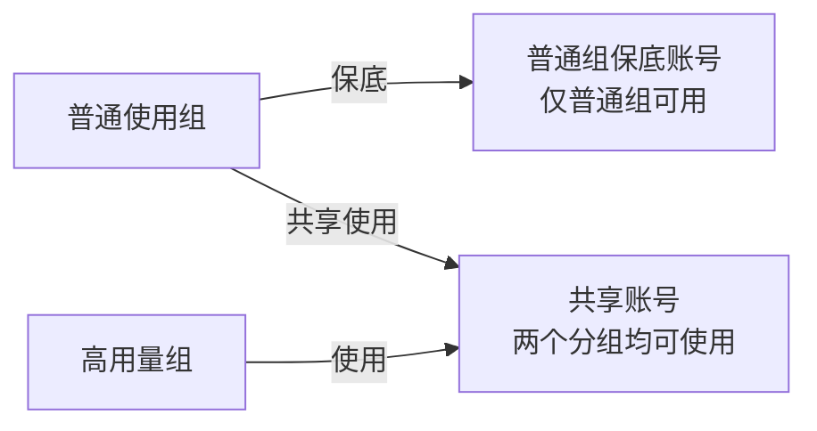
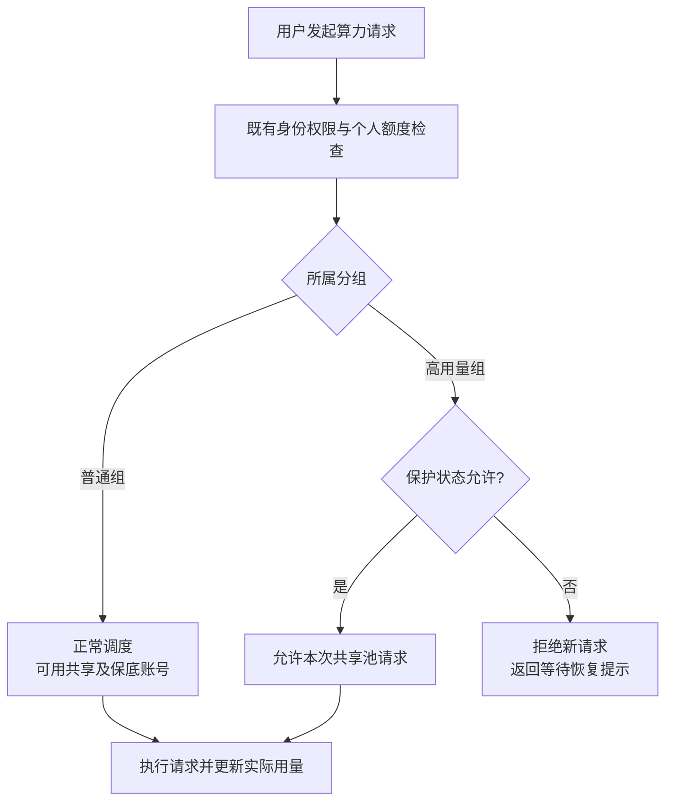
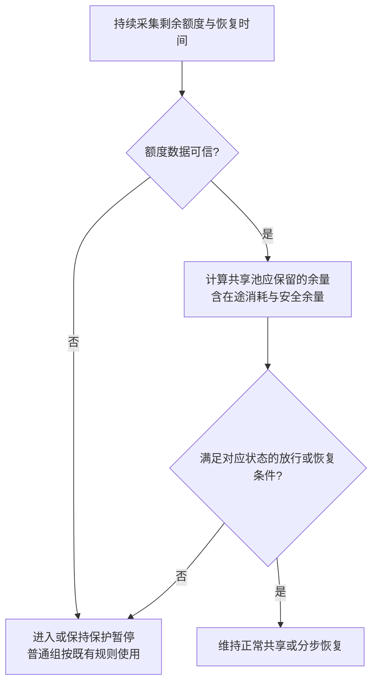

# 共享算力池普通用户保障设计

更新：2026-11-04。状态：**建议方案，未上线。后端没有任何按分组角色的保护功能；第一阶段（配置独立保底账号）可用现有能力完成，是否已配置以生产为准。第二阶段自动暂停/恢复与第四方案"角色阈值"都只停留在设计和演示，未实现。业务政策（比例策略、阈值 T、保障范围）待业务负责人确认。**

本文是共享算力池普通用户保障的唯一权威文档，包含需求、源码现状、四方案对比、推荐方案、参数、两阶段实施和自动暂停/恢复规则。设计说明、汇报稿和两轮方案评审的结论都已写入正文；评审原文与设计说明原文已移出仓库，最后存在于提交 `26f6363af`（可用 `git show 26f6363af:docs/features/shared-compute-pool-independent-design-brief-cn.md`、`…/shared-compute-pool-protection-report-cn.md`、`docs/reviews/shared-compute-pool-three-options-review-cn.md`、`docs/reviews/shared-compute-pool-claude-revision-review-cn.md` 查看）。

面向人的汇报版保留在仓库中，只作演示，内容与本文冲突时以本文为准：
- [保障机制汇报（交互版）](../presentations/shared-compute-pool-protection-report-cn.html)：两阶段方案、共享模式对比、余量调节与暂停/恢复演示；
- [四方案决策对比（交互版）](../presentations/shared-compute-pool-three-options-comparison-cn.html)：前置门槛、评分、逐账号演示、准入覆盖清单；
- 三张机制图：[资源分配](../presentations/shared-compute-pool-protection-assets/01-resource-allocation.svg)、[请求准入](../presentations/shared-compute-pool-protection-assets/02-request-admission.svg)、[保护与恢复](../presentations/shared-compute-pool-protection-assets/03-protection-recovery.svg)（同名 `.png` 为位图版）。

演示中的 1000 总量、200 暂停线、300 恢复线、甲 500/乙 300/丙 200 容量、T=80% 等都是示例，不是生产参数；演示不连接真实网关。

阅读顺序建议：
- 了解决策：先读 §1、§5、§9；
- 准备实现第四方案：读 §3、§6、§8；
- 准备第一阶段配置：读 §7.1。

## 1. 需求

多个上游账号共同提供 AI 服务，普通用户和高用量用户通过不同 API 分组使用同一批上游资源。高用量组短时间集中消耗后，普通组可能在上游额度恢复前无法使用。

目标：资源充足时高用量组正常使用；接近普通组保障范围时**只约束高用量组**；资源恢复后自动放行。

两类问题不能混为一谈：

| 问题 | 表现 | 边界 |
| --- | --- | --- |
| 累计额度不足 | 周额度被提前耗尽，后续请求无法执行 | 降低并发只能减缓消耗，不会增加总额度 |
| 瞬时并发不足 | 周额度还有，但共享账号槽位已满，普通请求排队或失败 | 保留周额度不等于预留并发；请求数不等于 token 或费用 |

本期先缓解"高用量组耗尽额度"。普通组是否需要独立的并发保障、具体服务水平、允许等待多久，**尚待确定**；不扩展成完整资源调度平台。

### 1.1 已确认的业务约束

| 事项 | 约束 |
| --- | --- |
| 分组角色 | 在现有分组上标记普通组/高用量组，或由一份保护策略保存分组 ID；不建多级分组体系 |
| 原动态公式 | 方案二用"普通组最近 7 天（滚动 168 小时）累计用量 × 1.05"（`R = U7 × 1.05`）；5% 是普通组七天用量的 5%，不是池容量的 5% |
| 统计范围 | 同一实际共享资源范围内普通组的消耗，不混入不相关平台或模型 |
| 账号窗口 | 用户计划把含 5 小时限额的账号移出目标号池；方案二、三以此为上线前置条件（未验证完成）。方案四沿用现有逐窗口（5h/7d）账号过滤，不以移出为前置条件 |
| 周重置时刻 | 即便都是周账号，重置时刻、容量、消耗速度也可能不同；不假定同时恢复 |
| 性能 | 每个请求可以检查状态，但不能同步遍历全部上游账号或重查七天日志；后台计算、请求读缓存 |
| 路由 | 尽量保留现有优先级、负载感知、粘性会话、模型能力、账号健康与故障切换 |
| 暂停对象 | 只针对高用量组的新算力请求；不能为保护普通组而全局停用两组共享的账号 |
| 在途请求 | 已发往上游的请求仍会继续消耗，暂停不能撤销 |
| 推广 | 先限定单平台、明确资源范围试点 |

### 1.2 待确认的生产信息

| 信息 | 最小内容 | 是否阻塞 |
| --- | --- | --- |
| 目标账号类型 | 平台、套餐、是否只剩周额度 | 阻塞第四方案范围 |
| 规模与共享关系 | 账号数、真实配额主体数、两类分组的绑定重叠 | 阻塞第一阶段配置 |
| 模型能力 | 是否同质、是否有只由少量账号服务的模型 | 阻塞范围 |
| 并发与负载 | 各账号上限、负载因子、峰值占用、排队与超时 | 决定是否另做并发保障 |
| 用量特征 | 两类分组近七天消耗、峰值速度、长请求占比 | 用于阈值校准 |
| 部署形态 | 实例数、共享缓存、后台任务与通知机制 | 影响缓存一致性设计 |
| 服务目标 | 普通组容许等待、失败率、是否要求硬并发保留 | 业务负责人决定 |
| 路由经营约束 | 优先级是否必须严格、是否允许改变粘性或成本偏好 | 业务负责人决定 |

## 2. 资源如何衡量

| 维度 | 用途 | 注意 |
| --- | --- | --- |
| 账号数量 | 不能代表容量 | 10 个小容量账号不一定大于 2 个大容量账号 |
| 周剩余比例（`used_percent`） | 方案四的判定依据 | 不同套餐的 50% 不能直接相加 |
| 周绝对余量 | 方案二、三的判定依据 | **当前不存在**（§3） |
| 配置并发 / 空闲槽位 | 瞬时服务能力 | 不能乘进周额度；`maxConcurrency<=0` 表示不限制，不能当零容量求和 |
| 实际吞吐 / 等待时间 | 普通组体验指标 | 需上线后观测 |

额度与并发是两套独立约束；本期只控制额度。

## 3. 源码现状（2026-09-21/22 核对，2026-11-04 抽查函数仍在）

| 能力 | 当前行为 | 对方案的影响 |
| --- | --- | --- |
| 账号绑定分组 | 一个上游账号可绑多个分组 | 能配置专用保底账号；同一上游配额不会因多凭证或多分组而增加 |
| 分组日/周/月限额、分组 RPM | 按用户 × 分组计数 | 都不是整组预算或整组速度上限 |
| 分组容量摘要 `GroupCapacityService` | 汇总关联账号的并发、会话、RPM | 观测值；共享账号跨组重叠，多组汇总不能相加 |
| 分组日用量 `usage_group_daily_rollups` | 只有 `(bucket_date, group_id, actual_cost)` | `actual_cost` 含用户计费倍率，且无 `account_id`，不能按资源范围切分；按池统计须回 `usage_logs` 按 `account_id` 汇总，物理口径宜用倍率前 `total_cost` |
| 上游额度快照 `OpenAICodexUsageSnapshot` | 只有 `*_used_percent`、`*_reset_after_seconds`、`*_window_minutes`；写 `extra` 的 `codex_7d_used_percent`、`codex_7d_reset_at`、`codex_usage_updated_at` 等 | **没有绝对额度字段**；任何池级绝对余量都需要新建每账号容量换算 |
| 快照来源 | 转发响应头经 `updateCodexUsageSnapshot` 更新（30 秒持久化节流、异步写回，缺头直接返回）；主动查询只在管理端用量、quota GET/refresh、自动用卡流程 | 没有为已暂停或无流量账号服务的后台周期刷新；`QueryUsage` 返回不等于快照与调度缓存已更新 |
| 账号级额度自动暂停 `shouldAutoPauseOpenAIAccountByQuota` | 候选过滤时按账号 `extra.auto_pause_5h/7d_threshold`（缺省取全局 `OpsOpenAIAccountQuotaAutoPauseSettings`）跳过越线账号；支持 `auto_pause_{5h,7d}_disabled`；原因 `quota_auto_pause_{5h,7d}`；**对所有分组一视同仁**；非 OpenAI 账号直接放行 | 只约束高用量组的最佳扩展缝，但不能直接复用（会让所有分组一起失去该账号） |
| 过期与重置语义 `resolveOpenAIQuotaUtilization` | 快照超过 `openAICodexAutoPauseStaleAfter`（2 小时）或 `openAIQuotaWindowReset` 判定已过重置时刻时返回"无信号"，账号不再暂停（fail-open） | 该放行**没有**单次探测或累计消耗上界；缺头、写失败可持续放行 |
| 分组作用域调度上下文 | `SelectAccount*` 入口在 `selectAccountForModelWithExclusions` 前用 `withOpenAIQuotaAutoPauseContext`、`withOpenAIGroupPrivacyRequirement` 等装门 | 按分组改变候选过滤有现成模式 |
| WS 后续轮次 | `OpenAIWSIngressHooks.BeforeTurn` 只做利润门 `ProfitControlVetoLatest` 复核、定价冻结、重抢槽位；`BeforeRequest` 做模型白名单与审核；都不重跑 `CheckBillingEligibility` 或账号额度过滤；连接内不换号 | 任何方案都要在 `BeforeTurn` 补检 |
| 公共准入 `CheckBillingEligibility` | 约 20—23 处 handler 调用点；兜底分组另调一次 | 外层准入需逐入口接入；账号级过滤自动覆盖经同一选号函数的重试与 failover |
| 账号调度阈值 `ApplyAccountSchedulingThreshold` | 落库写 `TempUnschedulableUntil`，是**全局停调** | 分组级保护绝不能复用这条写路径 |
| 余量加权 `quota_headroom` | 默认关闭，偏向周剩余比例高的账号 | 是相对比例，不是保障策略；调权重会影响优先级取舍 |
| 手动停用分组 | 阻止后续鉴权请求 | 不是自动阈值控制，不取消在途请求 |

结论：方案二、三的核心比较"有效余量 E − 需求基线 R"在目标号池上**没有定义**——R 侧是含倍率的费用，E 侧上游只给百分比。这是两份评审一致的阻断判断。

## 4. 候选方案

| 方案 | 机制 | 收益 | 代价 / 前置条件 |
| --- | --- | --- | --- |
| 一 独立保底＋自动保护 | 普通组绑定专用与共享账号，高用量组只绑定共享账号；共享部分再建自动保护。可先只做"配置子集" | 专用部分物理隔离额度与一部分并发；配置子集无需任何换算，可立即落地 | 专用账号可能闲置；须足够额度、并发与模型覆盖；完整自动部分另需验证 |
| 二 全共享动态触停 | 分组标角色；后台算 `R = U7 × 1.05`；有效余量触线时暂停高用量组新请求，满足恢复条件后放开 | 共享程度高，沿用原路由 | **缺少可靠同单位容量换算**；历史可能低估需求；不保证并发 |
| 三 动态保底＋分级限速 | 在二上加人工最低保底；临近保底线逐级减少高用量组可接纳请求，最后整组暂停 | 临界消耗更平缓 | 继承二的前提；新增组级原子计数与状态；限请求数不等于限 token，也不等于硬预留并发 |
| 四 分组感知的账号周额度阈值 | 原账号规则通过后，高用量组还须满足"该账号可信 7d 已用比例 < T"；越线或状态未知的账号对高用量组不可选，普通组照旧 | 不需要费用↔额度换算；上游百分比是事实来源，自动吸收账号大小、错峰重置和池外消耗；候选过滤自然覆盖重试与 failover；不改评分、TopK | 保留量是每账号百分比，不是池级绝对量；不预留并发；普通组粘性集中在少数账号时保留可能不够；**不等价于 `U7 × 1.05`** |

### 4.1 前置门槛（不折算进评分）

| 方案 | 当前源码状态下能否实施 | 缺什么 |
| --- | --- | --- |
| 一（配置子集） | 可立即实施 | 资源盘点与绑定 |
| 一（完整自动） | 需另行验证 | 自动部分的数据模型 |
| 二 | 暂不可实施 | 每账号容量换算（`total_cost` 增量 / `used_percent` 增量标定、套餐分档、漂移复核）+ 至少一个周重置周期采样；R 改用 `total_cost` 并给日桶加列回填；5h 账号移出核验 |
| 三 | 暂不可实施 | 同二，另加组级原子计数 |
| 四 | 可设计与观察验证 | 可信周快照、角色规则、后台刷新写回、入口覆盖验证 |

"移出含 5 小时限额的账号"需要改写成可验收的判定式：平台侧没有"只有周窗口"的账号类型——OpenAI 每个账号同时产出 5h 与 7d 候选，Anthropic、国产 Coding Plan 也各有 5h 窗口；若实际指"配置了 `window_cost_limit` 的账号"，是另一件事。

### 4.2 评分（主观规划判断，不是生产实测）

权重：普通组保障 30%、资源效率 25%、实施简易 15%、异常容错 15%、高用量体验 15%；分差 3 分以内视为接近。

| 方案 | 保障 | 效率 | 实施 | 容错 | 体验 | 加权 | 建议 |
| --- | ---: | ---: | ---: | ---: | ---: | ---: | --- |
| 一 独立保底＋自动保护 | 96 | 65 | 72 | 96 | 75 | 82 | 配置子集可先做；完整自动部分需独立验收 |
| 二 全共享动态触停 | 65 | 85 | 55 | 60 | 70 | 69 | 先验证容量口径，不直接投产 |
| 三 动态保底＋分级限速 | 72 | 80 | 48 | 65 | 82 | 71 | 依赖二的计量基础，复杂度更高 |
| 四 旧稿 | 74 | 85 | 75 | 55 | 75 | 74 | 过期放行上界、阈值组合、准入范围未闭合 |
| 四 修正后目标版本（§6） | 84 | 85 | 80 | 82 | 80 | 83 | 条件性目标分，不是已取得的分数 |

推荐四是因为它更符合"低侵入的共享池保护"，不是因为 83 比 82 多一分。业务若必须严格执行 `R = U7 × 1.05`，四只能作为替代政策；若必须隔离资源或并发，方案一更合适。

### 4.3 工作量（AI 辅助，含人工审查与测试；周恢复周期观察另计）

| 方案 | 人日 |
| --- | --- |
| 一 完整版本 / 配置子集 | 4—7 / 1—2 |
| 二 | 3—6（含初步校准） |
| 三 | 4—7（含初步校准） |
| 四 修正版 | 3—5 |

四的分项：策略顺序、范围与异常规则 0.5；候选、选中复核、重试与 WS 接入 0.75—1.25；后台刷新、写回与缓存一致性 0.75—1.25；配置与原因展示 0.25—0.5；回归、观察模式与回退验证 0.75—1.5。方案相互替代，不相加。

触发重新估算：新采集协议、跨平台保护、不可迁移会话的特殊恢复、严格额度预占、硬并发预留。

## 5. 推荐方案

1. **第一阶段（立即）**：方案一配置子集——用现有账号/分组绑定划出普通组保底账号。它是唯一今天就能交付确定性保障的方案，也是后续任何动态方案的安全网。
2. **第二阶段**：在第一阶段之上做方案四修正版（§6），**先观察模式**（只记录拟拒绝），再小范围拒绝。
3. 四稳定运行后，用实际闲置率与拒绝率决定是否缩减方案一的专用账号。
4. 方案二、三暂缓；只有业务坚持 `U7 × 1.05` 且完成容量标定后再评估。

需业务确认：
- 是否接受"按账号百分比"的比例政策（运营设定 T，不宣称它等于 `U7 × 1.05`）；
- 保障范围（普通组用户、关键模型、时段）、保底规模、高用量组等待规则与提示方式；
- 试点平台与高用量组；推广门槛与回退触发条件。

已否决：
- 已否决：把准入点放在 `CheckBillingEligibility`。原因：约 20—23 处调用点需逐个接入并单独处理兜底分组，且不覆盖 WS 后续轮次；改在调度候选过滤处接入。
- 已否决：只向上下文注入角色阈值、复用账号阈值默认值。原因：账号 `extra.auto_pause_7d_threshold` 优先于上下文默认值，账号已有 95% 覆盖会让高用量组的 80% 失效；`auto_pause_7d_disabled` 与自动用卡"有卡即不暂停"分支也会绕过。
- 已否决：快照过期沿用原 fail-open 并宣称"一批在途请求的有界泄漏"。原因：源码没有单次探测令牌或放行预算；离线反例从剩余 200 开始连续 10 次过期放行即可耗尽保留区。
- 已否决：用"提高 T"增加普通组保留。原因：方向相反——T 从 80% 提到 90%，名义保留从 20% 降到 10%。
- 已否决：用 `T ≈ 1 − R / 池周容量` 反推 T。原因：仍需与 R 同单位的池容量，正是当前不存在的东西。
- 已否决：全局修改共享账号 `schedulable` 或复用 `ApplyAccountSchedulingThreshold` 实现暂停。原因：会让普通组一起失去该账号。
- 已否决：照抄 Anthropic 的 `window_cost_limit` / `window_cost_sticky_reserve` 三态软门作为现成实现。原因：那是账号级 5h 费用阈值，不按分组区分；可借鉴"软档只放粘性、硬档不调度"的形态，但需新写分组维度。

## 6. 第四方案修正设计（推荐的第二阶段）

### 6.1 规则

- **范围**：首期只覆盖有可信 7d 快照的 OpenAI 周额度账号和约定的文本 HTTP/WS 入口。5h、其它平台、Live/媒体持续消耗另列范围，不宣称自动覆盖。
- **交集**：`高用量可用 = 原账号规则允许 ∧ 角色保护允许`。原规则（权限、模型、健康、人工停用、原额度阈值、并发）拒绝的账号不能被新策略放行；原账号阈值覆盖、`auto_pause_*_disabled`、自动用卡提前放行都**不豁免**角色门；需要特批豁免时是单独的管理政策。普通组不经过角色门。
- **阈值 T**：由运营配置（演示可调 60%—90%）。降低 T 才扩大名义保留（80%→70%，保留 20%→30%）。这是访问边界，不保证普通组实际能用到整段区间。
- **异常数据**：高用量角色遇到该账号快照缺失、过期、待重置确认时，**拒绝在该账号上发起新请求**，由后台刷新恢复；单个账号过期不封掉其它可信且合格的账号；普通组继续执行原规则，不会因新角色快照过期被放行到不健康账号。
- **重置**：7d `used_percent` 在窗口内单调上升、到重置时刻一次归零，恢复是离散事件；预计重置时刻到达只触发后台查询，确认归零后才对高用量组放回。同一快照重复读取不算新观测。
- **不改共享账号全局状态**：不写 `schedulable`、`TempUnschedulableUntil` 或人工状态。
- **错误分类**：仅因角色保护而无候选时返回独立本地限流原因（429 + Retry-After，可取最近 `codex_7d_reset_at`），不记为上游故障、不触发无意义切号。现有候选为空时只返回 "no available OpenAI accounts"，诊断不区分角色过滤与真实耗尽。
- **身份**：换 Key、改分组、内部兜底（`FallbackGroupID`）、重试、重启都不能洗掉限制；兜底后按新分组重新取配置时，要明确原调用方角色如何继承。复合分组首期排除。
- **只作用于 token 算力请求**：models 列表、metadata、count_tokens 等旁路不受影响。

### 6.2 准入覆盖（按真实调用链逐项验收）

| 范围 | 设计要求 | 验收 |
| --- | --- | --- |
| HTTP 文本 | 约定 OpenAI 入口统一装载调用方角色；候选与选中复核都用额外检查 | 逐路径验证（含 scheduler 与 legacy 选号），不以公共计费调用次数代替覆盖证明 |
| 粘性与重试 | 已越线账号不能靠旧绑定或重试绕过；保留不可迁移 continuation 的协议约束 | 同账号、换号、旧缓存、等待后再抢槽 |
| WS 后续轮次 | 每个算力轮次（`BeforeTurn`）取最新账号与角色状态；越线按协议结束轮次或连接，要求重连，不悄悄换掉不可迁移账号 | 建连后越线、角色变更、重置待确认、重连 |
| 原策略顺序 | 原拒绝仍拒绝；override、disabled、自动用卡不豁免角色门 | 更严原阈值、原阈值豁免、有卡但新额度未确认 |
| 其它平台与媒体 | 不属于首期；不开放为绕过渠道 | Gemini（另一套选号）、embeddings（`SelectAccountWithSchedulerForCapability`）、Anthropic 兜底分别确认 |
| 错误分类 | 见 §6.1 | 不误报上游故障 |

### 6.3 后台刷新闭环

- 查询成功不等于调度快照已更新：后台任务要完成查询 → 规范化 → 较新快照校验 → 写回 → 缓存可见 → 失败退避的完整链路，并防止新主动查询结果被迟到的响应头快照覆盖（或反之）。
- 刷新频率、并发上限与上游查询负担要设上限；Redis 故障、重启、通知丢失时状态有界陈旧，请求不触发全池查询风暴。

### 6.4 它不保证什么（需向业务说明）

- 保的是"每个账号最后 (100 − T)% 只给普通组"，不是"普通组一定够用"；需求超过 Σ(100 − T)% × 各账号容量时仍须扩容。
- 新请求开始时低于 T，不保证结束时仍低于 T；快照有延迟，高用量组会略微冲过阈值；在途与长输出仍会追加消耗。不承诺"绝对不超额"。
- 不预留并发：阈值前高用量组仍可占满共享槽位。
- 普通组粘性集中在少数账号时，那几个账号先被自己耗尽，其它账号的保留段用不上；调阈值不能创造容量，要看可迁移账号、模型覆盖和会话约束，必要时补少量专用账号。
- 覆盖不了"某模型专属账号耗尽而其他模型有余"；首期限定可互换模型。
- 原子额度预占、共享槽位硬并发预留、自动需求预测、多平台预算协调都不在首期。

## 7. 两阶段实施

### 7.1 第一阶段：现有配置保底

保底账号必须有独立上游额度；高用量组不得获得普通组访问权限。

| 步骤 | 动作 | 完成条件 |
| --- | --- | --- |
| 1 盘点资源 | 确认账号平台、真实额度、恢复周期及配额是否相互独立 | 同一上游账号的多个凭证不重复算作资源 |
| 2 划定保底 | 按普通组到额度恢复前的需求分配独立保底账号 | 保底账号覆盖普通组实际使用的模型 |
| 3 配置权限 | 普通组绑定共享 + 保底账号；高用量组只绑定共享账号 | 高用量用户不能切到普通组绕过（核对分组授权、已有 Key、有效订阅，不只隐藏前端入口） |
| 4 场景验证 | 模拟共享账号额度耗尽与跨组访问 | 普通组仍可用保底账号，高用量组不能进入 |

边界：不需要新代码；保底账号不会自动借给高用量组；保底比例按实际需求定，不预设账号数量。分组日/周/月额度与分组 RPM 都按用户计数，不能当整组预算；OpenAI 账号用量阈值会让所有使用该账号的分组同时失去它，不能直接用来只暂停高用量组。

### 7.2 第二阶段：按分组执行的准入

两组都保留既有权限与额度约束；暂停不取消已发往上游的请求。汇报稿的图 2 画的是"整组暂停"（方案二口径）；按方案四实现时，"保护状态"是逐账号判断：越线账号对高用量组不可选，全部越线时才表现为整组无可用账号。

| 对象 | 处理 |
| --- | --- |
| 普通组 | 保留既有权限、个人额度和并发检查；不受高用量组保护影响 |
| 高用量组正常 | 通过角色检查后进入共享池 |
| 高用量组受限 | 拒绝新算力请求并提示等待；在途请求允许结束 |
| 所有入口 | 网页或客户端调用、长连接后续轮次、重试执行同一规则 |

### 7.3 推进顺序与进入条件

| 阶段 | 工作 | 进入下一阶段的条件 |
| --- | --- | --- |
| 资源与需求确认 | 盘点额度独立性与普通组需求；按平台与不可互换模型分别定策略 | 保障范围、计量方式、保底规模明确 |
| 现有配置保底 | §7.1 | 共享资源耗尽时普通组仍能完成约定测试请求 |
| 自动机制观察 | 实现角色门与后台刷新，先只记录拟拒绝动作 | 观测覆盖至少一个周重置周期；误判与数据缺失有处置 |
| 小范围启用 | 同一平台一个高用量组启用拒绝、提示与恢复 | 通过 §8 验收场景，普通组体验与消耗符合预期 |
| 逐步推广 | 按平台扩展，按运行数据调阈值 | 每次扩展可单独关闭；保底资源仍有效 |

回退：关闭自动机制即回到已验证的配置保底；不能靠修改共享账号全局状态回退。

## 8. 自动暂停与恢复

### 8.1 通用状态规则（汇报稿口径，适用于池级方案二、三）

| 当前状态 | 判断条件 | 高用量组动作 |
| --- | --- | --- |
| 正常共享 | 任一关键额度窗口达到暂停线，或数据失去可信度 | 进入保护暂停 |
| 保护暂停 | 未超过恢复线，或恢复观测不充分 | 保持暂停，不因短时回升放行 |
| 恢复观察 | 所有相关窗口超过恢复线且持续稳定 | 逐步恢复；再次达到暂停条件退回暂停 |

- 暂停线 = 普通组到相关额度恢复前的需求 − 独立保底账号已覆盖部分 + 在途消耗 + 安全余量（扣除保底覆盖，避免重复预留）。
- 恢复线高于暂停线，且需连续有效观测（重复读同一快照不算）；人工停用不被自动恢复。
- 示例（非生产参数）：可比较窗口总资源 1000，暂停线 200，恢复线 300；余量降到 200 暂停，回到 260 仍暂停，超过 300 并持续满足后逐步恢复。
- 保底线高于当前有效容量时明示资源不足，不为了放行静默调低保底。

### 8.2 方案四的恢复

方案四没有池级停止线，也不需要迟滞状态机：每个账号的 `used_percent` 在自身重置后由上游归零，后台确认新快照后该账号对高用量组放回，账号之间逐个恢复。迟滞与"渐进回补 + 稳定观测"只在池级方案（含在途修正 D、需要防抖）时有意义。

## 9. 验收场景

| 场景 | 必须满足 |
| --- | --- |
| 高用量组快速消耗 | 达到保护条件后，同组不同用户、不同 Key 的新请求都被拒绝 |
| 普通组持续使用 | 在约定保底范围内仍可完成目标模型请求，不被连带暂停 |
| 长连接与并行请求 | WS 后续轮次不能绕过；多节点状态一致 |
| 额度恢复 | 未确认恢复不放行；确认后自动恢复，不频繁切换 |
| 额度数据异常 / 快照过期 | 高用量组保守拒绝；普通组不被无条件放到失效账号；无业务请求也能恢复且不引发查询风暴 |
| 已暂停且无新响应头 | 后台仍能发现恢复，不永久卡住 |
| 账号甲、乙不同时间重置 | 只计实际确认的恢复；逐账号恢复 |
| 消耗不均（甲 100%、乙 70%、丙 90%） | 方案四下乙仍可被高用量组使用；不能用池级比例代替逐账号规则 |
| 10 个小账号 vs 2 个大账号 | 不按个数判断容量 |
| 周额度尚足但共享槽位全占满 | 明确当前方案不服务这一场景，需专用账号或另做并发保障 |
| 只有某模型的账号耗尽 | 其他模型余量不能掩盖 |
| 普通组粘性集中在少数账号 | 能观察普通组在目标模型上的账号分布 |
| 同一额度账号在池外被使用 | 上游真实余量减少能被发现 |
| 换 Key、分组授权、订阅或兜底目标 | 不能绕过保护 |
| Redis 故障、重启、通知丢失 | 有界陈旧，无查询风暴；人工停用不自动解除 |
| 重试、断流、失败后切号 | 计数与结算无重复或漏释放 |
| 高用量组被全部过滤 | 独立原因码 + 429 + Retry-After，不记为上游故障 |
| 人工干预与回退 | 关闭自动机制后回到已验证的配置保底 |

上线后跟踪：普通组因资源不足的失败率与等待时长、高用量组受限时长、共享资源使用率、保底资源闲置率、受限后的追加消耗、准入耗时 P95/P99 与最大快照陈旧度。目标值在试点前约定。

## 10. 代码地图（拟接入点，均为现有代码）

| 位置 | 用途 |
| --- | --- |
| `backend/internal/service/openai_gateway_scheduling.go` | `shouldAutoPauseOpenAIAccountByQuota`、`resolveOpenAIQuotaAutoPauseThresholds`、`resolveOpenAIQuotaUtilization`、`openAICodexSnapshotStaleForPause`、`openAIQuotaWindowReset`、`selectAccountForModelWithExclusions`、`withOpenAIQuotaAutoPauseContext`、`openAICodexAutoPauseStaleAfter`、`OpsOpenAIAccountQuotaAutoPauseSettings` |
| `backend/internal/service/openai_account_scheduler.go` | `withOpenAIGroupPrivacyRequirement`（分组作用域上下文先例）、`buildOpenAIAccountLoadPlan`、`openAIQuotaHeadroomFactor` |
| `backend/internal/service/openai_gateway_usage.go` | `updateCodexUsageSnapshot`（响应头快照写入） |
| `backend/internal/service/openai_gateway_service.go` | `OpenAICodexUsageSnapshot`、`openAICodexSnapshotPersistMinInterval`（30 秒） |
| `backend/internal/service/openai_quota_service.go`、`account_usage_service.go` | 主动查询 `QueryUsage`、`getOpenAIUsage` |
| `backend/internal/handler/openai_gateway_handler.go` | `OpenAIWSIngressHooks` 的 `BeforeRequest` / `BeforeTurn` |
| `backend/internal/service/billing_cache_service.go` | `CheckBillingEligibility`（已否决的准入点） |
| `backend/internal/service/gateway_scheduling.go` | `filterAccountsBySchedulingThreshold`、`ApplyAccountSchedulingThreshold`（全局停调，勿复用）、`diagnoseSelectionFailure` |
| `backend/internal/service/gateway_profit_control.go` | `profitControlVetoLatest`（分组级"只过滤候选"的先例与终检形态） |
| `backend/internal/service/group_capacity_service.go` | `GroupCapacityService`（观测） |
| `backend/internal/repository/custom_group_usage_rollup_repo.go` | 分组日桶（只有 `actual_cost`） |
| `backend/internal/service/setting_gateway_runtime.go` 中 `GetOpenAIQuotaAutoPauseSettings` | 本机缓存 + 异步 singleflight 的配置读取模式 |
| `frontend/src/views/admin/GroupsView.vue`、`frontend/src/api/admin/groups.ts` | 分组配置入口 |

相关回归测试：`gateway_group_isolation_test.go`、`openai_account_scheduler_test.go`、`openai_account_scheduler_canonical_quota_test.go`、`openai_ws_account_sticky_test.go`、`openai_ws_turn_pricing_test.go`、`openai_quota_auto_reset_test.go`、`ops_settings_advanced_test.go`。

## 11. 关键约束与易错点

1. **百分比不能跨账号相加，费用不等于额度。** 依据：不同套餐的 50% 容量不同；`actual_cost` 含用户倍率，用户打折会让保底线随之缩水（评审 1.1）。
2. **不要把演示里的池级停止线当作方案四的实现。** 依据：两账号各 500、一个用尽一个 70%，总剩 150 < 池级线 200 会整体暂停，而 T=80% 规则下第二个账号还可用约 50（评审 F6 的反例）。
3. **角色门与原规则取交集，不放宽原规则。** 依据：只注入默认阈值会被账号级覆盖值绕过（评审 F3）。
4. **过期数据对高用量组保守拒绝，并配后台刷新。** 依据：原 fail-open 无上界；但保守拒绝而无刷新会永久卡住。
5. **降低 T 才增加保留。**
6. **WS `BeforeTurn` 必须单独接入。** 依据：账号级候选过滤不覆盖已建连 WS，连接内不换号。
7. **不复用全局停调写路径。** `ApplyAccountSchedulingThreshold` 写 `TempUnschedulableUntil`，会连带普通组。
8. **非 OpenAI 平台不会被 OpenAI 账号 gate 覆盖。** `shouldAutoPauseOpenAIAccountByQuota` 对非 OpenAI 直接放行；Gemini、embeddings、Anthropic 兜底各走其它选号。
9. **主动查询返回 ≠ 调度可见。** 写回、版本比较、缓存失效缺一不可（评审 F7）。
10. **额度保护不是并发保障。** 不要对外宣传成全方位服务保障。

## 12. 状态与待办

- 已完成：需求澄清、源码只读核对、四方案对比与两轮评审、交互汇报（`docs/presentations/`）。
- 未实现：任何后端保护代码。
- 待业务决定：§5 列出的比例政策、保障范围、保底规模、等待规则、试点范围、推广门槛；§1.2 的生产信息。
- 待办（获批后）：第一阶段配置与验证 → 第四方案观察模式 → 小范围启用。
