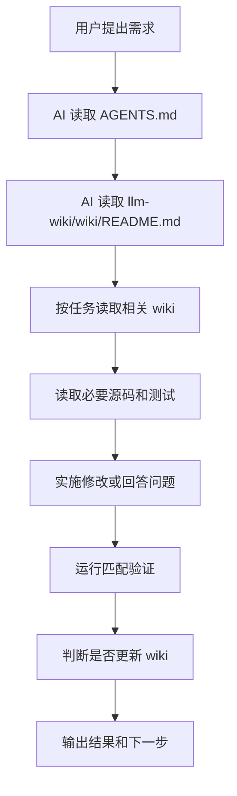

# AI 日常协作流程

## 人需要做什么

1. 正常提出需求, 不需要额外提示“请读取 llm-wiki”或“请更新 llm-wiki”。
2. 如果需求涉及业务背景, 直接说明目标, 约束和验收标准。
3. 如果发现 AI 结论和项目事实不一致, 指出冲突点; AI 应修正 wiki。
4. 对高风险改动, 明确是否允许改数据结构, migration, 配置默认值和兼容逻辑。

## AI 需要做什么

每轮任务开始:

1. 读取根目录 `AGENTS.md`。
2. 读取 `llm-wiki/wiki/README.md`。
3. 按任务类型读取对应 wiki。
4. 再读取相关源码, 不从全仓库盲扫开始。
5. 给人的逐步操作（启动分支、设置页、后台任务、改一类需求动哪些文件）以 `docs/ARCHITECTURE_AND_OPS_HANDBOOK.md` 第 23–30 章为准，不要把整章抄进 wiki。

实现过程中:

1. 以源码和测试为准。
2. 遇到 wiki 过期, 立即在本轮修正。
3. 修改业务代码时保持范围小, 不做无关重构。
4. 对缺陷先定位根因, 再改代码和补验证。

收尾前:

1. 判断是否需要更新 `llm-wiki/wiki/`。
2. 执行匹配的验证命令。
3. 输出修改内容, 验证结果和后续建议。

## wiki 更新决策

必须更新:

- 新增/修改架构, 模块职责, 依赖注入, 路由, 后台任务。
- 新增/修改配置项, 环境变量, 启动方式, CI。
- 新增/修改数据库 schema, migration, 数据生命周期。
- 新增/修改认证, 权限, 限流, 幂等, 支付, 计费, 网关协议。
- 发现现有 wiki 与源码冲突。

可不更新:

- 纯样式微调。
- 局部文案。
- 局部测试 fixture 调整。
- 不改变外部行为的内部变量命名。

## 功能文档与审核归档

- 目录入口 `docs/README.md`：各目录用途、新文档放置规则、不可移动文件和路径迁移表。
- **一个功能只保留一份文档** `docs/features/<feature>-design-cn.md`，面向 Claude 阅读：现行规则、接口、数据模型/迁移、配置、代码地图（函数名，不写行号）、关键约束与易错点（规则 + 依据）、验证命令与最近结果、状态与待办。不建 v2/v3 文档，不写"第 N 轮审核"过程章节。
- 审核、复核、交付证据、执行计划不进仓库：收到后把采纳的结论直接改进设计正文或易错点，未采纳但对后续有约束的写成"已否决：X，原因 Y"；原文先归档到仓库外再删除（未提交文件删除不可恢复）。2026-11-04 之前的原文最后存在于提交 `26f6363af`。
- 面向人的演示材料（HTML 汇报、介绍页）放 `docs/presentations/`，文字结论仍以对应功能文档为准。
- 上游同步材料统一放 `docs/upstream-sync/`：台账 `merge-log.md`（只追加）、流程 `playbook.md`、每轮只一个 `<YYYY-MM-DD>-v<版本>/review.md`。
- `docs/` 根目录只放上游自带文档和本地总手册；`docs/legal/` 被前端打包和 Dockerfile 引用。被 SQL migration 注释引用的设计文档不能移动或改章节号（migration 有 checksum 校验）。
- 路径迁移表见 `docs/README.md`。合并台账保留当时路径，不改写既有条目。
- 合并旧分支先对照迁移表，把有效增量合入现行文档；不要为解决 modify/delete 冲突恢复已整合的旧文件或 reviews/delivery/superpowers 目录。`.gitignore` 不拦截已跟踪路径，收尾须检查工作区、暂存区和新增文件。
- wiki 就地维护现行规则与最新验证边界，不按每轮合并重复追加 SHA、冲突过程和测试流水；历史事实集中在上游 review 与只追加台账。功能文档更新已有章节，不靠追加第 N 轮章节保存过程；仍有效的跨版本约束应归并到对应规则。

## 推荐写法

wiki 页面应写:

- 稳定事实。
- 关键路径。
- 为什么这个点对维护重要。
- 验证命令或检查方式。
- 常见坑。

wiki 页面不应写:

- 对话过程。
- 临时猜测。
- 未验证结论。
- 密钥或私密凭据。

## 平时怎样运作

## Codex 与 Copilot 规则

- Codex 项目规则: 根目录 `AGENTS.md`。
- Copilot 项目规则: `.github/copilot-instructions.md`。
- 两者都要求开发前自动查阅 wiki, 并在任务改变项目知识时同步更新 wiki。

## 知识图谱怎么配合

权威顺序不变: `AGENTS.md` → `llm-wiki` → 源码/测试。图谱只做导航。

| 动作 | 命令/入口 |
| --- | --- |
| 检查是否就绪 | `tools\check-understand-status.cmd` |
| 打开代码/Wiki 图 | `tools\start-understand-dashboard.cmd` |
| 刷新 Wiki 图 | `tools\refresh-understand-wiki.cmd` |
| 重建代码图 | `/understand` |
| 变更影响 | `/understand-diff` |

Windows 不要使用裸 `powershell -File ...`（RemoteSigned 下可能被拦截）; `.cmd` 已带 `ExecutionPolicy Bypass`。状态检查会在 wiki dirty 或图谱基线落后 HEAD 时返回 PARTIAL。

持久化约定:

- 入库: wiki 正文、`llm-wiki/index.md`、共享 config/ignore、**wiki 图谱 JSON**、AGENTS 与本页规则。
- 不入库: 代码图谱 JSON、fingerprints、dashboard 日志（见根 `.gitignore`）。
- 不入库: 根目录旧合并 diff、`ours_numstat.txt` / `theirs_numstat.txt`、根目录 Redis `dump.rdb`、Python `__pycache__/` 及 `backend/_local_compat.go` / `backend/_upstream_fallback.go` 旧合并脚手架；精确忽略规则见根 `.gitignore`。正式补丁和 source-freeze 不能按 `*.diff` / `*.patch` 批量删除或忽略；交付验收证据按本页归档规则处理，先确认仓库外可读取，再移出仓库，有效结论并入对应文档。

## 相关页面

- [[README]]
- [[backend]]
- [[frontend]]
- [[ops]]
- [[data-and-domain]]
- [[security-and-reliability]]
- [[ai-workflow]]
